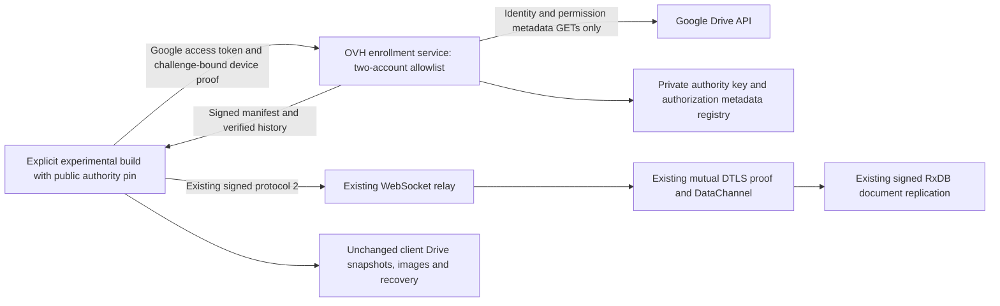

# Standards migration report

## Release history guard review — 2026-10-17

**Finding:** complete history validation is required by the adopted policy;
`history.reviewed` is a project implementation choice, not a central requirement.
The original unconditional check was in `scripts/release-policy.mjs:76`, added by
commit `13cd1e31264ba0fa82253d90efdf50dd1a7830bc` (`shared versioning polcies`).
`project-standards.json` initialized it to false. `releaseReadiness()` was called
by the stable/beta CLI and workflow control before `remoteInventory()`, so it
prevented automated inspection. It was persistent migration state, never an
implemented requirement to repeat manual approval for every release.

Verified the adopted edition 1.0.0 at
`e3111c4e9dc652f833a5f2ba5232c292646e7969` using
`python3 scripts/verify-standards.py /tmp/pboard-standards-review`: all 21 file
digests passed. The sibling standards checkout was newer; it was not used as
policy authority. A separate clone was detached at the exact pin.

Applicable central requirements at that pin:

- [VERSIONING, Precedence and forward progress](https://github.com/sg0zzy/dev-standards/blob/e3111c4e9dc652f833a5f2ba5232c292646e7969/VERSIONING.md#precedence-and-forward-progress):
  use SemVer precedence, exceed published versions and durable reservations,
  inventory complete remote tags/releases/tombstones, reconcile historical
  aliases, block unknown records, and never free an identity by deletion.
- [RELEASE, Common transaction and evidence](https://github.com/sg0zzy/dev-standards/blob/e3111c4e9dc652f833a5f2ba5232c292646e7969/RELEASE.md#common-transaction-and-evidence)
  and failure/retry rules: share reservation state, create tags only, preserve
  failed reservations, revalidate publication ordering, and verify identical
  completed-publication retries without replacing bytes or moving tags.
- [ADOPTION, Initial adoption](https://github.com/sg0zzy/dev-standards/blob/e3111c4e9dc652f833a5f2ba5232c292646e7969/ADOPTION.md#initial-adoption):
  inventory historical identities, stores and outstanding submissions; preserve
  authoritative version/signing history and record unresolved gaps.
- [ANDROID, Monotonic versionCode](https://github.com/sg0zzy/dev-standards/blob/e3111c4e9dc652f833a5f2ba5232c292646e7969/ANDROID.md#monotonic-versioncode):
  account for allocated/submitted/distributed codes, retain retry reservations,
  enforce bounds and supported update ordering; encoded schemes may be retained
  when their ordering, limits, concurrency and migration behavior are proven.
- [CONFIGURATION, Validation and override rules](https://github.com/sg0zzy/dev-standards/blob/e3111c4e9dc652f833a5f2ba5232c292646e7969/CONFIGURATION.md#validation-and-override-rules):
  unresolved production placeholders fail the affected operation. Neither the
  required mapping nor its example specifies a `history.reviewed` gate.

Replaced the checkbox with `history.unresolved`, a list of specific historical
ambiguities. The existing uncertainty about deleted/abandoned reservations and
aliases remains explicitly listed; no evidence was invented or gap cleared.
Ordinary release operations automatically paginate tags and Releases before
readiness checks. Once historical gaps are reconciled and documented, an empty
list allows automated validation with no manual history approval per release.
Missing migration configuration fails closed; setting the obsolete checkbox
cannot override unresolved evidence. The diagnostic `inventory` command reports
current history and remaining gaps without treating that result as readiness.

Durable alias values now remain reservations even after their remote names
disappear. Aliases cannot remap canonical identifiers downward. The publication
baseline and ordering checks use the same historical mapping. Added the Android
historical code floor to direct stable workflow validation (the local CLI
already enforced it), and check reservations before staging and again before
visibility changes. Tag creation, immutable object matching, shared lifecycle
serialization and exact published-byte retry verification remain enforced.

Repeated read-only paginated GitHub inspection returned tags and published stable
Releases for `0.9.3`, `0.9.6`, and `0.10.1`, with no other current records. This
agrees with the earlier inventory below. APIs cannot establish deleted history
or external submissions. Production certificate, Android code/submission review
and repository/environment protection evidence remain outstanding; releases are
still blocked for those concrete reasons. No distribution mode or standards pin
was changed. No project commits, tags, pushes, releases or workflow dispatches
were created; tests use isolated disposable fixtures.

Validation: `npx vitest run tests/standardsPolicy.test.mjs tests/releaseCli.test.mjs
 tests/releaseGates.test.mjs tests/releaseMetadata.test.ts` passed all **50 tests**
in four files. Coverage includes partial API failure before edits/refs, pagination
on both endpoints, automatic operation without the checkbox, unknown records,
drafts/tombstones/disappeared aliases, unresolved evidence despite a true legacy
flag, canonical-alias conflicts, direct stable Android history floors, superseded
staging, immutable tags and verified published-byte retries. `git diff --check`
passed. These are local/fake-remote checks, not live publication/device evidence.

## Release-readiness inventory — 2026-10-17

Investigated `release.sh prepare --apply` stopping at `history.reviewed: false`.
The wrapper correctly resolved `VERSION` to `0.10.2`; the readiness check stops
before metadata edits, builds or Git mutations.

Read-only paginated GitHub inventory found these tags and matching published,
non-prerelease Releases; no drafts or other current remote tags were returned:

| Tag | Git object type | Git object SHA |
| --- | --- | --- |
| `v0.9.3` | commit (historical lightweight tag) | `950b4ed8f57b8fc3dab47ce4b7ccbd17cc2b2188` |
| `v0.9.6` | annotated tag | `a7cf79de8c6f1d2170c60bbeb0481f307d43ae03` |
| `v0.10.1` | annotated tag | `21edbf61e66393ca1f3223031ce121bb10206616` |

Local tags match these version names. Existing Release asset lists contain
browser ZIPs and reviewer sources, with no Android packages. This does not
establish that Android has never been distributed elsewhere or submitted.
The repository comparator accepts `0.10.2` above the visible reservation set;
its adapters produce browser `0.10.2.65535` and Android code `10002999`.
This is candidate evidence, not confirmation that the version/code is available
against deleted history or external submissions.

Owner evidence still needed: deleted/abandoned versions and historical aliases,
Android allocated/submitted/distributed code inventory, and intended production
signer public SHA-256 fingerprint. `history.reviewed`, Android `historyReviewed`,
`highestHistoricalCode` and `certificateSha256` remain unchanged pending that
evidence. Repository/environment protection verification also remains open.
The pinned standards checkout and all 21 file digests were verified. No release
preparation, remote mutation or credential change was performed.

## GitHub Actions Node.js 24 runtime migration — 2026-10-17

Updated all 38 action invocations across CI, official target builds, beta and
stable workflows to full commit pins resolved from upstream stable release tags.
Verified each pinned `action.yml` declares `runs.using: node24` and accepts the
configured inputs. Reviewed upstream release notes and migration guidance:

| Action | Reviewed upstream release |
| --- | --- |
| checkout | [v7.0.1](https://github.com/actions/checkout/releases/tag/v7.0.1) |
| setup-node | [v7.1.0](https://github.com/actions/setup-node/releases/tag/v7.1.0) |
| upload-artifact | [v7.0.2](https://github.com/actions/upload-artifact/releases/tag/v7.0.2) |
| download-artifact | [v8.0.2](https://github.com/actions/download-artifact/releases/tag/v8.0.2) |
| setup-java | [v6.1.0](https://github.com/actions/setup-java/releases/tag/v6.1.0) |

The Node.js 24 action runtime requires runner 2.327.1 or later; these workflows
use GitHub-hosted `ubuntu-latest`. Project Node selection still uses `.nvmrc`,
and Android still selects Temurin 21. Explicit npm caches remain enabled only
where already configured; other setup-node calls now disable automatic caching
to preserve signing/publication boundaries. Existing credential persistence,
permissions, approvals, artifact names/paths/retention and triggers are preserved.
Artifact uploads retain the default archived format; downloads retain extraction
and separate directories for pattern matches, with digest mismatches now fatal
by upstream default.

Validation: actionlint passed; parsed comparison against HEAD confirmed only
action pins and automatic-cache opt-outs changed workflow behavior. All 38
invocations passed upstream runtime/input checks, five isolated release-gate
tests passed, and whitespace checks passed. The central policy pin and all 21
digests were verified. No remote workflow was started; hosted execution and the
absence of deprecation annotations await the next authorized run.

## Artifact root creation race — 2026-10-17

The reported CI concurrency failure exposed a race before artifact-lock acquisition:
two processes could both observe a missing root, and the second `mkdir` failed
with `EEXIST`. Root creation now tolerates that collision and validates the
resulting canonical directory before locking. Files/symlinks remain rejected;
other filesystem errors propagate. Exclusive build reservations and retention
protection rules are unchanged.

Local L07/L08 regression evidence: deterministic child-process fault injection
reproduced the failure before the fix and now covers competing directory,
symlink and file creation plus permission failures. The existing concurrent
creation/completion test also passes. On Node 24.21.0, all 16 artifact tests,
the full root suite (73 files / 520 tests), TypeScript and whitespace checks
passed. The pinned standards checkout was verified against all 21 locked files.
CI has not been rerun remotely; existing release-readiness gaps remain.

## Version and release shell automation — 2026-10-16

The requested PhoneHaul-style shell interface is implemented locally without
changing VERSION, platform identities, the standards pin, or destination modes.
`scripts/version.sh show|bump patch/minor/major|set X.Y.Z-dev` now validates
forward core selection, known local/durable reservations and platform limits,
synchronizes every mirror transactionally, and supports nonmutating previews.
Development selection retains the tracked Android code and reserves no beta/code.

`scripts/release.sh prepare X.Y.Z` automates validation, metadata synchronization,
a dedicated metadata commit when necessary and annotated local tagging;
`tag X.Y.Z` validates/resumes an already committed selection. New commands default
to plans; `--apply` executes their stated action. Existing metadata-only syntax is
preserved. Failed validation restores metadata; later Git failures preserve an
explicit resumable checkpoint. No destructive reset or tag replacement is used.
`publish X.Y.Z --apply` requires matching current main/tag/version, revalidates
complete history and destination identity (including push URL), and uses an
atomic explicit main/tag push with no force, unrelated tags or partial fallback.
An identical remote tag is a no-op; conflicting objects block.

`scripts/beta-version.sh next` is a read-only history-based preview. Its
`allocate` and exact-tag `retry` operations dispatch the existing trusted-main
workflow only with `--apply`. Branch selectors are resolved once to full remote
SHAs; retry retains the immutable tag selector. Official beta allocation stays
inside the common beta/stable lifecycle, including clean trusted source, full
high-water inventory, signing, staging and protected publication. Dispatch errors
require remote reconciliation instead of blind allocation retries. No new
standing remote authorization or store automation is adopted.

Validation: 22 new shell-interface cases passed in disposable Git repositories
with mocked GitHub/npm/push boundaries, including all three bump kinds,
regression/overflow, partial-sync rollback, nonmutating plans with dirty work,
annotated tags, dedicated/no-redundant commits, mandatory-check failure, tag
failure/resume, superseded reservations, atomic push, identical/conflicting
remote tags, branch/destination rejection, pinned beta source, exact-tag retry and
indeterminate dispatch. The fixed historical fixtures are independent of the
application's current VERSION. These provide local V01–V03/S01–S03/S07–S09 and
B01/B03/Q02 evidence as applicable; they do not establish live remote acceptance.
The focused policy/release suites passed 34 cases; the full root suite passed
73 files / 510 tests. Root TypeScript, all shell syntax checks, changed JavaScript
syntax checks, version mirrors and whitespace validation passed. RELEASE.md
records usage, checkpoints, dependencies, dry-run limits and official CLI/Git
references. Existing readiness placeholders and all other audit gaps remain.

Only plans/help/show were exercised in this real checkout. No real release
commits, tags, pushes, workflow dispatches, credential changes or publication were
performed. Prior audit/security changes and the current branch/worktree were
preserved.

## Security remediation — 2026-10-16

Independent audit finding 1 (unauthenticated collaboration fallback) is addressed
in the current local changes. `src/collab/manager.ts` now requires trusted,
current, structurally valid manifests bound to each requested board/account and
including the local device. Missing providers, null results and verification
errors block startup before signaling. Shared rooms also require a successfully
installed mutation guard for that project. Board security is resolved once per
start and supplied to both collection rooms; there is no production legacy
admission option. Failed starts/role refreshes close partial rooms and report an
error. Retry can resume after account trust is restored. Private local operations
without an account remain available.

`tests/collaborationAdmission.test.ts` adds 17 regressions for missing/null/failed
providers, invalid/expired/misbound manifests, unknown devices, missing or wrong
mutation guards, private local operation, restored trust and refresh cleanup.
Root TypeScript and all 72 root test files / 488 tests passed; Android TypeScript
and all 15 test files / 98 tests passed. Version mirrors and `git diff --check`
passed. The native two-profile Chromium convergence/JSEP smoke test passed.

The pre-existing manager convergence tests used unauthenticated transport
fixtures. Simply supplying signed manifests did not establish secure sessions in
those fixtures. They and the browser convergence harness now explicitly double
authentication at the handler boundary, using ephemeral signed test manifests and
test mutation-guard doubles. Their transport/storage checks still use real
WebRTC/IndexedDB, but are not proof of end-to-end protocol-2 authentication.
Production builds do not load the test double or the harness's build resolver.
The 45 focused admission/recovery/protocol/adversarial checks passed separately;
real-browser secure-session and real-Drive revocation validation remain open.

This closes the reproduced missing-manifest fallback only. Audit findings 2/3,
backup/restore, signing/history and remote-control verification gaps remain.
The existing audit changes were preserved. No version/identity/credential change,
commit, tag or remote operation was performed.

## Independent compliance audit — 2026-10-16

**Verdict: not fully compliant.** This audit checks committed source
`13cd1e31264ba0fa82253d90efdf50dd1a7830bc` on `main`. The initial worktree
was clean. Only this audit record was edited; application/tooling fixes are
outside this check. Historical implementation claims below are not current
acceptance evidence where this section identifies a contradiction.

Authority: edition 1.0.0, commit `e3111c4e9dc652f833a5f2ba5232c292646e7969`.
`python3 scripts/verify-standards.py /tmp/pboard-standards.R5jlaX` verified all
21 locked files. The sibling `../dev-standards` is at
`90bf955cbeb0fdf0a711e255b182f864807b3784` and failed the pin check; it was
not substituted. No standards update is implied.

Configuration SHA-256:
`66132ecc9817170be13684ba02fde497db7739c47f6926dc9946a1a1a1ef6ade`.
Lock SHA-256:
`94de81784d476c7f37a61ea018134467a6ad70b90579b7d7a0fb0a3cd4ab88be`.
The requested `../ononehaul/scripts` does not exist. The available
`../phonehaul/scripts` version/build/release/cleanup implementations were
consulted as reference only; they are not policy authority or proof of Pboard
compliance.

### Confirmed implementation findings

1. **High — missing security context enables unauthenticated replication.**
   `src/sync/runtime.ts:261` returns null for a missing board pin; manifest
   resolution also returns null for missing/invalid/unverifiable manifests.
   Account security has the same missing-pin path. These callbacks are wired
   into the production manager at `src/sync/runtime.ts:404`.
   `src/collab/manager.ts:230` and `:280` interpret a null context as open peer
   admission and omit handler security. `doStart` also continues when the
   mutation-guard installer returns null. Thus the comment promising offline
   behavior without a pin is not enforced. Existing protocol-2 cryptographic
   modules do not close this fallback.
   **Evidence:** an isolated copy of the existing manager integration test
   “connects two owner sessions through periodic Drive signaling when the second
   browser opens later” was run with `boardSecurity`, `accountSecurity`, and
   `installMutationGuard` explicitly resolving to null. It passed, including a
   genuine local ICE/DTLS handshake and replicated content. No Google service
   was used. This demonstrates the fallback, not exploitation of a live account.
   **Policy:** ARCHITECTURE privacy/trust boundaries and synchronization
   integrity; COMPLIANCE R06/R07/R10 as applicable. **Owner:** application/security
   maintainers. Require verified security before creating production rooms;
   keep any test-only legacy transport explicitly separate. Add manager/runtime
   integration coverage for missing, invalid and expired manifests, including
   account rooms and missing mutation guards.

2. **Medium — publication success is recorded without checking the result.**
   `scripts/release-control.mjs:198` discards the visibility-update response and
   immediately records `published`. It does not verify final draft/channel
   state or latest selection. This contradicts RELEASE's explicit requirement
   to check the resulting beta release controls and RELEASE.md's visibility
   verification claim.
   **Evidence:** an isolated fixture using the existing release-gate harness
   provided valid source/config/targets/checksums/reviewed plan and mocked
   Git/GitHub only. The PATCH returned `draft: true, prerelease: true` for a
   stable publication; the command exited zero and wrote `state: published`.
   All five existing release-gate tests plus this reproduction passed (six
   tests). The reproduction asserts the current defect, not compliant behavior.
   **Policy:** RELEASE manual beta/result verification and observable state;
   COMPLIANCE B01/S04. **Owner:** release maintainer. Verify the returned and
   reconciled remote tag, visibility, channel and latest controls before
   recording success; retain recoverable failure evidence otherwise.

3. **Medium — official packaging failures lack a durable target result.**
   `scripts/release-build.mjs:66` writes its manifest only after successful
   compilation/validation. There is no failure handler that records failed
   target state. In `build-targets.yml`, package uploads run only on success;
   signer failure has no diagnostic upload either. The validation job's
   preserved record can remain at `tag_reserved` when packaging fails, without
   the required failed target/recovery result. GitHub job logs remain useful,
   but do not supply the declared structured release record.
   **Evidence:** an isolated copy with reviewed fixture metadata, fake Git and
   an injected failing required npm check exited 1; neither
   `official-output/build-info.json` nor `release-record/state.json` existed.
   Workflow inspection confirms there is no failure upload for these jobs.
   **Policy:** RELEASE common transaction/evidence, BUILD per-target outcomes,
   ARTIFACTS CI/release metadata; COMPLIANCE B04/S06. **Owner:** release
   maintainer. Initialize target records before work, preserve failed/skipped
   outcomes and partial output on error, and upload explicitly incomplete
   evidence with failure/always handling without enabling publication.

### Existing blockers and evidence limits

- Full database backup/restore instructions and representative restore evidence
  remain missing, including attachments, relationships/settings, Android
  photos and tombstones (ARCHITECTURE recovery; application maintainers).
- Official history remains unreviewed and production Android certificate/code
  inventory is unset. Existing readiness checks correctly reject these
  placeholders; this is a release blocker, not permission to invent values
  (RELEASE/ANDROID; release owner).
- Actual remote branch/tag protections, environment approvals/ref restrictions,
  production signer behavior, store acceptance and physical-device update/data
  preservation remain unverified. No remote settings/API audit or release was
  performed (SECURITY/ANDROID/COMPLIANCE; repository and release owners).
- Collaboration documentation now describes implemented protocol-2 signatures,
  mutual proof and storage guards. Historical blanket statements below about
  absent authentication are incomplete; finding 1 identifies the current
  concrete bypass. Real-browser secure-session and real-Drive revocation
  acceptance gates remain open in `docs/collaboration.md`.
- Local manifests read standards/config digests from the live tree after
  capturing source (`scripts/local-build.mjs:78`), rather than from the private
  snapshot. Concurrent edits could make provenance disagree with captured
  inputs. This is an inspection concern, not a reproduced failure in this
  audit; capture provenance/config from the same snapshot before claiming
  concurrent-edit coverage for those fields (ARTIFACTS/L13).
- Operation-protocol audit gaps (2026-10-28, read-only pass plus the focused
  operation tests). No narrow-screen overflow menu component exists: the header at
  `src/sidebar/App.tsx:890-933` relies on flex-wrap, so the "owner maintenance
  popover on narrow screens" wording at `docs/architecture/drive-operation-sync.md:47`
  describes an unbuilt component; the WebRTC toggle is gated on
  `VITE_PBOARD_SIGNALING_PROVIDER === "websocket"` (`:897-904`) while the persisted
  live toggle (`:46`, `:911-926`) is always rendered, which matches `:216` but not
  `:47`. No code was changed for these items.
- Performance instrumentation is not exercised on the operation path:
  `src/collab/counters.ts` offers `countRender` (`:145`), `countEffect` (`:149`),
  `countEmission` (`:153`), `countInitialisation` (`:157`), `time` (`:162`),
  `timed` (`:171`), `withDrivePurpose` (`:182`) and `instrumentFetcher` (`:193`,
  which returns the fetcher unchanged when `DIAGNOSTICS` is off), and the only
  operation-layer call site found is `src/sidebar/components/Card.tsx:94`. No test
  exercises counters and no test asserts a performance threshold;
  `tests/operations/performance.test.ts` prints measurements with no bound, so the
  acceptance threshold stays unenforced. Adaptive polling bounds themselves are
  covered (`src/sync/operations/session.ts:18-19,33-35,94,146-152,156-161`).
- No application undo/redo command stack exists in `src`. Every undo/redo/rollback
  match is a comment or recovery semantics: `src/sync/attachmentGc.ts:11`,
  `src/storage/boardErasure.ts:6`, `src/collab/security/checkpoint.ts:107,135`,
  `src/security/mutation.ts:159`, `src/webrtcHandler.ts:111,133,140`;
  `tests/recovery/attachmentGc.test.ts:31` is a GC grace window and
  `tests/recovery/causalReconciliation.test.ts:114` uses "undone" for a replay
conflict. The absence statement at `docs/architecture/drive-operation-sync.md:48` is
accurate, and the Escape clause at `:49` is backed by the form handlers at
`src/sidebar/components/Card.tsx:350` and `src/sidebar/App.tsx:419,955,1185`; the
capture selection overlay has its own handler at
`src/background/regionCapture.ts:139`.
- Presence and cursor shapes are absent at the operation layer by design:
  `src/sync/operations/realtime.ts:42-43` accepts only `have` and `operations`; live
  cursors and ephemeral drag remain in `src/collab/signaling.ts` and
  `src/webrtcHandler.ts`.
- The AppData boundary holds for the operation protocol
  (`src/sync/operations/driveStore.ts:12-14`) but not as a blanket claim. Legacy
  writers remain: `src/sync/driveTransport.ts` defaults to AppData when no regular
  parent is supplied (`:31`) and writes there (`:114`), and `src/sync/runtime.ts`
  still constructs legacy transports without a regular parent at `:176,184,839,1034`
  (account preferences also live in AppData by product decision, `:247`). The design
  doc is now scoped to the operation protocol; retargeting those writers is a
  storage-owner decision under the privacy/trust boundaries, not part of this audit.
- Measured limits now reproduce from permanent tests:
  `tests/operations/performance.test.ts`, `tests/operations/wireVolume.test.ts` and
  `tests/operations/wholeBoardComparison.test.ts`. On one workload (1,000 card
  creates, then 50 edits each followed by a forced sync) the incremental path measured
  511 B payload per edit against about 10,392 B whole-board upload per sync, and
  4.9 ms against 14.7 ms median edit-plus-sync latency, but it issued more Drive
  requests per edit (8.3 against 7.0 per whole-board sync). Latency is run-dependent;
  byte counts are not. Incremental retained state grows with history: 1,001 receipts
  produced a 1,199,052 B checkpoint against 530,923 B board state. The per-connection
  inbound buffer bound (16,777,216 B) is derived from `realtime.ts:33,36`, not
  observed. Live Google accounts, real ACL propagation, physical Android devices and
  native Firefox collaborative sessions remain unexercised.

### Validation executed for this audit

Node 24.21.0 was selected from the installed NVM toolchain; the initial shell
had no Node/npm on PATH. No dependency installation was necessary.

| Check | Current result |
| --- | --- |
| Exact pinned policy SHA and all locked digests | Pass, 21 files |
| Generated version mirrors | Pass, VERSION 0.10.2 |
| Root TypeScript | Pass |
| Full root suite | Pass, 71 files / 471 tests |
| Android TypeScript and full suite | Pass, 15 files / 98 tests |
| Focused policy/retention/release/metadata suite | Pass, 4 files / 27 tests (also included in full suite) |
| Existing release gates + isolated false-publication reproduction | 6 passed; reproduction confirms finding 2 |
| Null-security-context WebRTC reproduction | 1 passed / 6 unselected; confirms finding 1 |
| Injected official required-check failure | Exit 1, no persisted target/failure manifest; confirms finding 3 |
| actionlint on all four workflows | Pass |
| Whitespace validation | `git diff --check` passed |

Temporary reproduction trees and their copies were removed after inspection.
Only their redacted observations are recorded here. Existing local artifacts
were not rebuilt, pruned or modified. Full package compilation, signing and
live remote acceptance were not repeated; historical build evidence below
must not be mistaken for a build of this audited commit. No commits, tags,
pushes, workflow dispatches, publication or credential changes were performed.

Operation-protocol verification for this audit (2026-10-28). The serialized suite
(`npm test -- --maxWorkers=1`) passed 178 files / 1,196 tests in 309 s, including the 29
realtime tests and the three permanent measurement files. Two parallel runs failed three
pre-existing files only under worker load — `tests/googleIdentitySharing.test.ts:63` (5000
ms timeout), `tests/recovery/imageSyncBackoff.test.ts:107` (`expected 6 to be 7`) and
`tests/collab/liveDeleteConflict.test.ts:115` (`waitUntil: condition not met within
timeout`, 15613 ms) — and each passes in isolation; none of them was modified.
`tests/operations/wholeBoardComparison.test.ts` timed out in the first parallel run at the
default 5000 ms and now carries an explicit 30000 ms timeout. Byte counts are stable across
runs; latency is not. The serialized run measured 10.1 ms median incremental edit-plus-sync
(583 ms on the first edit) against 26.8 ms median whole-board, and the microbenchmark
recorded 178.9 ms elapsed / 181.1 ms CPU, 6.84 ms / 8.41 ms incremental and 75.5 ms
snapshot generation. `npx tsc --noEmit` reported nothing.


Adoption date: 2026-10-16. Central origin: https://github.com/sg0zzy/dev-standards. Edition **1.0.0**, commit **`e3111c4e9dc652f833a5f2ba5232c292646e7969`**. No central tags existed; Git resolved main to this SHA. Browser access returned 404, but authenticated Git retrieval succeeded. The pinned checkout and SHA-256 inventory of all 21 files were verified locally. No policy was reconstructed from memory.

Status: **partial adoption, with tested local development and fail-closed release infrastructure**. Unverified production identity/history, repository controls and existing recovery/security gaps prevent claiming full compliance. No remote workflow or release was executed.

## Audit and migration checklist

Inspection covered root/ancestor/nested agent instructions (no project-owned AGENTS.md existed), local VERSIONING/BUILD/RELEASE/README and docs index, workflows, npm/lock metadata, both browser manifests, version/build/package/release scripts, Android Gradle/manifests/Capacitor configuration, artifact locations and Pages configuration. Existing browser reviewer, license, store listing/permission and Android operational instructions were retained. Dependency and `.delta` worktree agent files were outside this checkout's policy scope.

The internal checklist established before edits was: preserve initial dirty work; pin/verify standards; consolidate authority/docs; map architecture/version/platform/signing/distribution; fix local snapshot/storage/retention; update read-only CI outputs; share release coordination and staged publication; fail closed on unverified production signing/history; validate documentation, scripts, workflows, tests and builds; report gaps without application rewrites.

The checkout already had edited/untracked build/release work and a staged deletion of `scripts/build-manifest.mjs`. Those changes were incorporated rather than reset; the staged deletion remains untouched. No branch switch, Git commit/tag creation, push, remote dispatch, publication, deployment or credential change was performed.

## Implemented documentation changes

- Added `DEVELOPMENT_STANDARDS.md`, following the central adoption template: pin, precedence, applicable documents, native mappings, justified departures, MUST gaps, authorization and update/offline behavior.
- Added `dev-standards.lock.json` and repository-owned `scripts/verify-standards.py` for exact Git SHA plus full-file digest verification. Central policies are retrieved separately rather than duplicated locally; normal builds never fetch them.
- Added concise root `AGENTS.md`: read adoption first, verify and consult pinned policies, central precedence, project commands/data safeguards, preserve active worktree and user work, and explicit remote boundaries. No useful subsystem agent instructions were removed.
- Replaced the duplicated local versioning contract with `VERSIONING.md` describing Pboard's actual authority, generated mirrors, numeric platform mappings, code bounds and version-zero compatibility surface.
- Reworked `RELEASE.md` into concrete preparation, signing, workflow, notes, manual distribution and recovery instructions. Removed claims that unsigned/debug packages are production releases, and that retries may silently replace completed assets.
- Updated `BUILD.md`, README and docs index. Retained Chrome listing/permission/reviewer guidance, package verification, temporary installation and reproducible Firefox compilation. Distinguished upload ZIPs from signed XPI/CRX. Clarified that Drive synchronization is not historical backup.
- Reframed the stale cloud-worktree handoff file as historical context while preserving its branch/worktree safety instructions.

Generic SemVer, local-build identity, retention, release-state, permission and architecture rules now have their authority in dev-standards rather than independently editable local policy. Operational commands and project-specific mappings remain local. No useful operational document was deleted.

## Implemented tooling and workflow changes

`project-standards.json` declares required target matrices separately for local/CI/beta/stable, explicit signing profiles, retention, historical-inventory readiness, and per-channel store modes. Unknown targets, contradictory requiredness, invalid signing/modes and retention values fail validation. All prior packaging capabilities remain: Firefox/Chromium ZIPs, Android debug testing and Android release APK compilation; official release APK completion now requires a verified production signature. No native desktop/AAB target existed.

The unified local builder captures a private immutable dirty-source copy, records tracked/untracked/deleted input identities plus the effective public OAuth parameter, and builds with repository-owned implementations. Every selected target is required and recorded. It archives final output to unique exclusive direct children of `local_artifacts/` for both stable and development-selected VERSION states. It preserves developer `dist/` locations as intermediates. Private env files and raw Git patches are not archived. Low-level staging/reviewer commands are explicitly documented.

Artifact transactions use schema/manager ownership, explicit state, atomic manifest replacement, sizes/hashes and a completion sequence allocated under one shared lock. Creation, completion, protection and collection coordinate through that lock. Retention defaults to 10 successful unprotected builds and rejects/excludes unsafe roots/children, traversal, malformed/unknown/legacy records and duplicate completion sequences. `.keep` of any type protects without consuming a slot. Cleanup replans/revalidates; failed builds never invoke it. Manual failed/protected recovery has a dry-run and requires repeating the exact positively owned build ID as confirmation. Legacy layouts remain untouched. The old unreferenced metadata writer was removed after its callers were replaced; the prior staged legacy-manifest deletion was preserved.

Local Android builds no longer require selecting a development core or mutate tracked Gradle fields. They use a local versionName, retain the tracked code, verify package identity/signature, and remain debug/test-only. Unsupported old bundle reuse fails explicitly. Device install/launch still requires the explicit existing flags.

Version sync now includes the previously stale Android lockfile, which moved from mirrored `0.10.1` to canonical `0.10.2`. Tests derive the version from VERSION. Existing authoritative VERSION and tracked Android code/ID remain unchanged. Encoded production-code compatibility is retained with strict bounds; complete production history is still required before activation.

CI now checks out the exact event SHA, records proposed-merge PR head/base identity, runs required root/Android checks, builds Firefox/Chromium/Android, and uploads mandatory temporary packages and manifests for 14 days. Failed diagnostics are separately labeled. No production signing/API secrets are passed to compilation. Actions are pinned to full commits resolved from their v4 references during migration.

Beta/stable workflows share `official-release-lifecycle`. Trusted control code resolves/revalidates source, checks reviewed-main ancestry and matching configuration/Firefox identity, inventories paginated remote tags/releases plus reviewed aliases/tombstones, and uses SemVer ordering. Beta allocation creates annotated refs without update/force operations; stable validates annotated tags. Beta reservation continues packaging in the same workflow. Exact-beta-tag retry uses that tag as selector. Source corrections or superseded reservations need a greater version.

Official compilation is read-only. A separate protected Android signer consumes the hash-verified unsigned intermediate, verifies final package fields/certificate, and uploads verified output. Aggregate staging requires every mandatory target and transport hash. A reviewable notes/manifest/checksum plan is produced before protected publication approval. Publication requires identical regenerated plan bytes, verifies draft upload bytes and rechecks ordering before visibility. Beta explicitly disables latest stable. Store delivery was removed from the combined release job and is manual/disabled, independent of GitHub completion.

Stable preparation now requires explicit `X.Y.Z`; dry-run makes no edits or refs, and apply rolls back metadata on validation failure. Commit, annotated tag and authorized push remain separate human operations. Neither local build nor preparation auto-increments a stable release or publishes anything.

Vitest now explicitly includes this checkout's `tests/**/*.test.{ts,tsx,mjs}`. The first broad run accidentally included an old embedded `.delta/worktrees/` checkout (124 files/838 tests) and produced a WebRTC timeout/unload error. Scoping excludes unrelated worktree tests without modifying either worktree's application code.

## Retained decisions and compatibility

- Preserve TypeScript/React/RxDB WebExtensions and existing Capacitor/React/native Java Android integration. Native Kotlin/Compose is a SHOULD preference, not a migration requirement.
- Preserve Gecko ID `project-board@local.invalid`, Android ID `it.stefanogozzi.pboard`, existing OAuth IDs, data schemas, synchronization formats and native API 33/36 support.
- Preserve existing Android code arithmetic and historical values; new official reservations remain blocked until its actual signing/submission high-water inventory is reviewed. No unsupported upgrade edge is promised.
- Use verified central retrieval instead of vendored duplicate policies. Offline work requires a previously verified checkout; missing unverifiable policy blocks policy-dependent release/deletion.
- Keep manual release commit/tag preparation and manual/disabled stores. No standing external automation authorization is adopted.

## Compliance by area

| Area / central cases | Result and evidence |
| --- | --- |
| Adoption P01–P03 | Pin and all policy digests verified; template/native mapping supplied; invalid mappings tested. Offline behavior documented; initial offline-without-cache is explicitly blocked |
| Local L01–L03, L13 | Two full dirty builds at the same Git SHA succeeded with unique directories and different snapshot digests; VERSION unchanged; compilation uses captured inputs. Installed dependencies are identified by locks and must not be mutated during a build |
| Artifacts L04–L12 | Isolated tests cover default/zero retention, reverse completion order/clock disagreement, protection, stale plan, failed/active/unknown/legacy records, malformed/traversal records, duplicate sequence, symlink root/child/internal link, stale lock and concurrent processes |
| Local failure L06/L14 | Missing-SDK injection returns failure, records failed required Android outcome and preserves both preceding successes without retention |
| Versions V01–V03 | Numeric/core/prerelease/metadata precedence, skipped-core forward progress, failed-reservation high-water and malformed official forms pass repository tests |
| CI C01–C05 | Exact-revision/read-only/required matrices/temporary upload gates statically validated; live GitHub CI execution pending; no optional targets declared |
| Beta B01–B07 | Dispatch, full inventory, create-only tag, common serialization, exact-tag retry and explicit prerelease/latest controls implemented. Remote concurrency/retry/publication execution pending; activation blocked by inventory/signing |
| Stable S01–S07/S10 | Explicit preparation/dry-run, annotated/source checks, staged mandatory gate and complete stable baseline implemented. No refs created locally; actual tag-triggered builds and environment review pending |
| Retry S08–S09 | Published retries verify existing bytes and return a no-op without rebuilding; drafts reuse hash-identical staged assets and upload missing ones. Conflicting content fails for audited recovery; live timeout/retry tests pending |
| Android A01–A08 | Debug APK built/verified; arithmetic boundaries and beta→stable numeric ordering tested; missing production identity fails preflight. Production signer/history/device updates and store certificate compatibility remain unverified |
| Distribution D01–D05 | Store modes manual/disabled, builds do not upload stores, destination evidence/retries documented. Real store transfer/acceptance not tested; no automatic store integration claimed |
| Security Q01–Q02 | Read-only builds, isolated signer/control publisher, reviewed-plan gate, no raw secret/diff archives, immutable asset guards. Actual protected environments/rulesets remain owner work; no remote mutations performed |
| Architecture R01–R12 | Existing architecture and data behavior preserved; conditional stack rationale documented. Existing full backup/restore and collaboration trust gaps remain; no full architecture-compliance claim |

## Local validation evidence

Source context: existing checkout on `main`, original uncommitted work preserved; manifests record full HEAD and effective configuration digests. Evidence files below are local ignored logs, not official release artifacts.

| Check | Observed result |
| --- | --- |
| Exact standards SHA and SHA-256 inventory | Pass, 21 files; `python3 scripts/verify-standards.py /tmp/pboard-standards.R5jlaX` |
| Remote standards tag inventory | No tags; pinned main SHA independently resolved by Git |
| Read-only project history | Three tags and three published stable releases: v0.9.3, v0.9.6, v0.10.1. These do not establish deleted identities or Android store history |
| Root TypeScript | Pass (`npm run typecheck`) |
| Scoped full root suite | 70 files / 465 tests passed; `.build-state/migration-tests.log` |
| Added release-gate fault suite | Five tests passed with fake Git/GitHub executables and isolated files; no network/ref mutations. Missing target, corrupted bytes, dirty source, wrong signer and missing reviewed plan and changed published bytes fail closed; identical existing publication verifies read-only |
| Focused retention/version/release gates | 24 tests / 3 files passed on the final focused run, including later comparator/trusted-identity/idempotence changes. Logs: `.build-state/migration-policy-tests-final.log`, `.build-state/migration-release-tests.log` |
| Android TypeScript and tests | Pass, 15 files / 98 tests; `.build-state/migration-android-tests.log` |
| Full local build twice | Firefox and Chromium package byte-verification, Firefox strict lint and Android debug Gradle assembly/signature/identity passed; `.build-state/migration-build.log`, `.build-state/migration-build-final.log` |
| Final public build entry | `npm run build` passed after the final local-runner changes, including locked staging preservation; `.build-state/migration-firefox-final.log` |
| Manifest integrity | Every preserved final package size/SHA-256 matched its manifest; both successes recorded all three targets; completion sequences 1 and 2 |
| Failure injection | Invalid SDK path failed; two prior successes preserved; failed manifest excluded by cleanup dry-run; `.build-state/migration-failure.log` |
| Version mirrors | `node scripts/sync-version.mjs --check` passed after repairing Android lock mirror |
| Workflow syntax | All four YAML documents parsed; actionlint 1.7.7 passed (temporary local installation) |
| Shell validation | `bash -n` passed for all repository shell scripts. ShellCheck was unavailable |
| Build verification | `node scripts/verify-build.mjs all` passed |
| Documentation references and whitespace | 66 relative file/heading references resolved after excluding inline Markdown examples; `git diff --check` passed |

Preserved successful build IDs:

- `0.10.2-local.147594974188894793326708714648792616696`
- `0.10.2-local.93527491865933640660251706827635283081`

A later public-entry Firefox build is `0.10.2-local.59163505989340352848318128210965140998`. All are under ignored `local_artifacts/`; the second build's Android Gradle assembly completed in 20 seconds. Private source copies were removed after build; no source patch archive was retained. Root tests use genuine local WebRTC handshakes, not live Google Drive or public-store integration. Mocked release tests do not prove live publication or device updates.

## Remaining gaps and recommended next steps

1. **Release owner:** reconcile deleted/failed official reservations, full Android installed/submitted codes and public production certificate identity. Fill the deliberately unset production metadata only with verified evidence; assess outstanding store versions before enabling the four-field browser mapping. Never generate/rotate a key to bypass the blocker.
2. **Repository owner:** verify branch/tag rulesets, trusted reviewed main source, non-bypassable approvals/eligible refs for `release-signing` and `release-publication`, and secret placement. Review generated notes/manifest/hash plan before approving publication.
3. **Release maintainer:** validate existing-publication no-op and same-plan partial-draft resume with controlled API timeout/failure cases; conflicting draft or official bytes must continue to fail for audited incident handling. Artifact attempts are propagated from reservation outputs so failed-job retries can find prior successful build artifacts.
4. **Application maintainers:** establish and exercise a complete recoverable backup/restore procedure, including attachments and relevant relationships/settings; resolve existing peer authentication/receiver-write authorization limitations using the existing security plan. This task intentionally preserves application/data behavior.
5. **Maintainers, after explicit remote authorization:** execute CI, beta failure/retry/concurrency, stable staging/publication/notes, upload-timeout and immutable retry cases in a controlled repository. Verify device install/update/data preservation for every update edge before promising compatibility. Then record live evidence and revise adoption status.
6. **Store owners:** deliver verified completed artifacts manually only when authorized; retain input/output hashes, signing identities and submission/approval receipts. Keep store outcomes independent from GitHub release success.

Implemented local changes and simulations are distinct from these pending owner decisions and remote acceptance work. No full GitHub release validation or complete standards compliance is claimed.

## Local signaling experiment evidence — 18 October 2026

The additive Rust/WebSocket experiment is recorded in
[the architecture/validation note](docs/architecture/websocket-signaling-experiment.md).
The pinned standards verifier passed at the unchanged adopted revision (21 hashes).
Drive remains the production/default provider; OAuth, stored data, schemas and
release activation are unchanged. Rust protocol/limit tests, authenticated
TypeScript and two-profile Chromium adapter tests, Android checks and production
browser builds provide local evidence. They do not establish a working production
manifest enrollment → secure DataChannel → RxDB write flow: the note records the
existing enrollment and first-negotiation/session-binding blockers without bypasses.
Local loopback measurements are not VPS/Internet capacity evidence.

The full root suite currently reports 529 passing tests and two failures already
present in unchanged HEAD: VERSION `0.11.0` differs from `0.10.2` generated mirrors,
and the release-readiness assertion expects a different unresolved-history message.
No mirror/version or release-policy change was made to conceal those failures.
Owners retain the existing history, certificate, protection and release-readiness
responsibilities above. No remote deployment, credential change or publication occurred.

## Secure development integration — milestone 0.2 (18 October 2026)

The [current architecture and validation record](docs/architecture/websocket-signaling-experiment.md)
now supersedes the 0.1 live-integration blocker: two real isolated Chromium extension
profiles run explicit signed enrollment, verified presence, reciprocal DTLS proofs,
origin signatures, receiving storage guards and RxDB convergence without authentication
or storage-policy doubles. Separate cases cover same-account devices and different
owner/editor accounts. Google HTTP alone is simulated. Snapshot/image persistence and
the signaling/content boundary are exercised. Device-purpose fingerprint persistence
and the incremental-write guard bypass were repaired while preserving keys/data.
Development packages use the existing managed provenance/retention workflow; ordinary
builds still select Drive. The invalid standalone-Vite/console setup instructions have
been replaced by actual extension installation and public enrollment/grant export UI.

This is attended, five-minute authorization testing, not production readiness. Authority
renewal/history/revocation, historical offline edits, signed snapshot recovery, real
Google ACL/revocation, native Firefox/physical Android and deployment soak validation
remain open. Existing version-mirror and release-readiness assertion failures remain
visible; no version, credential, standards pin, distribution or production activation
was changed. No live Google writes, DNS changes, deployments, commits or publication
were performed by the agent. Browser UI actions implement explicit user approval;
tests publish only into their temporary simulated Google API.

Final 0.2 verification: full root run 537 passed / two unchanged release-metadata
policy failures; final focused security/runtime run 91 passed. Android checks and
98 tests passed; Rust protocol tests 10 passed. Both ordinary and experimental
Firefox/Chromium packages verified. Ordinary bundles omit experimental WS/UI code
even with VITE provider flags set. Native Chromium and Firefox temporary-extension
UI probes passed; the latter used Firefox 153.5.0esr and temporary geckodriver 0.37.1.
Secure native Chromium runtime cases passed for Rust signaling (same/different
accounts) and the existing Drive signaling (different owner/editor accounts), without
authentication/storage-guard doubles. Full Firefox replication and live Google ACL
validation remain separate manual/integration gates. Development files are staged at
`dist/` and `dist/chromium/`; no production installation was replaced by the agent.

## Owner-authorized permanent experimental signaling service — 18 October 2026

The owner explicitly requested: "i'd like to setup a permanent service" on the VPS
identified by `../vps-maint` and SSH alias `cecosl`. Under pinned SECURITY this authorizes
installation/activation of that experimental service, superseding the earlier local-only
restriction for this destination. It grants no commits/tags/pushes, production release,
Google OAuth/storage migration, automatic DNS configuration or unrelated VPS repair.
The 21-file standards source at the existing pin was verified before deployment.

Installed checksum-verified isolated-source Rust executable under `/opt/pboard-signaling`,
non-login unprivileged account, root-owned group-readable deny-all grants and enabled
hardened systemd unit. The listener is loopback only. Empty/expired allowlists can now
start a healthy process while authentication and active-session expiry still deny access;
invalid key/room/fingerprint configurations remain errors. Added no-listener configuration
validation and an operator grant-update command with local public-export validation,
remote validation, atomic replacement, restart/health check and attempted rollback.
No trust bootstrap was disabled, no authorization lifetime widened, no data removed.

Evidence: 11 Rust integration tests passed, strict Clippy/fmt passed; remote health and
enabled/active unit verified. Actual deployed-relay diagnostic passed key/room rejection,
offer/answer/ICE forwarding, presence and disconnect/reconnect through an SSH tunnel.
Temporary test grants were removed and deny-all verified afterward. Installed executable
SHA-256 `40317d88636e15ec2a0f14cb50a899c9cbce5938d2424f65b8350298b189c99c`;
retained source digests/artifact at service-local ignored `local_artifacts/20261018T142659Z/`.
Idle process RSS 4,172 KiB/two threads at one observation; no capacity or load claim.
Focused provider/default and grant-merge regression tests also passed (five tests).

DNS for `signal.stefanogozzi.it` is unresolved. Public TLS and HAProxy activation remain
pending the owner's DNS record; no DNS, certificates, firewall, mate service or proxy
were changed. Prepared HAProxy fragment validated against the installed HAProxy and
existing config without reloading it; scoped certificate hook passed shell syntax check.
The service is immediately usable through an operator SSH tunnel. Five-minute manifest
and grant expiry still requires attended renewal. No VPS reboot, real-Google end-to-end
replication, public WSS test, or remote load benchmark was performed.

The owner subsequently selected `pboard.cecosl.ovh` instead of the initial
`signal.stefanogozzi.it` example. Prepared proxy/certificate configuration and the
service runbook now target `wss://pboard.cecosl.ovh/ws`. The owner will configure
the OVH DNS A record to `164.132.195.137`; TLS/proxy activation remains pending DNS.

HTTPS activation completed after owner-configured DNS on 18 October 2026.
`pboard.cecosl.ovh` resolves to `164.132.195.137`; Let's Encrypt certificate
issuance succeeded (expires 16 January 2027). Installed the scoped Certbot deploy
hook, checked key/certificate correspondence and hostname, backed up HAProxy config
to `/var/backups/pboard-signaling/20261018T144211Z/haproxy.cfg`, validated the
new host/backend/rate-limit configuration and reloaded HAProxy. Public HTTPS health
returned 200/`ok`, root returned 404, and the mate site retained its expected 302
login redirect. Public WSS diagnostic passed unknown-key/room denial, authenticated
offer/answer/ICE forwarding, presence and disconnect/reconnect without TLS bypass.
Diagnostic grants were removed afterward; the service remains deny-all until the
owner uploads approved enrollment exports. Existing certificate timer handles renewal;
the new deployment hook was exercised with the issued certificate, but no future
renewal/dry-run was performed. No unrelated certificate, firewall, Google storage,
OAuth, release or production-default change was made. Five-minute client/grant
expiry remains unchanged; real-account WebRTC/RxDB testing is still a manual gate.

Experimental Firefox and Chromium packages were rebuilt/verified with
`wss://pboard.cecosl.ovh/ws` and staged at `dist/` and `dist/chromium/`.
Firefox lint reported zero errors/warnings; both native temporary-extension UI
probes passed. An additional native Chromium sidebar probe reached the public
WSS endpoint with normal TLS verification and confirmed unauthenticated join
rejection. Ordinary build defaults, extension identities and device keys were
unchanged. Existing profiles should reload, rather than remove/reinstall, the
temporary extension. No actual user profile or Google account was automated.

## Owner-authorized automatic signaling admission — milestone 0.3

The owner approved automatic relay admission after requesting access for everyone
without SSH/manual server allowlists. This extends the previously authorized
experimental service on `cecosl`, not public app publication or Google migrations.
Pinned standards source verified; existing branch/worktree and prior dirty work
preserved. No commit/tag/push, credential upload, OAuth scope, VERSION, RxDB schema,
Drive folder/snapshot/image migration or default provider change was made.

Added strictly public signed-manifest/device challenge admission with authority-derived
room namespaces. A self-supplied key can authorize only its own namespace; it cannot
claim another pinned authority's room by knowing a board ID. No official-app header
or bundled shared secret is trusted. Existing owner approval, authority pins, Drive
ACL checks, secure DataChannel admission and receiving mutation guards remain.
Five-minute expiry is unchanged; automatic renewal/historical mutation verification
is a separate requirement, not bypassed to make this test pass.

Legacy operator-grant protocol remains available; current clients require protocol 2
and refuse downgrade. Server anti-rollback/fork state is bounded and in memory;
higher observed epochs close older sessions across collections. Restart/unobserved
revocation is bounded by proof expiry, not a durable revocation guarantee. Global
crypto-attempt/scope caps complement existing resource limits; no capacity claim.

Validation: 16 Rust tests, strict Clippy/fmt, seven provider/default tests, root and
Android typechecks and Android's 98 tests passed. Full root run: 540 passed, the same
two pre-existing release metadata/policy failures. Real native Chromium/RxDB/DTLS
runtime probes passed through local automatic admission (same/different accounts),
the existing Drive transport, and public WSS (same/different accounts). Google HTTP
is simulated; real Google login/ACL/revocation, physical Android, full Firefox
replication and VPS load/renewal/soak behavior are not claimed. Public diagnostic
requires neither SSH nor grant uploads and tested nonmember/authority impersonation
rejection, offer/answer/ICE forwarding, presence and reconnect.

Deployed isolated-source checksum-verified Rust binary
`3400caf84aa732bfb3fe40017fb172e1f8b7546527f2e7829cd1e64992af2153` with explicit
automatic-admission flag. Source/artifact provenance retained under service-local
ignored `local_artifacts/20261018T150057Z/`; rollback binary/unit retained remotely
at `/var/backups/pboard-signaling/20261018T150140Z/`. Existing operator config,
proxy, TLS and mate service were preserved. No private device keys/Google tokens or
board/image payloads were uploaded to the relay. The service still binds loopback
behind the existing authenticated-protocol WSS endpoint.

Final security review tightened epoch retention: a newer manifest expiring earlier
than a revoked old one must not resurrect old admission. Observed epoch tombstones
are retained for 390 seconds (maximum proof lifetime plus clock skew), with the
existing 1,024-scope cap. The revocation regression explicitly waits for a shorter
new manifest to expire and verifies that the still-unexpired revoked old proof is
rejected. All 16 Rust tests, strict Clippy and seven provider tests passed afterward.
Final deployed binary SHA-256:
`9b2c84bee645baf0f24e6b4429fba1e3f5b2fe4a2812a6cd11636f0ae160abfe`;
isolated source/build provenance: service-local `local_artifacts/20261018T151350Z/`;
latest rollback binary/unit: `/var/backups/pboard-signaling/20261018T151441Z/`.
The public no-SSH diagnostic passed again on this final binary.

Both ordinary Firefox/Chromium managed builds/package checks passed, even with
experimental VITE variables set; ordinary bundles omit the admission/UI markers
and retain Drive defaults. Both WSS experimental packages were rebuilt and staged
at `dist/` and `dist/chromium/`; strict Firefox lint reported zero errors/warnings.
Native Chrome and Firefox temporary-extension UI probes passed. These are test
builds, not published or signed production releases; existing user profiles were
not automated, and should reload rather than remove/reinstall the extension.

The complete two-profile Chromium secure runtime/replication test also passed on
the final public binary after tombstone hardening (different-account scenario).
The service remained enabled/active, public health returned `ok`, the legacy grant
file remained empty, and mate/HAProxy remained active. No operator grants were
installed by either public automatic-admission test.

## Follow-up: real same-account enrollment diagnosis

A user reported the generic "Collaboration requires a trusted security manifest"
status. That status does not distinguish an absent local authority pin from a
missing/unreadable/unverified Drive manifest. Its exact real-profile cause is not
yet identified; browser/profile and initial enrollment details were requested.

Experimental runtime diagnostics now identify account versus board and missing
trust, missing Drive file, Drive read failure, authority mismatch, verification
failure, scope/binding mismatch, expiry, missing device membership and rejected
history/storage acceptance. Text is fixed locally and exposes no Drive response,
private keys or tokens. Missing trust is not initialized or bypassed automatically.
Ordinary Drive null/error behavior is preserved, including download failures.
Eight new runtime regression cases verify fail-closed operation, no signaling or
Drive mutations, preservation of trust, redacted diagnostics and default-provider
compatibility. Focused runtime/admission/provider tests: 32 passed; root/Android
typechecks passed. A native two-profile public-WSS same-account test passed with
Google HTTP simulated; an added renewal scenario also passed after owner renewal,
peer restart without bundle re-import and another signed edit. This evidence does
not identify or resolve the real user's failure, and real Google ACL/API behavior
remains outside the fixture test. No server update, storage/schema migration,
OAuth change or trust relaxation was made for this diagnostic follow-up.

The diagnostic follow-up experimental Firefox/Chromium packages were rebuilt and
verified; both staged bundles include the scoped messages. Native temporary-extension
UI probes passed for both browsers, with Firefox lint at zero errors/warnings.
The real-profile failure remains pending the new diagnostic message; no real user
profile, stored keys or Google files were altered by the agent.


### 19 October 2026: correlated experiment diagnostics

The owner requested real-service testing restricted to two named Google accounts,
and useful frontend/server debugging. The diagnostic portion is implemented and
installed on the existing OVH service under that authorization. The new binary
SHA-256 is `a094fa05ed334356196bfd80accf5a31dda896a0db0ae278470fc343142fa3e2`;
its isolated source build/provenance is retained in
`services/pboard-signaling/local_artifacts/20261019T053418Z/`. The previous binary
and unchanged systemd unit are backed up at
`/var/backups/pboard-signaling/20261019T053418Z/` on OVH. Public health and automatic
admission/negative probes passed after replacement. No OAuth scope, Google files,
trust pin, signing key, default provider, proxy rule or schema was changed.

The experimental frontend now has a 100-entry local history and console events;
relay session prefixes correlate with server connect/authenticate/join/disconnect
records. WebRTC events distinguish transport connection from verified mutual proof
and permission to start replication. Server summaries include forwarding counts,
duration and fixed disconnect reasons; payloads are omitted. Production Drive
builds emit no experiment history. Two tests verify bounded history, metadata
projection, absence of injected credentials/content and the ordinary-build guard.

Validation: all 16 Rust protocol tests; 34 focused frontend/runtime/admission tests;
root and Android TypeScript checks; strict Rust Clippy and formatting; verified
experimental Firefox and Chromium packages (Firefox lint: zero issues); native
Chromium packaged UI including the diagnostic panel. Two real Chromium profiles
passed same-account enrollment/renewal over public WSS, followed by a post-update
owner/editor two-account public-WSS probe exercising signed card create/edit/delete,
project rename, offline catch-up/reconnect, guarded DataChannel replication and
fixture Drive snapshots/images. Google HTTP was simulated in both probes, not real
Google-account verification. The public adapter probe also rejected nonmembers and
authority impersonation and forwarded offer/answer/ICE. Journal correlation and
forwarding summaries were observed, with no fixture content sentinel. Firefox
native UI was not rerun on this host because geckodriver is unavailable. No new
load or performance-capacity measurement was made.

**Pending authorization design:** the requested email-only automatic enrollment
is not implemented or enforced by this update. An email allowlist alone cannot
replace proof of identity or the client's existing trusted-manifest guards. The
original experiment forbids the server from connecting to Drive. The owner has
been asked whether to permit transient Google access-token verification for
identity and Drive permission metadata (no refresh tokens, persistence, payload
reads or token logs). No token transmission or verification endpoint is enabled
while that exception is pending; current signed-device admission remains active.


## Milestone 0.4: approved Google verification and automatic enrollment

Owner authorization on 19 October 2026 explicitly permits transient Google access
credentials for identity/permission metadata, restricts admission to the two named
accounts, and authorizes updating the existing permanent OVH experiment. This is an
additive opt-in authorization service, not production activation or an OAuth/data
migration. The earlier no-Google-server and entirely in-memory statements are
superseded only for this mode. The default standalone server and ordinary shipped
Drive provider retain their earlier behavior.



Added `src/collab/googleBrokerEnrollment.ts` and server
`src/google_enrollment.rs`; reused `CollaborationSecurityOptions`, device keys,
manifest signatures, relay challenge-response, collection scoping, WebRTC mutual
proofs, RxDB storage guards and existing role refresh lifecycle. The runtime selects
this path only with the explicit experimental build flag and an independently
configured public authority pin. Manual pins and pending attestations remain intact;
broker epoch records use a separate authority-qualified namespace. A small optional
history context accepts only independently verified same-authority/same-binding old
manifests and rechecks current membership, role, original signature and issue-time
limits. Ordinary mutation verification remains strict about the current epoch.
The first owner can bootstrap unsigned local content; a later same-account owner
cannot overwrite newer state by re-attesting its stale unsigned snapshot.

Five-minute grants renew automatically through the existing ten-second refresh
cycle. Membership/role changes restart the scoped pools; a new epoch invalidates
older relay sessions. The key and bounded metadata history persist atomically so
server restart can recover existing epochs and originally valid historical edits.
No access/refresh token, SDP, ICE payload, board document or image is persisted on
OVH. Google access tokens exist transiently in an authorization header, are verified
against fixed Google HTTPS metadata endpoints, and are never logged. This does make
the server trusted with existing token privileges; a compromised authorization
service is more sensitive than the earlier pure relay. No application attestation
is claimed. Consent here is for the private experiment, not general public rollout.

The default provider, Google scopes, client backup/snapshot/image paths, schemas,
board identities, platform packaging and production version remain unchanged.
OVH now deliberately rejects older manual/self-signed signaling clients; return to
a compatible non-Google server to use those retained modes. Android still shares
TypeScript runtime code but has no milestone-0.4 packaging/physical-device evidence.
Explicit-user ACLs, initial owner presence, bounded delayed revocation, bounded
registry/history capacity and unsigned offline edits on additional devices remain
limitations; see the service README for capacities and recovery. A production
rollout needs metadata/history lifecycle and migration/recovery design, device
revocation controls, longer offline recovery tests, real Google/Workspace coverage,
Android integration, operational hardening and fresh capacity measurements.

Validation: 20 Rust tests (four new Google enrollment/closed-admission cases and
16 existing relay cases), strict Clippy/formatting; five new frontend broker/history
cases; 40 focused diagnostics, runtime, admission and mutation tests; an earlier
47-test run including real native manager tests; root and Android typechecks;
verified Firefox and Chromium experimental packages with a public OVH pin and
Firefox lint at zero errors/warnings; native Chromium packaged UI rendering.
A local feature-gated synthetic Google API drove real Chromium profiles through
same-account and owner/editor automatic enrollment, signed DataChannel/RxDB changes,
Drive fixture snapshots/images, reconnect and server restart. Short test grants
exercised renewal beyond original expiry; a new third owner profile received a
historic editor mutation with its **original signature** and retained the newer
shared project name. The original Drive-provider native probe also passed.
One harness restart initially used a concurrently rebuilt non-fixture executable;
copying the selected binary before launch fixed the test isolation issue. Real
Google account success still requires the owner's test; the public negative probe
already verified live Google rejection, nonce replay rejection and denial of a
valid self-signed manifest bypass. Public health/root/mate statuses are 200/404/302.
No real account tokens or existing Google files were accessed by the agent.

Deployed optimized feature-free binary SHA-256:
`2f7938d6279f122f1c22a4c95b32918225b8c56fbda7dd42fcde523367ba3d55`.
Private on-server key generation and metadata directory permissions were verified;
public pin is `deploy/ovh-authority.public.json`. Build/provenance and rollback
paths are in the README. One idle post-negative-probe sample was 7,204 KiB RSS
and high-water RSS; this is not a load benchmark or a capacity guarantee. No new
100/500/1000/2000-peer load measurement was performed. Firefox native UI was not
rerun because geckodriver is unavailable on this host. No commits, tags, pushes,
production release, DNS changes or unrelated deployments were performed.


### 19 October 2026: native Firefox enrollment fetch fix

Repeated `google.account.verifying` entries could occur with no HTTP rejection:
the broker called native fetch as `options.fetcher(...)`, supplying an ordinary
object as its JavaScript receiver. A disposable native Firefox extension reproduced
`TypeError: 'fetch' called on an object that does not implement interface Window.`
The identical unbound request returned 200 from the live OVH challenge endpoint.
The provider now keeps a local fetch function and invokes it unbound, as the other
Drive transports already do. Every enrollment exception now records a fixed phase
(`challenge`, `google_token`, `enrollment`, `authority`, `history`, `manifest`, `save`,
etc.); a valid challenge records `challenge_received`. Raw exceptions and credentials
are not copied into diagnostic history. The original exception still reaches the
existing collaboration status/error path.

The HTTP unit double now asserts an undefined receiver, closing a gap hidden by
arrow-function mocks. A regression also verifies safe phase diagnostics on network
failure. Focused provider/runtime/admission/diagnostic validation: 40 tests passed;
TypeScript check passed. The native Firefox probe bundles the actual provider,
passes `window.fetch` directly, and reaches live Google verification on OVH with a
deliberately invalid token; it asserts `google_token_rejected`, challenge progress,
and safe enrollment failure diagnostics. No real Google credentials are used.
Geckodriver 0.37.1 was fetched from Mozilla's release and checked against its upstream
SHA-256. The earlier no-geckodriver validation gap is resolved for this probe, not
for full Firefox two-account DataChannel replication.

Reproduce after an experimental Firefox build:

```sh
PBOARD_GECKODRIVER=/path/to/geckodriver PBOARD_TEST_ENROLLMENT_FETCH=1 \
  node services/pboard-signaling/firefox-ui-smoke.mjs
```

The change is client-only. The OVH binary, two-account authorization policy,
private authority key, registry, OAuth scopes and user data require no update.
Reload the existing experimental extension after rebuilding with the milestone
0.4 Google flag and public pin above. The real user's successful enrollment still
needs confirmation after that reload.


### 19 October 2026: Firefox host permissions after extension updates

A fresh install and an existing-profile upgrade are different paths. Installing an
old manifest without the OVH origin and then updating it reproduced
`permissions.contains(...) === false`, a native fetch `NetworkError`, and exactly
`google.account.verifying` followed by `google.account.failed.challenge`.
[Mozilla documents that newly requested host permissions are not shown on update](https://developer.mozilla.org/en-US/docs/Mozilla/Add-ons/WebExtensions/manifest.json/host_permissions).
The earlier fresh-profile request test did not cover this case.

Browser runtime wiring now checks access to the configured service before any
broker request or credential acquisition. Missing access produces
`google.account.failed.host_permission` and a status message directing the user to
Connect or Firefox's extension Permissions tab. The Connect button invokes
`browser.permissions.request` immediately from the user's click, requesting only
the configured HTTP(S) hostname pattern already declared in the manifest. It
restarts collaboration only after a grant and reports denial/API failure visibly.
Loopback development ports use the same hostname match pattern as the manifest.
No new manifest permissions, Google scopes or server authorization rules are added.

The native Firefox upgrade probe now installs old then current manifests, confirms
the missing permission, verifies preflight denial, uses a real content click to
open Firefox's native permission prompt, accepts its primary button, and verifies
that the real broker can reach Google's OVH verifier afterward (using only an
intentionally invalid token). Headless Firefox's chrome prompt cannot be scrolled
by WebDriver, so its native primary-button handler is activated directly; no
permission database or policy is modified. This passed in a disposable profile.
The new UI regressions cover synchronous scoped requests, deferred connection,
denial and safe failure messages; broker tests cover no HTTP before grant and
successful recovery after grant. Server, private keys, trust history and existing
board data require no changes.

After reloading the existing extension, select the board, open Experimental device
enrollment, click Connect / reconnect with Google, and **allow access to
pboard.cecosl.ovh** if Firefox prompts. Alternatively use about:addons → Pboard →
Permissions to enable that service. Real-account success remains for the user to
verify after this browser permission is granted.

```sh
PBOARD_GECKODRIVER=/path/to/geckodriver PBOARD_TEST_ENROLLMENT_FETCH=1 \
  PBOARD_TEST_PERMISSION_UPGRADE=1 node services/pboard-signaling/firefox-ui-smoke.mjs
```

Validation for the host-permission follow-up: 44 focused tests passed, root and Android TypeScript checks passed, both experimental packages were rebuilt/verified, Firefox lint reported zero issues, and native Firefox upgrade/grant/retry plus Chromium packaged UI probes passed. Successful real-account enrollment remains a manual user check.

## Independent board-grant opt-in — 19 October 2026

The user selected Drive-default production WebSocket opt-in and clarified that
Google identity/Drive ACLs must not authorize standalone collaboration. Review
confirmed that the legacy implementation actually uses both appData and shared
Drive folders, and its experimental broker authorizes from Drive ACLs. That
compatibility path remains; the new path uses independently pinned P-256 board
authorities, explicitly approved device/role grants, namespaced anti-rollback
history, fresh session proofs and existing verified WebRTC/RxDB. Drive storage,
OAuth declarations, schemas, existing pins and data remain unchanged. Default
signaling remains Drive and private appData backup can run concurrently.

Central edition 1.0.0/pin e3111c4e9dc652f833a5f2ba5232c292646e7969 was verified
against `/tmp/pboard-policy-git` (21 files); SECURITY/ARCHITECTURE/CONFIGURATION/
BUILD/ARTIFACTS applied. Existing dirty work/current main worktree preserved.
No commits, tags, pushes, release/version allocation or publication occurred.
The owner's existing permanent-service/all-user collaboration authorization
covered the same OVH test-service update only. Binary source capture/digests,
on-server rollback, unchanged broker key/registry and public positive/negative
evidence are recorded in
`docs/architecture/websocket-signaling-experiment.md#authorized-ovh-opt-in-service-update`.

Validation: Rust 21 tests and strict Clippy; 63 focused client/security/UI tests;
root/Android TypeScript; ordinary Firefox/Chromium packages and native production
UI probes; local and public-WSS two-profile signed DTLS/RxDB tests, zero Google
requests during standalone collaboration, simultaneous private appData backup,
renewal, reconnect, local service restart/republication and revocation; legacy
Drive snapshot/image/replication and Google-broker renewal/historical-catch-up tests;
legacy public broker rejection probe.
Full-suite checkpoint: 567 passes, two pre-existing releaseMetadata/standardsPolicy
failures, not repaired by this scope. New foreign-authority attestation regression
ensures signed and unsigned local data survive a refused migration unchanged.

This is guarded opt-in availability, not complete production readiness: standalone
images/account-order, Android onboarding, growing bounded history, revoked-author
historical catch-up, offline signing recovery and conflict workflows remain
explicit follow-up gates. No new capacity claim; one post-test RSS snapshot was
7,928 KiB. Existing LWW conflicts, schema/provenance fields and migration/recovery
gaps remain. See the current architecture review for exact limitations.

## Public rendezvous security audit and hardening — 19 October 2026

The user explicitly requested a pre-change audit and hardening of the existing
public rendezvous, continuing the prior permanent OVH service authorization.
The pre-change protections and gaps were reported before implementation; details
and source references are in `services/pboard-signaling/SECURITY_AUDIT.md`.
Edition 1.0.0 pin e3111c4e9dc652f833a5f2ba5232c292646e7969 was reverified against
`/tmp/pboard-policy-git` (21 files). The current main worktree and pre-existing
changes were preserved. No commits, tags, pushes, DNS changes, release/version
allocation, distribution or OAuth/data migration occurred.

Targeted additions: configurable bounded resources and pre-parse HTTP quotas;
strict signed control-plane schemas and replay/session isolation; WSS proxy/Origin
defense in depth; authority-only fresh publication challenge; current grant checks
at admission. No client-controlled header acts as identity or authorization. The
server has no content storage, outbound proxy/TURN or new persistent user database.
Valid SDP/ICE may still encode a bounded covert channel; this is explicitly not
official-binary attestation or complete resistance to distributed denial of service.

Validation: Rust 30 passing tests, formatting and strict Clippy; 12 focused client
tests; full Vitest 569 passes with the same two unrelated releaseMetadata and
standardsPolicy failures; root/Android TypeScript; normal Firefox/Chromium build
verification and Firefox lint with zero issues; native Drive regression; local
standalone and legacy Google-broker fixture replication; public production-flagged
Chromium and Firefox DTLS/RxDB/reconnect tests; public positive/negative admission,
application-data rejection, Origin and publication replay checks.

Feature-free coherent server artifact:
`services/pboard-signaling/local_artifacts/20261019T104810Z/`, SHA-256
`e43c4d548740db49414b3611f0c97fe5972430f9527c5f41d4084c003426c0e1`.
Applied to the same authorized `pboard.cecosl.ovh` service after local validation;
HAProxy/app configs checked, private issuer key preserved, registry not replaced,
health/status verified. Rollback backup remains root-only on-server at
`/var/backups/pboard-signaling/20261019T105034Z/`. No private material was retrieved
or logged. See the audit for the initial automatic health-check rollback and
successful corrected activation. Existing authority profiles/history must be
preserved; old static publications fail closed and clients need extension reload.
No new load/capacity claim, Android physical-device certification or conflict-merge
implementation is implied. Existing rollout/recovery gates remain documented.

## Disposable automatic collaboration bundle — 19 October 2026

The user requested the earlier two-user automatic test experience instead of manual
JSON enrollment. Added `npm run test:collaboration` and `npm run demo:collaboration`,
reusing the existing native Chromium/production-runtime harness and the public WSS
service. Both create isolated temporary profiles, fresh keys and a synthetic board;
the trusted local driver performs owner approval and fingerprint pinning. The demo
adds a disposable editing UI and keeps both devices open with ten-second grant
refresh, without changing the normal sidebar, authorization, real profiles or data.
No Google account, SSH, Rust binary or manual grants file is required in public mode.
The old harness's unnecessary public-mode Rust-binary copy was removed. Graphical
launch skips first-run/default-browser setup; bounded browser-operation waits and
signal forwarding support cleanup. No server configuration/deployment changed.

The new launcher rejects plaintext/malformed or credential-bearing relay URLs and
invalid options before starting probes, strips unrelated inherited Pboard modes,
and never downgrades authentication. Normal defaults and storage remain unchanged.
Private keys stay inside temporary profiles and are not bundled, printed or sent.
The demo UI is diagnostic, not a replacement for the normal sidebar or a migration
of old signed boards. Closing it discards test data; abrupt termination may leave
OS temporary profiles, as documented in the service README.

Pinned central edition 1.0.0, commit e3111c4e9dc652f833a5f2ba5232c292646e7969,
reverified against /tmp/pboard-policy-git (21 files); current worktree/dirty work
preserved. No commits, tags, releases, distribution, authority resets or migrations.
Validation: public positive/negative automated run passed; public headless demo
with form submission/remote rendering and grant polling passed; actual graphical
two-window demo passed after correcting initial first-run startup; root typecheck,
syntax checks and 23 focused launcher/grant/provider tests passed. Interrupt cleanup
validation is recorded with the final results in the service README.

## Normal Pboard pairing UI and explicit collaborative copies — 19 October 2026

The user requested integration into real Pboard profiles rather than a disposable
demo. Added a normal opt-in code-based pairing panel; advanced manual grants remain.
Signed ten-minute invitation codes carry an out-of-band pinned public authority,
not private keys or board access. Signed device requests return to the owner;
matching-code confirmation plus explicit Editor/Viewer approval produces the existing
board-specific grant. The joining browser polls existing grant metadata, verifies
membership and pins, then automatically receives/selects the board. Local pending
requests survive reload, cancellation is checked after in-flight HTTP, and existing
pins cannot be replaced. No new server endpoint/mailbox/database or deployment.

An explicitly confirmed separate collaborative copy supports current text-card
snapshots from older signed boards: new board/card IDs and new authority, original
signed records/keys/tombstones unchanged. This is new owner attestation, not silent
historical re-signing or in-place migration. Images cause refusal; no attachment
is silently dropped. No changes to OAuth scopes, Drive ACL/layout/persistence, RxDB
schemas, default signaling, conflict policy, existing data or compatibility IDs.

Fixed expiring security-cache reuse and retained a last-polled manifest marker so
role lookups cannot mask epoch changes from active pool refresh. Current manager
status appears in the pairing panel each second. Native tests use actual normal
sidebar builds, not the earlier diagnostic UI. Optional relay host access alone is
pre-granted in disposable test manifests; cryptographic admission and storage guards
are real. The Firefox harness closes its auto-opened install-time sidebar before
opening the one sidebar page under test; existing RxDB leadership remains enforced.

Pinned central edition 1.0.0 commit e3111c4e9dc652f833a5f2ba5232c292646e7969 was
reverified against /tmp/pboard-policy-git (21 files). Current main/dirty worktree
preserved. No commits, tags, releases, distribution, version bumps or deployments.
Validation: 19 focused tests; full suite 590 passes and the same two unrelated
releaseMetadata/standardsPolicy failures; root/Android TypeScript; both managed
normal builds/package verification; zero Firefox lint issues. Actual public-WSS
Firefox and Chromium two-profile UI runs passed creation, pairing, approval,
replication, reload, signed-board copy and original preservation, without Google
calls or detected board data in signaling. Exact reproduction and remaining limits
are in services/pboard-signaling/README.md.


### 19 October 2026 — automatic Google identity sharing under board grants

Pinned standards reverified against `/tmp/pboard-policy-git`: exact
`e3111c4e9dc652f833a5f2ba5232c292646e7969`, all 21 files. Work stayed on main and
preserved pre-existing changes, production version, OAuth scopes, data, legacy
Drive layout/default and browser/Android runtime compatibility. No commits,
tags, releases, OAuth changes or user-data migration were performed.

Added a volatile bounded identity-policy/device-request directory, fresh device
proofs and root-signed email authorization; same-account automatic enrollment and
explicit other-account email grants reuse existing signed WebRTC/RxDB. The sharing
UI dispatches by selected provider, leaving storage/Drive compatibility separate.
The original browser retains root management and renewal responsibilities; legacy
signed/Drive-trust boards cannot be silently adopted by another authority. The
selected TLS verifier's identity attestation is an explicit new trust dependency.

Validation: 34 Rust tests, fmt, strict clippy, root/Android typechecks, 4 new client
security/workflow tests, same-account and different-account native Chromium
WebRTC/RxDB fixture tests including restart/catch-up/removal, and retained normal
Chromium/Firefox manual-pairing UI regressions passed. A removed-invitation replay
after service restart is rejected against the root browser's persisted policy. Full suite: 594 pass, 2 pre-existing failures
(version mirrors and standards error-message expectation). Real Google positive
identity enrollment remains a user check; no capacity certification is inferred.

The user's standing authorization to maintain the permanent OVH experimental
service was applied only to that service. Feature-free coherent release artifact:
`services/pboard-signaling/local_artifacts/20261019T142032Z/`, SHA-256
`e83841eb70735bf9f7c36b026fd3ab7ae407b6c9338ff9cbb2e5e2e64c11d136`.
Added the explicit Google-identities switch and narrowly scoped proxy endpoints;
original private key/legacy registry, quotas, unrelated routes and TLS remained.
Rollback backup is server-local root-only at
`/var/backups/pboard-signaling/20261019T142219Z-google-identities/`.
Public authentication/replay/malformed-HTTP and WS authorization/payload negative
probes passed. Post-probe cgroup MemoryCurrent: 1,622,016 bytes, 2 tasks; this is a
single low-traffic observation, not a load benchmark. DNS, remote releases and
production distribution were not changed.

Final normal managed packages for this follow-up:
- Firefox: `local_artifacts/0.11.0-local.237094955510477113755924306025441953366/`.
- Chromium: `local_artifacts/0.11.0-local.242729912160159441491495391318065127155/`.
Both build/package verifications passed; Firefox lint had zero issues. The final
full suite passed 594 tests with the same two pre-existing failures. The final
same-account and other-account native Chromium runs passed after local policy
anti-rollback validation was added. No Android device or real-Google positive
end-to-end run is claimed.

### 19 October 2026 — approved synchronization baseline and Job 2 recovery harness

The user approved the two-mode/recovery contract and staged implementation,
prioritizing simple authorization, private restore after permanent source-device
loss, incremental causal reconciliation/conflicts, pre-authentication quotas and
preservation of current data/keys/OAuth behavior. The contract now records approval
and adds PR01/PR02 alongside the original 53 scenario IDs.

Pinned policy verification against `/tmp/pboard-policy-git` passed for exact commit
`e3111c4e9dc652f833a5f2ba5232c292646e7969`, all 21 files. Changes stayed in the
current main worktree and preserved pre-existing work. Job 2 adds test helpers,
local-only runner/coverage inventory and documentation. No runtime source/default,
OAuth, schema, user-data, key or grant migration was performed. No tag, release,
remote workflow, deployment or credential change occurred.

`npm run test:recovery -- --browser` passed all seven local harness steps: focused
Vitest 105 pass plus 5 expected target failures, Rust 36 pass, native private restore
from a fresh profile after deleting the source profile/keys and stopping peers/
Rust, same/different-account real WebRTC with synthetic Google HTTP, independent
Drive/signaling outages, actual process crash/reopen and legacy Drive regression.
The private restore retained original signatures/image bytes and minted no shared
board authority. It still performs a legacy discovery query; strictly appData-only
runtime recovery remains partial. Existing production Rust source/config hashes
(11 files) match the prior feature-free artifact, confirming no server-runtime
change was introduced by the additional exhaustion tests.

Five expected-failure tests deliberately reproduce C03 concurrent card loss, M06
late imports after logout, M07 missing per-board account binding, A04 expired-grant
local-save rejection and A08 nonpersistent viewer restrictions. They are not
acceptance passes. Source-controlled inventory: 55 scenarios, 20 partial, 5 known
gaps, 30 gaps, no full acceptance. The strict inventory gate fails closed.
Complete suite: 609 pass, 5 expected fail, the same 2 pre-existing releaseMetadata/
standardsPolicy failures. Root/Android typechecks, fmt, strict clippy, local links,
inventory and whitespace checks passed. No live-Google, Firefox/Android recovery,
OS sleep/MV3 suspension or public VPS capacity certification is claimed. The
remaining jobs and existing release-readiness gaps stay open.

## Jobs 3/4 — durable local changes and causal reconciliation, 19 October 2026

Implemented additive local IndexedDB write-ahead history for actual RxDB card and
project storage writes, immutable scoped change identities, exact previous-value
ancestry, unknown legacy baselines, destination-specific delivery receipts and
startup recovery. Security-rejected writes do not enter the journal. Preparation
failure rejects the write before document persistence; ambiguous writes retain
recoverable values rather than replaying them without authorization. Existing
RxDB schemas, snapshot formats, OAuth configuration, keys and grants are unchanged.
Image cleanup now protects retained history references.

The repository exposes a causal engine with persistent source variants,
conservative structural/unknown-history conflicts, unsigned independent-field
merge previews, tombstones and explicit descendant/concurrent resolution semantics.
Verified batch admission checks identity, binding and cross-board parent references,
requires a verifier and never assumes Google identity grants board membership.
Current mutation signatures do not authenticate the new journal ancestry: production
Drive/WebRTC history exchange and authored projection publication remain Jobs 6/7.
Conflict UI/resolution is Job 5 onward. Existing transport conflict policies remain
active; the C03 target failure remains open. See
[implementation and compatibility boundaries](docs/architecture/causal-change-journal.md).

Twenty-two new tests passed. Focused recovery runner: 127 passes plus 5 explicitly
expected target failures; Rust 36 passes. All four native browser probes passed,
including permanent-source-loss private restore, same/different-account signed
WebRTC with independent outages/process restart, and legacy Drive regression.
Full suite: 631 passed, 5 expected failures, the same 2 pre-existing releaseMetadata
and standardsPolicy failures. The first full run additionally exposed late WebRTC
responses after peer destruction; dropping responses for closed/destroyed sessions
fixed that race, with a handler regression assertion and no unhandled errors in
the repeated complete suite. Root/Android typechecks, both browser builds/package
verification, inventory and whitespace checks passed. Updated inventory: 32 partial,
5 known gaps, 18 gaps; no full acceptance claim. No real-Google, Android/Firefox
recovery, journal export/remote recovery or storage-capacity certification is made.

Pinned central standards verified at exact commit
`e3111c4e9dc652f833a5f2ba5232c292646e7969`, all 21 files. Existing dirty work remains
in the same main worktree. No commit, tag, release, remote deployment, destructive
migration or authority/OAuth change was performed. Journal growth, cross-database
crash ambiguity and old-client edits are documented; no destructive compaction or
automatic trust migration is introduced.

## Job 5 — persistent manual conflict resolution, 19 October 2026

Added a collapsed, global sidebar conflict panel, retained-version comparison,
manual card text/board-name resolution, deletion confirmation and persistent
per-editor-window drafts. Drafts remain available after restart and new concurrent
heads; an explicit fresh review is required before publication. Parallel drafts
use separate slots, and failed saves preserve visible text. Hidden/removed board
conflicts remain discoverable independently of the ordinary board picker.

Repository resolution commands validate reviewed heads, scope, current document
bytes, board/card invariants and current trusted authorization. Shared resolutions
verify signed source heads and use existing live mutation hooks/storage guards to
sign a new operation with all reviewed parents. Viewers, expired/revoked/missing
grants, foreign-authority versions and editor board-deletion decisions are rejected.
Original variants/signatures remain immutable. No Google identity or Drive ACL is
introduced as board authorization. Private local conflict resolution works without
signaling. The local intent is matched to exact bytes and cleared after success or
failure. Additive journal schema 2 adds only drafts; schema-1 entries/receipts are
preserved. Journal writes request strict IndexedDB durability.

Validation: 24 new Job 5 tests passed (15 real repository/security/migration and 9
UI tests). Focused recovery runner: 151 passed plus 5 expected target failures;
Rust 36 passed. All seven native recovery harness stages passed, including actual
Chromium manual draft entry, process kill/same-profile restart, draft restoration
and explicit resolution into real RxDB with both source heads retained. This uses
locally constructed private branches and is not authenticated transport-history
evidence. Same/different-account real WebRTC, independent outages, source-device
loss recovery and legacy Drive regression also passed; Google HTTP is synthetic.
Complete suite: 655 passed, 5 expected failures and the same 2 pre-existing
releaseMetadata/standardsPolicy failures, with no unhandled errors. Root/Android
typechecks, Firefox/Chromium builds/package verification, documentation links and
whitespace checks passed. Inventory: 33 partial, 5 known gaps, 17 gaps; strict
acceptance remains incomplete.

Remaining boundaries are documented in
[manual conflict resolution](docs/architecture/conflict-resolution.md): complete
history/variant exchange and remote persistence are still Jobs 6/7; current
snapshots/replication retain their existing policies. Template-changing resolutions,
board-deletion application, hard-deleted/missing documents, more than eight heads,
missing ancestors/images and unverifiable historical authorization remain explicit
blocks with retained evidence. Existing A04/A08/M06/M07/C03 gaps are not converted
to acceptance successes. No Firefox/Android native recovery or capacity claim is
made. No application schema, snapshot, OAuth scope, grant, key or Drive layout was
migrated; no production default, deployment, commit, tag or release changed.

The exact pinned central standards were verified again at
`e3111c4e9dc652f833a5f2ba5232c292646e7969`, all 21 files. Existing dirty work remains
preserved on main in the same worktree.


## Job 6 — private Drive causal persistence (19 October 2026)

Implemented additive immutable account-private history batches in appDataFolder,
causal projection into RxDB, conservative legacy snapshot intake, retained conflict
variants/drafts/resolutions, images and tombstones. Existing v1 snapshots remain
compatibility copies. Concurrent immutable uploads preserve both branches even
when compatibility snapshots replace one another. Account-specific receipts require
verified persistence; edits racing with uploads remain pending. Exact projection
intents avoid manufacturing new ancestry while existing storage security guards
remain active. Captured OAuth credentials bind history and compatibility transports
to one account; established local account bindings reject a different account.
These are private recovery copies, never shared-board grants or authority backups.
Retained signed history prevents automatic replacement authority initialization.

Validation: 17 new private-history component tests pass. C03 and the specific M06
held-download/logout regression are now ordinary passing tests; A04/A08/M07 remain
explicit expected failures. Complete suite: 674 passed, 3 expected failures and the
same two pre-existing releaseMetadata/standardsPolicy failures. Focused post-change
checks: 34 passed plus 3 expected failures; the complete focused recovery runner
has 170 passed plus 3 expected failures and 36 Rust tests. All seven native recovery harness stages
passed, including local Rust tests, separate-account and same-account WebRTC and
legacy Drive regressions. The private recovery probe backs up a conflict, draft and
resolution, permanently deletes its generated source profile/keys and restores
history on a fresh profile without peers, authority transfer or legacy discovery.
Google HTTP is synthetic; conflict branches are explicitly constructed private
fixtures. No live-Google/Firefox-native/Android-native recovery claim is made.
Root/Android typechecks, Firefox/Chromium builds and package verification pass.

Inventory: 55 scenarios, 35 partial, 3 known gaps and 17 gaps. The strict inventory
gate fails as intended; full acceptance remains blocked. Authenticated peer history
exchange is Job 7. Offline grant/viewer behavior, first account binding, complete
account-generation lifecycle, shared-folder compatibility separation, attachment
transport and platform recovery remain pending. History has bounded processing and
no destructive compaction, but repeated scans/storage growth need measurement.
Malformed legacy snapshots may block reconciliation while preserving source data.
See [private Drive history](docs/architecture/private-drive-history.md) for format,
security boundaries, test scope and limits.

Pinned standards verified at e3111c4e9dc652f833a5f2ba5232c292646e7969 (all 21 files).
No application schema, existing snapshot, OAuth scope, grant, key or production
default was migrated. Existing dirty work was preserved on main. No commit, tag,
release, publication or deployment was performed.

## Job 7 — authenticated peer causal history (20 October 2026)

Added domain-separated original-author proofs for complete causal change identities,
including parent links. The local WAL persists these before the document commit;
no peer import or relay is re-signed. Verified cards/projects DataChannels exchange
bounded missing-record offers, chunked records and durable acknowledgements. Sessions
reuse existing mutual DTLS proof, board manifests/history, collection scope and
storage guards. Receipts are board/device-specific and never acknowledge private
Drive. Incoming records persist backup intent before journal admission. Private
Drive batches optionally preserve proofs without authority keys, pins or grants.
No application or journal database schema is changed.

The existing RxDB conflict handler gives proven sole descendants precedence over
clocks while a trusted context is installed. Fresh flush barriers account for scans
started before a caller committed. Signed fallback heads avoid attempting unsigned
legacy projections under installed security guards. Concurrent valid replication
uses the ordinary guarded WAL even while an exact projection/resolution intent is
active; stale asynchronous callbacks cannot retire a replacement connection. Concurrent/incomplete histories keep
all variants and retain compatibility projections. Exact byte-identical signed
legacy observations can reuse later proven ancestry without deleting either source.
Unsigned pre-enrollment history stays local; older signed data has conservative
unknown ancestry. Shared automatic field-merge authoring remains an explicit limit.

Validation: 32 new peer-history component tests and one private proof-recovery test and two native-handler queue-limit tests
pass. Coverage includes real WAL signatures, replay/reconnect/database loss,
independent offline edits, conflicts, explicit signed resolutions, tombstones,
Unicode chunking, reversed clocks, author/scope tampering, viewer rejection, interleaved projection/resolution intents, floods,
quotas, deadlines, interruption, capability absence and private-data exclusion.
Full suite: 709 passed, 3 expected failures and the same two pre-existing
releaseMetadata/standardsPolicy failures. Focused recovery runner: 203 passed plus
3 expected failures; Rust: 36 passed. Native Chromium same-account and different
invited-account tests create actual signed offline branches and exchange their
retained conflicts, explicit two-parent resolution and backwards-clock descendants
through real WebRTC/RxDB after a local relay restart. No synthetic graph admission
is used in this Job 7 native scenario. All seven harness stages pass, including
private recovery/source-profile destruction and legacy Drive signaling/snapshots/
images. Google HTTP remains synthetic; no public service or live Google is tested.
Root/Android typechecks and Firefox/Chromium builds/package verification pass.

A pre-existing Rust test fixture constructed a maximum-duration policy using two
clock reads, intermittently exceeding its own duration limit. Its test-only helper
now derives both endpoints from one instant; production server authorization is
unchanged. Peer history has bounded request/assembly/record/frame quotas and paced
native sends; no capacity or latency benchmark is claimed.

The inventory remains 35 partial, 3 known gaps, 17 gaps across 55 scenarios. A04/A08
and M07 remain expected failures, and the strict acceptance gate stays closed.
Job 8 must address offline/historical authorization, grant expiry, durable viewer
roles and trusted authority recovery. Independent image bytes, account-generation
lifecycle, automatic modes, platform recovery and complete scheduler/status work
remain later jobs. See [Job 7 architecture](docs/architecture/peer-causal-history.md)
for protocol, implementation boundaries and limitations.

Pinned standards verified at e3111c4e9dc652f833a5f2ba5232c292646e7969 (all 21 files).
Existing work remains preserved on main in this worktree. Default signaling,
OAuth configuration, existing Drive files/layout, application identities and keys
remain intact. No commit, tag, release, publication or deployment was performed.

## Job 8 — offline authorization and public service gate (20 October 2026)

Local incremental implementation under the approved synchronization contract.
**Job 8 remains open** for structural pending work, portable historical admission
and owner-authorized delegation/recovery. These are not waived acceptance cases.
See [implementation, audit and remaining gaps](docs/architecture/offline-authorization.md).

Standards edition 1.0.0, exact pin
`e3111c4e9dc652f833a5f2ba5232c292646e7969`, verified against the cached checkout
`/tmp/pboard-job7-standards`: all 21 pinned documentation/configuration files pass.
Applicable architecture, security, configuration, build and local subsystem
requirements were reviewed. The existing branch/worktree and all preceding work
were retained. No commit, tag, remote workflow, OAuth/credential change,
deployment, data deletion or release is performed by this job.

Implemented boundaries:

- Additive local journal version 3 stores durable permission, pending edits and
  local verification receipts. Logout/manager stop never clears shared write
  restrictions. Recovered signed content grants no editing authority.
- Existing-card fields can be saved as original-device pending work when remote
  grants expire. These drafts remain outside replicated documents and snapshots.
  Fresh authorization admits a new operation against its original base, preserving
  concurrent heads. Crash tests cover acceptance-before-ack and ack-before-projection;
  neither retry re-signs the durable card operation. Private backup intent precedes
  admission, and project revision metadata advances after materialization.
- Verified newer manifests persist downgrade/removal before rejecting enrollment.
  Network failure is not revocation evidence. Viewer/removed work stays exportable.
- Exact previously verified historical bytes retain local admission evidence across
  restart; new old-timestamp claims remain rejected. Receipts are neither imported
  from Drive nor treated as transferable grants. Fresh-peer historical forwarding
  after author revocation remains incomplete.
- A separate, one-use Google service receipt binds actual WebSocket challenge,
  connection, room and device. Board/root/device authorization remains independent.
  Public binary configuration fails closed without its verifier/identity gate.
  Existing pre-authentication socket/HTTP/traffic quotas bound the new receipt path.
  No token is stored or sent over WebSocket; no board documents enter the service.
- Fix mutation-guard response cloning, which discarded RxDB's generated-revision
  association and broke a recovery upsert. Guards now retain response identity.
  The native conflict fixture re-reads unchanged heads before retrying an explicit
  stale-projection rejection; production review checks remain strict.

The file map is limited to local journal/repository/authorization, existing
signaling selection and runtime wiring, the Rust authentication/identity handlers,
protocol/operator documentation, and relevant tests/harness inventory. New files:
`src` functionality extends existing modules; the new standalone files are
`tests/serviceAdmission.test.ts`, `tests/recovery/offlineAuthorization.test.ts`
and `docs/architecture/offline-authorization.md`. Existing RxDB schemas, OAuth
scopes, Drive layout/snapshots/images, private data, compatibility identities and
Drive signaling default remain unchanged.

Validation: 19 new TypeScript tests; A04/A08 are now ordinary passing component
regressions. Full suite has 730 passing tests, one expected failure (M07), and the
two pre-existing metadata/standards-policy failures. One concurrent-load run also
timed out the unrelated release historical-code-floor fixture; the isolated full
rerun is recorded in `/tmp/pboard-job8-suite-serial.log`. Rust's 37 tests pass,
including negative service-receipt/authentication and existing resource-abuse
checks. All seven stages of `npm run test:recovery -- --browser` pass in
`/tmp/pboard-job8-recovery-final.log`: actual Chromium/WebRTC/RxDB with synthetic
Google, permanent-source-loss private recovery, same/different account recovery,
and legacy Drive signaling/snapshot/image compatibility. Root/Android TypeScript
checks pass. Managed Firefox/Chromium builds and packages verify in
`/tmp/pboard-job8-builds-final.log`; no production version bump.

Inventory: 55 scenarios, 40 partial, one known gap, 14 gaps; strict acceptance
remains intentionally closed. Existing-card pending work is local-only until
admitted, other shared command types still need current grants, and original-root
loss has no delegated renewal/recovery path. Local historical receipts cannot
admit revoked authors' newly presented history at a fresh peer. Job 11 must expose
pending/parallel work, blocked reasons and full lifecycle/status behavior. Live
Google, Firefox native recovery, Android device interruption, actual sleep/suspend,
proxy/TCP capacity and VPS load remain unverified. No full architecture, security
compliance, production capacity or deployment-success claim is made.

## Follow-up attachment/account-isolation fixes — 20 October 2026

Pinned standards source reverified at
`e3111c4e9dc652f833a5f2ba5232c292646e7969` (21 files).
The implementation review reproduced cross-board blob disclosure, cross-account
image upload, Drive-dependent peer recovery and the large-image framing failure.
Narrow fixes restrict serving to verified signed board history, reject unsolicited
images, pin private-image credentials and verify board/account bindings, keep peer
recovery independent of Drive failures, and add bounded acknowledged image parts.
Native testing additionally found/corrected JSON nesting validation that counted
braces within strings. No signing/canonical serialization format changed.

Connect-time enrollment now follows successful verified authentication and scopes
the account plus reviewed board IDs. Explicit Sync now can enroll its stated
board scope. Old timestamp-only enrollment is ignored; existing durable bindings,
boards, keys, grants, OAuth configuration and signaling defaults are preserved.
Pending durable recovery no longer resets background retry backoff.

Root validation: 791 tests in 109 files; Android: 98 tests in 15 files;
root/Android typechecks pass. Firefox/Chromium managed builds, packages and build
verification pass. Focused negative tests cover unauthorized blob requests,
unsolicited/tampered/out-of-order images, interrupted transfer/retry, Drive
failures, credential switching, scoped enrollment and failed login. Native
Chromium verifies a 600 KiB attachment while private image storage is unavailable
using synthetic Google HTTP and real authenticated DataChannels.
The recovery harness and remaining lifecycle/platform limits are recorded in the
architecture documents. This fixes the reviewed defects, not the unfinished
full operating-mode/status integration or final acceptance matrix. No commits,
tags, releases, deployments, DNS, credentials or remote service changes.

## Removal and new-board bootstrap follow-up — 20 October 2026

Reproduced owner deletion losing its signing context after the list handle was
hidden. Signed tombstones are now durable before selection teardown, signed-board
ownership uses the verified grant, and removal/reorder preserves restore metadata.
Also reproduced an untrusted-import scope suppressing initial empty-card signing.
Bootstrap, import, recovery and guard teardown now share the repository mutation
queue; attestation verifies the stored signatures before completing enrollment.
No authorization checks were disabled. Existing boards, keys, schemas, grants,
OAuth parameters, defaults and unrelated work are retained. No deployments,
credential changes, commits, tags or releases were performed.

Read-only public diagnostics: `/healthz` returned `ok` and `/ws` returned a welcome
supporting protocol versions 1/2. That welcome omitted `requiresServiceAdmission`,
which the current local server always includes. The deployed service's version/
configuration therefore requires review; reachability is not proof that its Google
service-admission gate matches the locally tested implementation. No production
credentials, Google login, board grants or payloads were sent in these probes.

Follow-up validation: 797 root tests (109 files), 98 Android tests (15 files),
37 Rust tests and all seven local recovery-harness stages pass. Native Chromium
same/different-account runs verify initial empty-note attestation and authenticated
replication, alongside source-loss recovery, revocation and legacy Drive behavior.
Root/Android typechecks and managed Firefox/Chromium builds/packages verify.
Google identity HTTP remains synthetic in these tests; live production identity
verification is not claimed. No server deployment was performed.

## Authorized OVH Google service-admission activation — 20 October 2026

Applicable remote authority: the user's explicit request, "please modify the
server to accept google service admission flag", following the public handshake
review; destination is the existing `pboard.cecosl.ovh` signaling service only.
Pinned SECURITY policy verified; no release/tag/push or unrelated remote change
was authorized or performed. Existing service settings already enabled Google,
board grants and identities. Updated only the outdated executable, using an
isolated production build with no optional/test features, 37 passing Rust tests,
matching binary hashes and a successful pre-activation config check as the service
account. Backed up the old executable and protected state on-server before atomic
replacement; existing key, registry, grants and configuration remained unchanged.

Deployment SHA-256:
`ff6f5b1ef14c7bea9bb1f88c9498ae0108fb101b3af1ab6373d97af09451c29d`.
Rollback/provenance and validation details are in the service README. Public WSS
advertises `requiresServiceAdmission: true`; anonymous room join and missing/
forged receipt attempts were rejected. Health and identity challenge routes pass;
the persistent service is enabled/active. Real Google login was not exercised and
no production token or board credential was sent. This resolves the previously
observed deployment handshake gap without claiming the whole acceptance matrix
or broader release readiness is complete.

### Pending recovery and creation responsiveness — 20 October 2026

Verified the unchanged central pin and all 21 policy-file hashes using the cached
checkout before local changes. Fixed the installed-guard recovery early return,
redundant pending-history reads, overlapping reactive reads, whole-board scratch
WAL amplification, and pending review document scoping. Authorization remains
fail-closed; durable local commands, source versions, grants, keys, schemas, OAuth
and Drive storage layout are preserved. Native coverage and measurement limits
are described in `docs/architecture/offline-authorization.md`. No deployment,
commit, tag, release or credential change is part of this local fix.

Final validation of this fix: 809 root tests, 98 Android tests, 37 Rust tests,
root/Android typechecks, both managed browser packages and all seven native
recovery-harness stages pass. Additional tests exposed and fixed restored pending
receipt reconstruction and missing supersession evidence in append-only private
backup. Existing archives are retained and surviving devices backfill evidence on
next sync; an older orphan draft with no surviving proof still needs review.
Synthetic Google HTTP limits and the still-incomplete full architecture acceptance
gate are recorded in the offline-authorization document. No release is authorized.

### Explicit local disposal of removed-board pending work — 20 October 2026

Added a confirmed, board-scoped permanent-disposal action below the restore action.
Only removed-board pending rows are deleted, with atomic local disposal receipts
to prevent private restores from reintroducing them. Signed history, cloud files,
keys, grants, other devices and referenced assets remain intact. No schema-version,
OAuth, release or remote-service changes. The existing verified standards pin is
unchanged. Validation: 813 application tests, 98 Android tests, root/Android
typechecks and both managed browser build/package checks pass. Focused cases cover
confirmation/cancel, stale review rollback, visible-board rejection, concurrent
restore, restart and repeated restore from the same private backup.

### Permanent board erasure correction — 20 October 2026

The previous pending-only disposal did not meet the user's intended permanent
board deletion: retained history could surface as a conflict, and private Drive
archives remained. The confirmed action now erases board/card payloads, pending
and conflict history, local legacy/rollback copies and the bound account's private
snapshots/history. Unreferenced image assets are removed while other boards' image
references and other users' copies are protected. Minimal local tombstones and a
private erasure marker prevent restoration by updated stale or fresh devices.
Cloud cleanup is durable, account-bound and retried through existing background
backoff, including offline/restart cases. No grant of authority, OAuth change,
shared-folder deletion, journal schema version change or server deployment occurs.

Validation: 818 root tests, 98 Android tests, both typechecks and both managed
browser build/package verifications pass. The seven-stage native recovery harness
passes; the final targeted Chromium same-account run additionally confirms signed
board erasure and no content/conflict recovery on existing/fresh profiles. Google
HTTP is simulated, not a deletion of real user Drive files. The native test passed
after fixing preservation of the erasure marker during receipt cleanup; package
verification also caught and resolved premature RxDB initialization while Google
was disconnected. Full architecture acceptance and physical Android/Firefox live
account validation remain separate gaps. No commit, tag or release was created.

### Immediate manual Drive sync — 20 October 2026

The manual button was disabled by cached dirty/syncing state, gave no immediate
feedback during account verification, and could join an old upload without a new
pass. Selected-board sync also waited on account-wide maintenance and downloaded
unrelated boards' private history. Explicit requests now carry a validated optional
boolean force flag, coalesce, and run a fresh ordinary reconciliation after an older
upload finishes. The selected-board path skips unrelated preference/deletion work
and filters history downloads by board. It preserves target erasure checks, account
binding, cryptographic authorization, merge/conflict semantics and background
defaults. Progress and completed/pending/error feedback are visible immediately.

Validation: 828 root tests, 98 Android tests, both typechecks, both managed browser
build/package checks and all seven recovery-harness stages pass. Native Chromium
includes an explicit selected-board sync after a Drive outage, signed-history
recovery and permanent-erasure protection. Google HTTP is simulated; no live user
Google account or server was modified. The broader acceptance gate is unchanged;
no OAuth, schema, version, deployment, commit, tag or release changes were made.

### Drive operation synchronization foundation — 28 October 2026

The exact adopted standards commit and 21 digests were reverified against a separate
local pinned checkout. See [the assessment and acceptance gaps](docs/architecture/drive-operation-sync.md)
for the additive journal schema 7, deterministic operation engine, durable outbox,
regular-Drive immutable storage/session prototype and conservative retention planner.
The new stores participate in existing local permanent-erasure guards and cleanup.
The current production sync/authority paths remain active; migration, RxDB projection,
peer admission and maintenance UI are unfinished. Existing architecture/security
and release-readiness gaps remain open. No live user Drive data, ACL, credentials,
version, standards pin, commits, tags, pushes or deployment were changed.

### Drive-first operation runtime and migration — 28 October 2026

Continued the authorized branch implementation after the protocol foundation.
The default browser/Android runtime now uses the existing WAL/RxDB with semantic
operations, a durable outbox, immutable regular-Drive segments, optional native
WebRTC, owner snapshots and confirmed conservative gardening. Journal schema 10
is additive; no prior history or keys were deleted. Legacy snapshot file IDs and
ACLs are preserved with a verified Drive content restriction before adoption.
Editors can bootstrap operation history without an online owner; fresh viewers
can read unmigrated legacy content. Offline legacy forks and pending drafts retain
review/export recovery paths. Account preferences/private erasure markers write
regular Drive storage; AppData is only a legacy read/recovery source.

Exact central pin e3111c4e9dc652f833a5f2ba5232c292646e7969 and all 21 digests
reverified using scripts/verify-standards.py and /tmp/pboard-standards-pinned.
See [architecture, migration, retention and validation details](docs/architecture/drive-operation-sync.md).
No version/standards pin change, commit, tag, push, remote workflow, live Google
write/ACL/deletion, signaling deployment or credential change was performed.
Local disposable test databases and simulated Drive files exercise deletion only.
Existing release readiness/protection/certificate and live-account/device evidence
gaps remain separate from this feature implementation.

Feature validation: full serial root run passed 175 files / 1,162 tests. The
focused operation suite passed 76 tests; Android passed 15 files / 98 tests.
Both typechecks and managed Firefox/Chromium builds/package verification passed;
Firefox lint reported zero errors/notices/warnings. Final board-scoped operation
notifications were rechecked with the operation suite and seven storage/journal
tests. Native Chromium verified real IndexedDB recovery, native chunked
DataChannels/reconnect/revocation, and responsive toolbar/preference behavior.
For 1,000 cards and 50 edits, recorded local median was approximately 9 ms,
with one Drive segment and no Drive calls during the edit loop. Drive HTTP is
simulated; live Google/physical-device validation and bounded receipt-history
pruning remain documented limitations. The default parallel legacy WebRTC suite
showed timing failures; the complete serialized run passed.

### Request-cost accounting, hang root causes and guard evidence — 29 October 2026

The central pin was verified against a checkout we own rather than the cached one.
`dev-standards.lock.json` records commit `e3111c4e9dc652f833a5f2ba5232c292646e7969`,
edition `1.0.0` and 21 file digests (`origin` is `null`); the cached central checkout
HEAD is `21e78eee013a58455b275fd339df97b40533c186`, which is not the pin, so a clone
was detached to the pinned commit and `scripts/verify-standards.py` reported
`Verified edition 1.0.0, commit e3111c4…, 21 files`. The pin itself was not changed.

Quota accounting defect: `DRIVE_DEFAULT_COST_PER_MINUTE` was `10_000`, an unverified
value about 3% of the documented per-user-per-project budget. Google documents
1,000,000 request-cost units per minute per project and 325,000 per user per project
(https://developers.google.com/workspace/drive/api/guides/limits, last updated 2026-09-11);
a browser client is bounded by the per-user figure, so the constant now carries
325,000. Per-method pricing is 5 (read), 100 (list), 200 (download), 50 (edit) and 5
(other); `driveRequestCost` is a pre-flight projection, and a reported
`X-Drive-Request-Cost` header is the accounting truth — an absent header is not zero
cost, and `observe()` corrects only a charge that `acquire()` booked (`pendingCharge`).

Measured deferral boundaries for the simulated inventory burst (`pageSize=200`,
projection 204 units per request, which exceeds the documented 100 for a list): at the
corrected budget, 0 deferrals for the first 3,248 requests (charged 324,800) and the
first deferral on request 3,249 for the full remaining window; at the previous
`10_000` the burst deferred on request 99 and the recorded run produced 48 deferrals,
the first at request 399 (charged 9,998, wait 56,560 ms). The whole-board half needed
359 requests / 980 projected units and deferred 359 times under the old budget. A
deferral is decided on the projection, so a request the projection prices above the
budget can be deferred even though Google would have served it; the throttle defers
only — it never refuses, never adds a request and never hides a 403.

Message defect fixed in `driveQuotaError`: it previously asserted a `projected cost N >
limit M` inequality that could be false when a real Google 403 arrived inside the local
window; the clause now states only the relation that holds (`projected cost …` when the
projection genuinely crosses, otherwise `charged N of limit M`). Quota classification
runs before any role/scope mapping, so `insufficientPermissions` cannot appear in the
quota message; permission denials come from `assertRole`. `driveSecondDelayMs` takes the
upper bound of a `second delays (N-M seconds)` body but clamps to 30 s, so a `(30-90)`
body yields `retry after 30000ms`; `Retry-After` clamps separately at 10 s. A prior
documentation claim that `secondDelay` priced 10,000 ms was false and was replaced.

Hang root causes, both fixed without raising timeouts:
- `tests/operations/service.test.ts` hung on the unverified default budget, not on a
  stranded storage-write-queue promise; the quota deferral awaited a full window under
  `10_000`. With the corrected default the file passes 13/13 in 1.45 s at default
  timeouts.
- `locked()` was a strict single-exclusion FIFO queue, so a nested acquisition from
  inside a held section chained onto its own still-pending previous operation and
  awaited a chain that could only resolve after itself — a self-deadlock. Possession is
  now proven by the section symbol the running section hands out (`createReentrantLock`
  in `src/storage/lock.ts`, additive exports only; `withStorageLock` and `fallbackLock`
  unchanged), and callers that cannot prove possession stay independent FIFO callers.
  `AsyncLocalStorage` was rejected as it is Node-only and would break mutual exclusion
  for unrelated callers. Evidence before the change: 2 failed / 7 passed; after: 9/9 in
  `tests/lockReentrancy.test.ts`. Removing the possession proof reproduces the hang
  (6 failed / 3 passed, 10,061 ms, `Test timed out in 5000ms`).

Change journal guard evidence: `prepare()` previously accepted a claim on an
already-superseded recorded entry, so the write became an anonymous fork that surfaced
only at confirm; intake silently dropped entries after a board was retired mid-flight.
Prepare now refuses a claimed recorded head (`Change must anchor on the recorded change
journal head`) before anything is written, and `accept(entries, refuseRetired)` refuses
retired boards inside the same strict transaction that reads the erasure markers —
never from a request event handler, where fake-indexeddb swallows listener throws into
an `AggregateError`. Two failing tests became 18/18 (487 ms) in
`tests/recovery/causalReconciliation.test.ts`; the confirm gate stays green 5/5 in 1.05 s
with its message pin intact (`STALE` is the contract).

Share dialog projection contract: `tests/driveProjectionContract.test.ts` is 3/3 green,
and every fix was in the test — the projection itself was already compliant. The parser
split only on commas, so an unclosed group segment lost its last character and produced
`Invalid field selection i`; the path filter `endsWith("/permissions")` missed
`permissions.update`'s `/files/<id>/permissions/<id>`; and the request count was a magic
number that ignored `invite`'s `ensureSharedProject` fetch. Drive `Permission` has no
`createdTime` field and `id` is opaque, verified at the source revision: the recorded
field projection stays `nextPageToken,permissions(id,type,role,emailAddress,displayName)`
and re-invitation is decided by grant identity, not by a timestamp that does not exist.

`canDraft` was examined and is not a defect. There is no `boardRole` helper or numeric
role mapping in `src` (`grep 'role > 1'`, `boardRole\(` → no matches), and
`liveBoardRole` is manifest-derived, not card-count dependent
(`src/collab/security/liveMutations.ts:25-27`, `:182-183`). `canDraft`
(`src/storage/rxdbRepository.ts:1120`) reports the pending-only mode — an authority key
with no current live entitlement — which matches its consumers in
`src/storage/conflictResolution.ts:44-49` and `:92`, where a pending board skips the
live-variant verification that a live-authority board requires. `Card not found` is
thrown by missing or soft-deleted card documents (`src/storage/repository.ts:213, 266,
296`; `src/storage/rxdbRepository.ts:835, 880, 899, 951`) and is independent of
`canDraft`. No permanent test covers `canDraft`.

Per-file evidence at default timeouts, no wall-clock sleeps in permanent tests:
`tests/driveQuota.test.ts` 15/15 (451 ms), `tests/collab/counters.test.ts` 8/8,
`tests/operations/session.test.ts` 14/14 (550 ms), `tests/operations/wholeBoardComparison.test.ts`
unchanged and green, `tests/drivePermissions.test.ts` and
`tests/driveFieldCostModel.test.ts` green, root `tsc --noEmit` clean. Throwaway probes
were deleted after their observations were recorded; message-text pins were dropped
where the message is not the contract, and no test timeout was raised.

Open gaps that block release readiness are unchanged: commit history, certificate
identity and repository protections. No commit, tag, push, remote workflow run,
publication, deployment, credential change or standards-pin change was performed. Drive
HTTP remains simulated; live Google account, ACL, physical-device and bounded
receipt-history validation are still documented limitations.

### Peer-history anchoring, write-queue settle and the image cadence — 30 October 2026

**Finding:** the remaining failures were expectations and test synchronisation, not source
behaviour; the head-anchor rule was re-confirmed as intended and was not changed.

`tests/recovery/peerHistory.test.ts` built its causal descendant from a `RxDocument` handle
captured before the ancestor write, so the second write's `previous` byte-matched a
superseded journal entry — exactly the anonymous fork the rule refuses. Observed directly:
that write is refused inside `prepare()` before `original.call`, so the RxDB conflict
handler never runs (RxDB `COL20`, `writeError.status` 422, `context`
`"incremental-write"`, empty `validationErrors`, the write row's `previous` still the
`Initial` entry whose recorded change has a child), and the peer stays `kind="current"` on
the ancestor head. The same content written from a document re-read after the ancestor
write is accepted, produces one head whose parent is the ancestor, and the conflict handler
selects the past-clock descendant. The assertion is only satisfiable through a proven single
head: `causalWinner` (`src/storage/rxdbRepository.ts:135-149`) consults `reconcile` only for
a single-head graph and otherwise falls back to `lastWriteWins` on `max(updatedAt,
deletedAt)`, which would have kept the 2099 ancestor. The test now builds the descendant
through the path `prepare` allows, asserts the single-head condition and keeps the
behavioural half; `src/storage/resolutionOrigin.ts` returns `undefined` for a document with
no registered intent, so that test's ancestry comes only from the byte-matched `previous`
(`comparable()` strips `_sec` only, so `updatedAt` is part of the identity). Green 35/35 in
2.68 s.

`tests/journalWriteQueue.test.ts` asserted a cause identity across two batches, which the
wrapper does not guarantee: `installJournalStorage` turns one thrown or ambiguous failure
into one `JournalWriteFailure` per input row and returns `{ error, success: [] }`, and its
shared failure object is proven per batch only. That cross-batch claim was removed; the
per-batch settle behaviour is still asserted. Two test-only typecheck defects were fixed:
the repository options object has no `journal` field (the repository builds
`new ChangeJournal(db.name)`, installs it and exposes it on the api), and
`BulkWriteRow.previous` is `undefined` for inserts, so it needs `RxDocumentData<...>`.
Green 3/3 in 854 ms.

`tests/driveFieldCostModel.test.ts:46` pinned the unverified `10000` default; it now pins
the documented per-user-per-project figure (`325_000` in `src/sync/driveQuota.ts`, mirrored
in `experiments/collaboration/driveFieldCostModel.mjs:21`). Green 13/13 in 311 ms.

`tests/recovery/imageSyncBackoff.test.ts` failed only inside the full run — 1 failed of 2 in
two consecutive full runs (1257 passed) while the same file passed alone. Cause:
`notifyCards()` fires `void tick()` and the next delay is armed in the pass's `.finally()`
when that pass settles, so advancing the fake clock past a still-pending pass (WebCrypto
hashing and asset verification resolve on the real event loop) put the clock beyond the
point where the base cadence was armed. The test now awaits that same pass — `sync.tick()`
returns the running promise, so it adds no probe — before moving the clock. No source
change, no wall-clock sleep, no timeout raise; the file is 2/2.

Validation: root `node_modules/.bin/tsc` exits 0, and `node_modules/.bin/vitest run` is green
across 185 files / 1258 tests in 78 s at default timeouts. The suite prints `Switched to a
new branch 'feature'` / `Switched to branch 'main'` from a test that runs git inside its own
temporary repository; `git branch --show-current` stayed `feature/drive-first-collaboration`
and this work changed no branch or worktree. Throwaway probes were deleted after their
observations were recorded, no message-text pin was added, and `node_modules` was not
patched. The standards pin (commit `e3111c4e9dc652f833a5f2ba5232c292646e7969`, edition
`1.0.0`, 21 files in `dev-standards.lock.json`) was verified twice against a checkout we
own; central access remains unreachable, so no compliance claim is made and no
policy-dependent release or deletion operation was performed. Open gaps that block release
readiness are unchanged: commit history, certificate identity and repository protections.

### Operation-protocol coverage audit — 30 October 2026

**Finding:** the delegated coverage audit needed correction: the protocol is implemented,
the realtime transport is directly tested, and two statements over-claimed. Those two
statements were corrected; the remaining gaps are stated here, not closed.

Scaffold check: `grep -c -E "TODO|FIXME|stub|placeholder|not implemented" -r
src/sync/operations` returns 0 for each of the fifteen files, so nothing is scaffolded.
The audit's claim that `src/sync/operations/realtime.ts` has no direct test is false:
`tests/operations/realtime.test.ts` is 493 lines with 49 `it(` blocks in two describes
(`realtime transport frame rules` at `:134`, `realtime transport permission gates` at
`:210`) covering in-order frame reassembly, frame-budget refusal, buffer-limit
stop/resume, out-of-order index refusal, the sixteen-concurrent-buffer cap, the 1–128
window, oversized text, foreign protocol refusal and batches above 128 entries.

Undo remains absent by design, not a defect: no command stack exists in `src` or
`apps/android/src`; the only `undo` hits are prose or comments
(`src/sync/attachmentGc.ts:11`, `src/collab/security/mutation.ts:159`) and two deletion
confirmations (`src/sidebar/components/ConflictResolutionControls.tsx:60`,
`src/sidebar/components/PendingWorkControls.tsx:55`). `SPECIFICATION.md:211` requires
trash undo only as a status change, which a normal card update already satisfies, and
`docs/architecture/drive-operation-sync.md:49-51` records both the absence and the rule
that a future command undo must emit conditional property changes and never restore a
board. Implementing a command stack is new scope, not a regression fix.

Two wording defects corrected in this pass:

- `docs/architecture/drive-operation-sync.md` said the persisted live toggle was visible
  only with a WebSocket build flag. `src/sidebar/App.tsx` renders the `webrtc-toggle`
  button unconditionally and persists it under `LIVE_COLLABORATION_STORAGE_KEY`;
  `VITE_PBOARD_SIGNALING_PROVIDER === "websocket"` gates only the debug-section button
  (`:70`, `:897`). That bullet now states the present behaviour, and the coverage bullet
  names the realtime frame-rule tests while noting that toolbar overflow is asserted by
  the post-build Chromium smoke, because vitest has no layout engine. The file is untracked
  content from this worktree, so the correction is ours rather than a historical record.
- `tests/operations/driveStore.test.ts:11` read as a store-wide "no PATCH" claim that
  `src/sync/operations/driveStore.ts:148` (`protectLegacy` PATCHes `contentRestrictions`)
  and `:179` (`trash` PATCHes `trashed: true`) contradict; its assertion covers only that
  test's requests (`:16`), so the title is now scoped to them. `appDataFolder` has no
  occurrence in `driveStore.ts` and still appears in the legacy paths
  (`src/sync/driveTransport.ts:82,97,128`, `src/sync/privateMigration.ts:5`,
  `src/sync/runtime.ts:442,573`), consistent with the storage layout in
  `docs/architecture/drive-operation-sync.md:31,168-169`.

Open gaps, unchanged by this pass: `tests/operations/performance.test.ts` asserts
correctness only (`:34-35`) and prints its benchmark (`:36`); no performance threshold is
asserted anywhere and there is no baseline against the real pre-protocol runtime, so the
performance claim rests on harness output. `experiments/collaboration/ui-perf.mjs` counts
reads, writes and refreshes without measuring frame or paint latency, and narrow-screen
overflow is asserted only by `experiments/collaboration/toolbar-smoke.mjs:57-68`.

Validation: `npm run typecheck` exits 0, and `node_modules/.bin/vitest run` is green at
default timeouts (185 files, 1259 tests). The Android gate was exercised: `npm run
typecheck` exits 0 and `npm test` passes 15 files / 98 tests in 2.17 s. `npm run build:all`
and `npm run verify:build all` passed. `node experiments/collaboration/toolbar-smoke.mjs`
passed at 240, 320, 480 and 800 px with no overflow, one toggle and the preference
surviving reload; `node experiments/collaboration/webrtc-browser-smoke.mjs` passed with two
isolated Chromium profiles (board switch in 7 ms, the gate dropped a replayed answer,
replication converged without snapshot resurrection); `node
experiments/collaboration/ui-perf.mjs` reported add 11.2 ms, edit 7.4 ms, history 6.4 ms,
340 journal writes and 553 reads. Only the changed file was re-run after the title change:
`tests/operations/driveStore.test.ts` 6/6 in 190 ms. No compliance claim is made: the
standards pin (`e3111c4e9dc652f833a5f2ba5232c292646e7969`, edition `1.0.0`, 21 files in
`dev-standards.lock.json`) was not re-verified in this pass and central access remains
unreachable. Release readiness stays blocked on owner-owned commit history, certificate
identity and repository protections; Drive HTTP remains simulated, and nothing was
committed, tagged or published.
