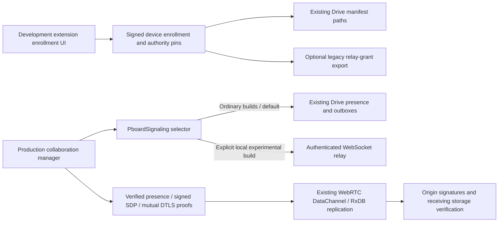
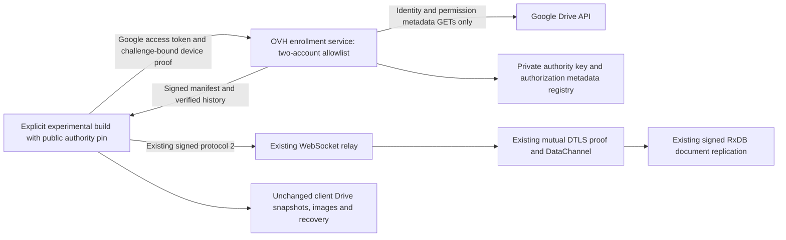

# WebSocket signaling — independent board grants (milestone 0.5)


## Automatic Google identity enrollment — 19 October 2026

The normal opt-in WebSocket path now supports devices on the same verified Google
account and different accounts explicitly invited to a board. This supersedes
manual code exchange as the Google-connected onboarding path; manual pairing below
remains available without Google. Drive remains the default signaling provider.

`googleIdentitySharing.ts` adds a small account-assisted layer around the existing
`boardGrants.ts`, manager, mutation guards, signed WebRTC signaling and RxDB pools.
`identity_enrollment.rs` adds a bounded, in-memory public-policy/request directory.
The server verifies Google identity through `/about` and device possession with a
fresh signed nonce. The local root signs an expiring email-to-role sharing policy;
its original browser automatically signs the usual device manifests only for
identities admitted by that policy. Login, knowing an email/board ID, and directory
visibility never grant room admission. The new request's board key also signs the
HTTP nonce, preventing copied-request submission with a different identity key.

`runtime.ts` initializes only eligible unsigned local boards on Google-connected
opt-in, reuses independent roots, and blocks legacy signed/Drive-trust authority
replacement. Its new `sharePermissions` adapter routes only the normal sharing UI
into root-authorized email invitations when WebSocket mode is selected. All Drive
persistence, scopes, layout, discovery/ACL compatibility, images, deletion handling
and default behavior retain their original service. Root owners can remove or
change email grants; blocked device keys are not silently re-enrolled by polling.
Existing valid, pinned device grants continue to work until their ordinary expiry
if optional identity discovery is unavailable; no new enrollment, anonymous access
or unsigned signaling fallback occurs. Missing/invalid grants still fail closed.

GoogleBoardSharing polls every ten seconds, shows authenticated available boards
and lets the user open one to receive its signed project over the DataChannel.
No unsigned project placeholder or board contents are stored on the rendezvous
service. The owner must open the board for first enrollment, content transfer and
five-minute grant renewal. Same-account secondary devices receive Editor access;
root-key delegation, unattended renewal and authority recovery remain future work.
Images and account-order WebRTC replication remain outside this independent path.
No conflict engine, offline mailbox or private-Drive data migration was introduced.
Existing LWW behavior and signed historical-document limitations remain.

The explicitly selected TLS identity verifier is trusted to report Google identity
honestly: a compromised verifier could induce an online owner to approve a false
identity. Root keys still remain local, but automatic identity enrollment adds
this trust dependency compared with manual fingerprint comparison. It receives a
transient existing OAuth access token, uses only identity lookup and never retains
or logs tokens. A future identity-token design could reduce token privilege;
this milestone does not change Google OAuth scopes. Account policies, invitation
emails and device requests are necessary authorization metadata, are bounded and
volatile server-side, and are not board content. Participants can see their board's
invited emails; only its verified owner sees pending device/email associations.

Validation: 34 Rust tests passed, fmt and strict clippy passed; 4 new client tests
cover default/disconnected behavior, same-account automatic grants, explicit
viewer invitations/removal, tampered policies and signed-data initialization
refusal, plus replay of a removed invitation after a service restart. Native isolated Chromium profile tests passed for both same-account and
different-account flows, with automatic initialization/enrollment, real signed
WebRTC/RxDB edits, offline catch-up, service restart and account revocation. Google
HTTP is simulated, with no client Drive ACL lookup or detected content in signaling
or identity HTTP. Normal production manual-pairing Chromium and Firefox UI regressions passed. The Firefox scenario now waits separately for project and card replication before editing.
The full suite passed 594 tests and retains two previously recorded failures
(version mirrors and policy error-message expectation). Positive live real-Google
identity enrollment remains a user check; no new capacity claim is made.

The already-authorized OVH experimental service now enables this extension with a
feature-free release binary SHA-256
`e83841eb70735bf9f7c36b026fd3ab7ae407b6c9338ff9cbb2e5e2e64c11d136`.
Rollback binary/config backup is root-only at
`/var/backups/pboard-signaling/20261019T142219Z-google-identities/`.
The issuer private key, legacy registry and unrelated proxy routes were preserved.
Public negative probes passed for missing/invalid Google credentials, nonce replay,
unknown fields, unauthorized WS traffic, and allowed SDP/ICE forwarding. The
post-probe systemd cgroup `MemoryCurrent` snapshot was 1,622,016 bytes (2 tasks);
this is one low-traffic observation, not a concurrent-peer benchmark or capacity
certification. Existing measured benchmark sections below remain separate.

Android shares the TypeScript runtime and its typecheck passes; the new onboarding
UI is still sidebar-only and no Android device run is claimed. Positive native
Firefox Google-account enrollment remains a follow-up; Firefox manual pairing and
its underlying WebRTC/security/runtime path passed. Before broader rollout,
prioritize real-account invitation/removal/renewal testing, a scoped identity-token
verifier, owner-key recovery/delegation, historical-author revocation semantics,
image transport and measured resource limits. No additional storage migration or
conflict-merging engine is implied by this milestone.

See [current operating procedure](../../services/pboard-signaling/README.md#automatic-google-account-sharing--current-flow)
and [protocol](../../services/pboard-signaling/PROTOCOL.md#identity-only-enrollment-extension-version-1).

## Normal-extension pairing and explicit copies — 19 October 2026

`src/collab/boardPairing.ts` and `BoardPairingControls.tsx` add real-profile pairing
to the normal opt-in panel. Owner-signed expiring invitation codes pin the board
key through a trusted user channel; signed device-request codes return to the
owner, who confirms the same 48-bit verification display in both browsers and
explicitly grants Editor/Viewer membership. Codes are encoding/UX around the
existing P-256 identity and manifest checks, not bearer board credentials. Merely
knowing a code, board ID or Google identity never grants membership. No private
key is included. The original manual protocol remains available as advanced UI.

The joining browser polls existing `/grants/<scope>` metadata every three seconds
while approval is pending. It verifies the pinned authority/current board binding,
then imports only an owner-approved grant containing its own key. Existing trust
and anti-rollback checks remain; conflicting pins are rejected. Pending requests
are kept locally for reload recovery, expire after ten minutes, and cancellation
is checked again after in-flight metadata fetches before trust is stored. No relay
mailbox, new HTTP endpoint, persistent server user data or deployment was added.
The normal sidebar's ten-second refresh maintains board grants afterward.

`src/collab/collaborativeCopy.ts` provides an explicit, separately identified copy
for older signed boards. A user must consent before the current text-card snapshot
is copied to new board/card IDs and attested under a new local authority. Original
signed documents/keys/history remain untouched. This is not automatic migration or
historical-provenance preservation. Images cause refusal before creating a copy;
no attachments are silently discarded. Tombstones remain in the original board.
Drive storage, ACL compatibility paths, Google scopes and default provider remain.

An additional renewal fix stops expired cached contexts from being reused on
startup/resume. A separate last-polled manifest marker ensures that refreshing the
cache during role lookup cannot hide an epoch change from active replication
pools. Status in the pairing UI reflects manager state each second. No conflict
merging, re-signing of original history, server-auth weakening or release bump is
part of this integration. Reproduction and final validation are in the service
README's normal-extension section.

## Current public rendezvous hardening — 19 October 2026

The [implementation security audit](../../services/pboard-signaling/SECURITY_AUDIT.md)
distinguishes protections present before changes from the targeted additions.
Fresh device authentication and board authority/member checks remain mandatory;
Google verification, Origin, application IDs and embedded keys never authorize
arbitrary boards. Strict signed presence/SDP/ICE validation replaces opaque data
forwarding. Configurable aggregate and per-session limits bound resources before
JSON parsing and crypto where practical. No board storage, proxy, TURN, account
system or new persistent grant database is added.

Standalone grant publication now requires a fresh single-use authority challenge
(publication protocol 2; read bundles remain version 1 and WebSocket remains 2).
After restart the server fails closed until the original authority republishes;
a captured device grant cannot restore an older cached membership. Legacy Google
proofs must match its persisted latest manifest. Earlier sections describing the
static publication/restart replay window are historical and superseded here.
Existing clients need an extension reload; authority identities, pinned keys,
signed history, RxDB, Drive storage and OAuth scopes are preserved. The default
provider remains Drive and opt-in WebSocket can coexist with Drive persistence.

The server restricts negotiation shape and volume but cannot prove that colluding
authorized peers have encoded no covert data within valid SDP/ICE. Self-issued
authorities can only create their own namespaces and remain subject to shared
quotas. Neither this protocol nor an Origin check identifies an official binary.
Detailed limits, tests, operational evidence and remaining rollout gates are in
the linked audit. No fresh load capacity is asserted.

The hardened service is deployed at the existing public WSS endpoint. Independent
Chromium and Firefox two-profile DTLS/RxDB/reconnect checks passed there; public
negative probes rejected anonymous operations, malformed/duplicate messages, wrong
authorities, nonmembers, arbitrary application payloads, untrusted web Origins and
publication replay. Rust has 30 passing tests; full client suite has 569 passes
and the same two pre-existing release-metadata/policy failures. Both normal builds
and root/Android type checks passed. Exact artifact digest, root-only rollback
location, preserved key/state, reproduction commands and limitations are recorded
in the linked audit. Reload both extensions before standalone collaboration.

## Current architecture review and correction — 19 October 2026

The actual pre-0.5 code does **not** implement an exclusively private appData
architecture. `sync/drivePermissions.ts` creates regular shared Drive project,
snapshot, image and realtime folders; `sync/runtime.ts` and the 0.4 Google
broker resolve collaboration roles from their ACLs. `google_enrollment.rs`
verifies those ACLs before signing device manifests. Private snapshots and account
records also use `appDataFolder`. Calling all of this appData-only would be false.
Those existing storage paths, OAuth scopes, shared data, discovery, permissions
and default Drive signaling remain for compatibility; nothing is migrated.

The **new production opt-in** corrects that assumption independently:

```text
RxDB local project/cards -- signed, mutually authenticated WebRTC --> peer RxDB
       |                             ^
       | optional private backup     | signed SDP / ICE via WebSocket
       v                             |
own Google appDataFolder       Rust rendezvous (public authorization metadata)
```

`collab/boardGrants.ts` stores explicit signaling settings and independently
pinned board grants in local platform storage. Missing settings select Drive.
`BoardCollaborationControls.tsx` is included in ordinary production sidebars:
enable WebSocket with a scoped native host permission, initialize an authority,
exchange device requests, approve a role, compare the authority fingerprint and
trust the approved bundle. Input and public output use separate labelled textareas.
No Google identity/token/email/ACL lookup participates in this path. Any user may
create their own cryptographic namespace; knowing someone else's board ID or
successfully authenticating to Google never grants that namespace's board access.
The old Share project email dialog continues to manage **legacy Drive sharing**;
it does not issue independent board grants.

The board authority is a distinct, locally persisted P-256 key, never uploaded.
The owner signs protocol-2 manifests listing explicit device keys and owner,
editor or viewer roles. Standalone board manifests bind both Drive IDs to empty
strings. A partial Drive binding is invalid. Legacy manifests still bind their
original nonempty IDs. The existing room derivation includes the authority
fingerprint, topic and Drive binding: another issuer cannot impersonate an
existing namespace even using the same board ID. Clients pin the authority out
of band, reject signature/expiry/history-fork/epoch rollback, and prove the member
device key against a fresh server challenge and session. Existing signed signaling,
DTLS mutual proof, document scoping and receiving mutation guards remain in use.

The isolated server option `PBOARD_SIGNALING_BOARD_GRANTS=1` admits these standalone
proofs alongside the unchanged 0.4 broker. `/grants/publish` caches authority-signed
rosters/history in memory and advances the existing cross-collection revocation
watch. Its signed publication is idempotent; replay cannot extend expiry, change
roles, or roll back an accepted epoch. `/grants/<scope hash>` returns **public**
key/role/authorization metadata, not board contents. The locator is not an access
credential. Reads are not private; do not put emails or other personal fields in
this protocol. WebSocket admission still requires current membership and fresh
device possession. Both HTTP and WS payloads are bounded and rate limited;
expensive publication validation uses one bounded blocking worker. The server
retains no new files, database, board documents, images or Google credentials.

Only the original authority browser renews the five-minute grants, normally on
the existing ten-second open-board refresh. Owner and members retain verified
signed history locally; the owner republishes it after service restart. A new
device imports no unsigned placeholder or Drive snapshot: its signed project and
cards arrive from an online authorized peer. Existing foreign-authority signed
data is checked before initial attestation changes any records; no automatic
authority migration/re-signing is provided. The initial unsigned-data attestation
flag is consumed after successful guard installation.

`sync/runtime.ts` selects roles from these grants, skips Drive collaboration
bootstrap/ACL/account-order/image helpers for this path, and leaves Drive
persistence/reconciliation independently available. A private appData backup was
tested while WebRTC stayed connected. Changing the signaling setting does not
disconnect Drive or select another storage backend. There is no insecure or
automatic Drive signaling fallback after a WebSocket failure.

### Scope, compatibility and remaining rollout gates

- Existing Drive and explicitly built 0.4 clients keep their protocols/data/trust
  paths. The 0.4 broker remains restricted to its original accounts; it is not
  opened globally or used for new board authorization. Existing test users can
  continue using it. There is no silent conversion of existing ACL memberships.
  Older clients cannot join new standalone empty-binding boards; both peers need
  the updated opt-in implementation. Existing 0.4-signed boards require a reviewed
  authority/history migration before using this new path; use an unsigned local
  board for initial standalone testing and keep old clients on the old flow.
- This is production-build **availability as an opt-in**, not a claim that broad
  production rollout is complete. Authority availability and bounded history are
  explicit operational limits. One public bundle is limited to 4 MiB/4,096 epochs,
  the server cache to 32 MiB/1,024 scopes; capacity errors fail closed, retaining
  source data/history. History grows on renewal. Do not truncate old receipts to
  avoid this limit. Compact/delegated authorization and durable receipt delivery
  need a reviewed follow-up before long-running/wide deployment.
- Removing a device closes its current rooms and blocks new admission. Current
  receiver policy also rejects historical documents authored by removed/downgraded
  devices. Previously stored local content remains; catch-up of those records to a
  new peer needs a reviewed owner-checkpoint/reattest workflow. Revocation does
  not erase another user's already-downloaded data. No automatic re-signing hides
  this limitation.
- Independent image transfer and account-order rooms are not wired yet. Existing
  Drive image persistence is untouched. A private backup may contain local images;
  WebRTC card image references alone do not deliver their bytes to another account.
- Same-user devices require explicit device approval too. The new path does not
  assume a common Google account approves every device. Different-user devices
  follow the same board-grant procedure, with no cross-user Drive access.
- RxDB is local persistence; Drive can recover the user's saved snapshot with no
  peers. WebRTC is live replication and can catch up when an authorized peer later
  returns. Neither the WebSocket server nor WebRTC stores a mailbox for peers that
  are never simultaneously online. A new collaborator without a private backup
  must wait for an authorized peer holding the board. Content backups do not
  export the separate private authority/device keys. Losing the original authority
  profile cannot be repaired by inventing a replacement pin; secure authority
  recovery/export remains a reviewed follow-up.
- Existing document last-write-wins conflict handling, tombstones, operation IDs,
  signed provenance and parent fields remain unchanged. No automatic field merge,
  durable conflict queue, or persistent manual resolution workflow is claimed.
  Existing last-write-wins can lose concurrent modifications. This change adds no
  new offline discard policy; unsigned/stale provenance can block rejoin and must
  be recovered explicitly. This milestone adds no schema
  or merge strategy that prevents a later offline journal/non-conflicting merge/
  durable manual-resolution implementation.
- Android shares the TypeScript runtime/provider, but its current service gates
  foreground collaboration on Drive connection and has no grant/settings UI.
  Android standalone onboarding/lifecycle remains a follow-up; no OAuth, packaging
  or native network policy is changed here.
- Browser host permissions, TLS, cryptographic device identity and pinned grants
  do not attest an official Pboard binary. No Origin/extension-ID/email-only
  authorization is introduced. TLS, secure device storage, verified fingerprints
  and protection of the authority browser remain necessary.

### Validation for the independent path

Rust: 21 tests passed, including independent publication, unauthorized publication/
join rejection, signatures, history forks, revocation, and restart/republication;
format and strict all-target/all-feature Clippy passed. New client/UI tests cover
production opt-in/default retention, owner approval, authority replacement/forks,
role/revocation, renewal after interruption, safe service failure and scoped native
permission consent. Final focused checks: 63 tests passed; root and Android
TypeScript passed. The existing full suite reported 567 passes and the same two
pre-existing release/version-policy failures at the full-suite checkpoint; later
focused checks validate subsequent changes.

Two native Chromium extension profiles passed real signed DTLS/RxDB project/card
creation/edit/reconnect into an initially empty database, zero Google calls during
collaboration, concurrent private appData backup (Google HTTP simulated), service
restart/republication, and revoked-device rejection. Audits saw no board contents
or image bytes in WebSocket or public grant HTTP payloads. The original Drive
signaling native two-profile test still passed, including shared image/snapshot
persistence. The legacy Google-broker native test also passed automatic renewal,
fresh-profile historical catch-up, snapshots/images and service restart using
synthetic Google HTTP. Native Firefox production sidebar loads and exposes the opt-in with
Drive as default; the equivalent native Chromium production UI probe passed too.
Ordinary Firefox/Chromium packages built and verified, with zero Firefox lint
issues. No updated load/CPU/peer-capacity measurements are claimed;
historical benchmark results do not establish capacity of this new grant path.

Implementation files added: `collab/boardGrants.ts`,
`sidebar/components/BoardCollaborationControls.tsx`, server `src/board_grants.rs`,
`build-local-release.mjs`, `board-grants-probe.ts`, and the board-grant client/UI
tests. Integration changes are in runtime/browser wiring, signaling selection,
manager image gating, manifest/relay-admission validation, initial mutation
attestation, App/styles, Rust admission/main/router and their tests. Existing UI
fixtures gained the new settings-service mock. The native browser harnesses,
deployment templates and README/PROTOCOL/collaboration/standards reports were
updated; no dependency, OAuth, RxDB schema or production version file changed.

Ordinary local builds require no experimental environment flags:

```sh
npm run build
npm run build:chromium
# Reload the existing extension; expand WebRTC collaboration.
# Select wss://pboard.cecosl.ovh/ws, enable and approve the host permission.
# The service must explicitly enable PBOARD_SIGNALING_BOARD_GRANTS=1.

cargo build --locked --manifest-path services/pboard-signaling/Cargo.toml
PBOARD_BOARD_GRANTS=1 node services/pboard-signaling/secure-browser-smoke.mjs
```

The user confirmed the earlier same-account, different-browser 0.4 live test
works. That confirmation is not evidence of cross-account standalone onboarding,
restrictive-network/TURN behavior, Android participation, long-running history
capacity or conflict recovery. Earlier milestone notes below are historical.

### Authorized OVH opt-in service update

The owner's requests to maintain the permanent OVH test service and enable
collaboration for other users authorize this same-service update, under pinned
SECURITY's explicit applicable authorization rule. No distribution/release or
OAuth/data migration is authorized or performed. The feature-free standalone
binary was built from a coherent private Rust source capture, retained as
`services/pboard-signaling/local_artifacts/20261019T092616Z/` with file digests,
compiler, standards pin and binary SHA-256
`27b2023dfe15692d6b3970ca8c1c8f37ed9572e5f9241c5a1d1b6d5d8d8eb12f`.

The existing `pboard.cecosl.ovh` service now enables independent board grants in
addition to its unchanged restricted legacy Google broker. A systemd drop-in adds
only `PBOARD_SIGNALING_BOARD_GRANTS=1`; HAProxy adds only the two grant route forms.
Pre-update binary/unit/proxy plus private authority and registry were backed up
on-server under root-only `/var/backups/pboard-signaling/20261019T092616Z/`.
Neither private authority nor registry was extracted or reset; both were compared
unchanged after restart. The new binary's checksum, health, active service, root
404 and existing mate-host 302 routing were verified. No DNS/TLS identity changed.

Two disposable Chromium extension profiles also passed the independent grant test
over **public WSS with DEV=false**: owner approval and pinned authority, no Google
calls during collaboration, real signed DTLS/RxDB replication into an empty
database, renewal without re-signing stored edits, reconnect, simultaneous private
appData backup (Google HTTP simulated), revocation and preserved local content.
No remote restart was performed by that public test. The public legacy negative
probe still rejected invalid Google credentials, replayed challenges and a
self-signed attempt to enter a legacy Drive-bound room. A one-shot post-test server
RSS observation was 7,928 KiB; this is not an idle/load benchmark or a capacity
claim. Public grant metadata remains disposable; the service stores no board data.

```sh
PBOARD_BOARD_GRANTS=1 PBOARD_M03_RELAY_URL=wss://pboard.cecosl.ovh/ws \
  node services/pboard-signaling/secure-browser-smoke.mjs
PBOARD_EXPECT_PRODUCTION=1 node services/pboard-signaling/extension-ui-smoke.mjs
PBOARD_GECKODRIVER=/path/to/geckodriver PBOARD_EXPECT_PRODUCTION=1 \
  node services/pboard-signaling/firefox-ui-smoke.mjs
```

Historical milestone 0.4 used an explicitly authorized, build-pinned Google enrollment
service for the two-account OVH experiment. See the final section for the current
architecture and recovery limits. Earlier descriptions are historical.

Milestone 0.3 adds automatic signed relay admission; see the final section
for its trust model, validation and deployment. Earlier milestones below are retained
for implementation history.

Local implementation and validation: 18 October 2026. Milestone 0.2 supersedes the
0.1 enrollment/negotiation blockers. The relay protocol/server remain unchanged;
this milestone completes development-extension and secure-client integration.
The local milestones performed no deployment, production activation, OAuth change,
RxDB schema migration or Drive storage migration. A later owner-authorized persistent
experimental VPS installation is recorded below. Ordinary builds still choose Drive signaling.

## Data flow and reused components



`src/sync/runtime.ts` remains the shared browser/Android composition root.
Board topics remain `pboard-collab-<projectId>-cards` / `-projects`, with a separate
`pboard-account-<accountHash>-order` room. Drive signaling uses the existing
`Pboard/<projectId>/realtime/` records and private account signaling records.
`PboardSignaling` now exposes optional signed-presence delivery in addition to its
existing rosters/directed messages. Drive uses its reserved `security.presence` field;
WebSocket forwards an opaque presence envelope to authorized room peers.

All real-time documents remain in the existing WebRTC/RxDB transport. Board snapshots,
images, invitations, ACLs, discovery, private app data and recovery remain Drive paths.
The Rust service never connects to Drive or stores documents/images/tokens. The
legacy RxDB-compatible WS helper remains unchanged and is not selected by this build.

## Development extension and onboarding

A regular web page cannot provide the extension APIs required by the sidebar. The
previous standalone Vite/console instructions were wrong and have been replaced.
`node scripts/build-signaling-experiment.mjs firefox|chromium` uses the existing
managed local-build/provenance/retention workflow with explicit experiment options.
Its private compilation sets DEV/provider/URL constants, labels the generated manifest,
and adds only that relay host permission. Compatibility IDs and tracked manifests
are preserved; dedicated test profiles avoid replacing a user's normal installation.
Ordinary builds clear the experimental-build switch and remain Drive-default.

The development-only **Experimental device enrollment** UI supports account/board
initialization, signed device requests, public JSON file import/export, approval,
authority trust, relay-grant export and explicit live restart. Nothing requires
pasting executable JavaScript into a console. `merge-grants.mjs` combines explicitly
approved public exports from different accounts, refuses conflicting room versions,
checks fingerprints/expiry/public-key structure and requires `--replace` to overwrite.
It does not approve devices or read private keys.

## Trust, admission and authorization

- `security/enrollment.ts` uses existing persistent P-256 keys and signed manifests.
  An authority initializes only for a verified Drive owner/account. The initial board
  action explicitly attests existing local content. Attestation keeps content and
  advances timestamps/adds signatures, so previously unsigned state cannot win over
  the attested state merely through equal timestamps.
- A device request signs the exact board/account/Drive identity, public key, email,
  nonce and one-hour request expiry. Approval requires independent fingerprint AND
  Google-email confirmation and a current Drive ACL lookup. Self-reported role/email
  alone do not grant access. Only the local authority owner holding its private key
  can publish the updated signed manifest. A board owner cannot enroll another
  user's account room. An already-pinned authority cannot silently rotate.
- Public bundles are accepted only against an independently verified authority
  fingerprint, matching Drive identity/binding, current local device membership and
  current Drive role. Accepted manifest epochs are persisted in extension storage
  to reject rollback after restarting the runtime. All keys remain local; public
  bundles and relay grants contain no private JWK `d` or Google credentials.
- Existing expected security files are published: `pboard-manifest.json` in the shared
  project folder; `pboard-account-manifest-<hash>.pboard` in private app data. No board
  snapshots/assets are relocated. Legacy protocol 1 receives exact-room public grants from
  these verified manifests, with expiry; current protocol 2 receives the signed proof
  directly from the enrolled client in an authority-derived namespace. Server challenge authentication remains
  mandatory and independent of board ID knowledge.
- Authorizations retain the existing **five-minute** protocol limit. This is an
  attended test workflow: the original authority devices renew and already-pinned peers read fresh
  signed manifests when restarting. Current protocol 2 needs no server upload.
  Initial authority trust/enrollment is still explicit. Epoch changes require live restart
  and matching manifests. Automatic renewal, historical authorization, revocation
  distribution and authority recovery/rotation remain future work. Do not widen
  lifetimes or disable checks to work around expiry.

## Secure negotiation fixes

`webrtcHandler.ts` now consumes signed remote presence, verifies it against the
locally trusted manifest, and learns the actual remote key/session before generating
an offer. Presence verification is awaited before applying that peer's signed signal.
Fresh room-session IDs are generated for each manager start, and transport stale-session
filtering/replay verification remains in place. Presence refreshes while a room runs.

DTLS peers issue a bounded `sessionChallenge` on their own DataChannel, then sign a
`sessionProof` answering the remote challenge. Proofs bind both actual device/session
identities and a SHA-256 ordered SDP transcript. Admission requires both a verified
inbound proof and a sent reciprocal proof. Early data is queued until local transport
connect completes; application frames before admission fail closed. A fresh challenge
is used after reconnect. Expired manifests close/reject content paths.

The authenticated RxDB RPC surface is limited to token, bounded catch-up and bounded
writes. Incoming documents/assumed states must belong to the room; existing-document
lookups reject attempts to reuse another project's primary key. This prevents a
modified authenticated peer from using general master RPC dispatch to access private
projects. Existing scoped catch-up/live streams remain in place.

## Signed local writes and receiving storage guard

`security/liveMutations.ts` installs bounded origin-hook dispatchers and verifies every
claimed board write at storage. Local inserts, edits, removals and tombstones are signed
by the approved owner/editor. Viewers cannot create signed content; only owners can
sign deletion of a project itself. Existing signed state can be relayed unchanged.

Two existing correctness bugs were fixed without replacing user keys or schemas:

1. `ensureDeviceKey()` stored purpose-slot names in key records and later returned
   those names as fingerprints. It now keeps the slot and cryptographic identity
   separate, repairs the fingerprint of an old slot while retaining its private key,
   and serializes browser creation through Web Locks.
2. The old guard replaced only `collection.storageInstance`; RxDB's incremental queue
   already held the original object and bypassed the replacement. The guard now patches
   that actual object's write method, including cached incremental and replication paths.
   Uninstallation restores it without bypassing still-active wrappers.

Origin hooks never sign replication writes. Repository snapshot imports are explicitly
marked as external so an untrusted Drive import cannot be laundered into a valid local
signature. Rejected imports preserve the existing local document and report failure;
image-byte repair remains separate. The v1 snapshot/checkpoint recovery limitations
below are not represented as solved by this live-replication change.

New mutation hashes use real SHA-256, fitting the existing 64-character schema field.
The verifier retains acceptance of correctly signed legacy canonical-hex payload hashes
when all binding/authorization checks pass; no stored document migration occurs.
Document ID, deletion state and manifest authorization expiry are explicitly bound.
The existing timestamp conflict policy remains; concurrent changes to one document
can still select one version over another.

## Validation and measured scope

- Exact pinned central standards checkout verified: edition 1.0.0, commit
  `e3111c4e9dc652f833a5f2ba5232c292646e7969`, all 21 file hashes. Project specification,
  storage/collaboration documents and applicable pinned security/architecture/build/
  artifact/version policies were consulted. No standards pin was changed.
- Real secure browser acceptance: two isolated Chromium **extension** profiles with
  native IndexedDB, real P-256 enrollment, production runtime/manager, real mutation
  guards, native DTLS/WebRTC and RxDB. Tests cover different owner/editor Google accounts
  and same-account devices. A third variant uses the existing Drive signaling
  provider with the same production security/runtime, without Rust or auth doubles. Missing enrollment is rejected before starting rooms;
  legitimate peers create/edit/delete cards, rename the board, reconnect/catch up,
  and recover from relay restart. Drive snapshot upload and hash-addressed image bytes
  are exercised through the actual transports against a local Google HTTP fixture.
  Auditing outgoing WS frames detects no document RPC, private card content or image
  data. Only Google HTTP is simulated; no auth/manifest/storage-guard doubles are used.
- Packaged UI smoke: actual experimental Chromium background/sidebar render with
  native extension APIs and enrollment file controls. Native Firefox 153.5.0esr
  also loads/renders its temporary development package under geckodriver 0.37.1
  in a disposable profile. Firefox packages pass strict lint and package verification. No localhost web-page shim is used.
- Unit/adversarial tests cover signed enrollment, fingerprint/email verification,
  forged/expired requests, removed collaborators, account isolation, rollback,
  public grant exports, persistent-key repair, origin signatures, raw/incremental
  storage rejection, untrusted snapshot-import rejection, signed deletion and
  cross-room/method/batch/private-ID request rejection. Existing Drive signaling,
  admission, security and convergence regressions remain covered. Default Drive
  clients with trusted manifests use the same origin-signing/verification helper;
  it is not a separate WebSocket-only security implementation.
- Final focused security/runtime run: 91 passing tests.
- Full root suite: 537 passing tests and two known pre-existing failures: VERSION `0.11.0` versus
  generated mirrors `0.10.2`, and a release-readiness assertion expecting a different
  unresolved-history error. No unrelated version/release-policy repair was made.
- Android TypeScript and all 98 Android tests pass. Root TypeScript, both ordinary
  browser builds and both experimental packages pass. Firefox lint reports zero
  warnings/errors.
- Rust relay protocol/network tests remain 10 passing tests. No Rust protocol change
  was needed. [Milestone-0.1 relay measurements](../../services/pboard-signaling/BENCHMARK_RESULTS.md)
  remain the only performance measurements; no new VPS capacity claim is made.
- Not validated: authenticated real Google invitation/revocation flows, native Firefox
  end-to-end sessions, physical Android/WebView, public TLS/systemd deployment or long
  running/expiry/revocation soak tests. Android shares the common runtime/security;
  its OAuth, package and network-security policies remain untouched.

The integration's Google identities/ACLs are simulated, so it does not certify that
Google's live permission endpoints behave as the fixture does. The automated driver
is the explicit out-of-band approval operator; it is not an automatic network trust
source. User enrollment retains the independent verification step.

## Remaining limits and next milestone

Ordinary clients continue using Drive and cannot rendezvous with WS-selected clients.
All participating test clients must use the experimental build. Account trust remains
separate from shared board trust. Relay restart loses presence/messages and triggers
reauthentication; WebRTC supplies no durable offline delivery. Connectivity still uses
existing STUN defaults without a configured TURN relay.

Five-minute epoch-bound provenance does not implement historical offline-write
verification or unattended renewal. Re-enrollment/owner attestation is explicit;
this experiment does not promise arbitrary offline history recovery across expired
or changed manifests. Existing v1 snapshots omit tombstone history and fractional
ordering fidelity, and signed snapshot checkpoints are not fully wired into production
recovery. Full historical/deleted-data backup and tamper-proof Drive recovery remain
separate gates. No user source data is deleted to obtain a successful connection.

Before a production rollout: implement authority-backed renewal/revocation/history,
validate expiry/offline/conflict recovery and signed snapshots end to end, verify real
Google ACL/revocation, native Firefox and physical Android behavior, review endpoints/
CSP and malicious-peer tests, and perform heartbeat-inclusive/flood/slow-reader/TLS
soaks on the target Debian VPS. Existing release-history/signer/protection and version
mirror gaps remain blocked. The original local milestone authorized no DNS,
deployment or release; later service authorization/activation is recorded below.

## Separately authorized persistent VPS experiment

After the local milestones, the owner explicitly requested a permanent service on
`cecosl`. On 18 October 2026 the relay was installed with an enabled systemd unit,
dedicated unprivileged account, root-controlled public allowlist and loopback listener.
The initial allowlist is empty. Server configuration validation now accepts empty or
expired allowlists so the process survives reboots/expiry without a restart loop;
all authentication and active-session expiry checks remain enforced. Invalid keys,
fingerprints and room structures still reject startup. `--check-config` supports
validation before atomic operator updates. This is a service-lifecycle adjustment,
not a trust-policy or protocol change.

The deployed binary was built from an isolated source copy, checksum-verified after
SSH transfer, and recorded with source digests in the service's ignored local artifacts.
The owner authorization covers this experimental VPS service, not public releases,
changes to Google storage/scopes, or automatic device enrollment.

The actual VPS passed a temporary diagnostic via an SSH tunnel: unapproved key/room
rejection, authenticated offer/answer/ICE relay, presence, disconnect and reconnect.
Diagnostic public grants were removed afterward, restoring deny-all. Eleven Rust
protocol tests, strict Clippy and formatting passed; the new case specifically verifies
empty/expired allowlists cannot authenticate a peer. Idle process RSS was 4,172 KiB
after the test, with two threads. No VPS capacity, CPU/latency load benchmark, reboot,
real-account end-to-end WebRTC test or sustained-production claim follows from this.

`signal.stefanogozzi.it` did not resolve during setup. DNS is an operator prerequisite;
the public TLS/HAProxy route is not yet activated. The existing mate website, proxy,
certificates and firewall were left unchanged. HAProxy and scoped certificate-renewal
templates were prepared and syntax-checked. Until HTTPS activation, the existing
experimental loopback extension can use an SSH tunnel to the persistent service.
Five-minute authority/grant renewal remains attended; running a persistent relay
does not turn the current client into an unattended synchronization service.

The [service README](../../services/pboard-signaling/README.md#persistent-experimental-vps-service)
records paths, grant updates, service controls, checksums and remaining HTTPS steps.

See [the README](../../services/pboard-signaling/README.md) for the exact supported
build/install/enrollment commands. Additional 0.2 files include:
`security/enrollment.ts`, `liveMutations.ts`, `replicationRequests.ts`, the development
UI component, two build entry scripts, secure runtime/UI browser probes, public-grant
merge tool and their regression tests. Existing runtime, handler, signing guard/key
code, repository import boundary and managed build helpers were changed narrowly.

The owner subsequently selected `pboard.cecosl.ovh` instead of the initial
`signal.stefanogozzi.it` example. Prepared proxy/certificate configuration and the
service runbook now target `wss://pboard.cecosl.ovh/ws`. The owner will configure
the OVH DNS A record to `164.132.195.137`; TLS/proxy activation remains pending DNS.

HTTPS activation completed after owner-configured DNS on 18 October 2026.
`pboard.cecosl.ovh` resolves to `164.132.195.137`; Let's Encrypt certificate
issuance succeeded (expires 16 January 2027). Installed the scoped Certbot deploy
hook, checked key/certificate correspondence and hostname, backed up HAProxy config
to `/var/backups/pboard-signaling/20261018T144211Z/haproxy.cfg`, validated the
new host/backend/rate-limit configuration and reloaded HAProxy. Public HTTPS health
returned 200/`ok`, root returned 404, and the mate site retained its expected 302
login redirect. Public WSS diagnostic passed unknown-key/room denial, authenticated
offer/answer/ICE forwarding, presence and disconnect/reconnect without TLS bypass.
Diagnostic grants were removed afterward; the service remains deny-all until the
owner uploads approved enrollment exports. Existing certificate timer handles renewal;
the new deployment hook was exercised with the issued certificate, but no future
renewal/dry-run was performed. No unrelated certificate, firewall, Google storage,
OAuth, release or production-default change was made. Five-minute client/grant
expiry remains unchanged; real-account WebRTC/RxDB testing is still a manual gate.

Experimental Firefox and Chromium packages were rebuilt/verified with
`wss://pboard.cecosl.ovh/ws` and staged at `dist/` and `dist/chromium/`.
Firefox lint reported zero errors/warnings; both native temporary-extension UI
probes passed. An additional native Chromium sidebar probe reached the public
WSS endpoint with normal TLS verification and confirmed unauthenticated join
rejection. Ordinary build defaults, extension identities and device keys were
unchanged. Existing profiles should reload, rather than remove/reinstall, the
temporary extension. No actual user profile or Google account was automated.

## Milestone 0.3: automatic relay admission (18 October 2026)

The owner requested access without SSH/manual grants and approved replacing that
step with signed room authorization. The implementation does not claim to attest
an official app: headers/extension IDs/shared bundled keys are insufficient. Any
client can establish its own cryptographic namespace, but cannot join another
pinned authority's room without its signed membership and a device private key.

Added `security/relayAdmission.ts` and Rust `src/admission.rs`. The runtime attaches
its already-verified signed manifest and independently pinned public authority to
the existing collaboration context; the manager passes that context to the selected
provider. Drive ignores the additional context and remains the production default.
The provider verifies a strict public-only manifest shape, derives a room from the
authority fingerprint and topic/Drive binding, and automatically sends the signed
payload plus a fresh device challenge proof. The server recomputes that namespace,
verifies both signatures, fingerprints, membership, scope and expiry. Original
WebRTC/RxDB topics, DTLS proofs, trust pins and mutation guards are reused unchanged.
No private key, Google token, document, image or email is included in admission.

Protocol 2 is enabled explicitly on the VPS via
`PBOARD_SIGNALING_AUTOMATIC_ADMISSION=1`. Protocol 1/operator grants remain available
for legacy raw-topic rooms, but cannot authorize protocol-2 namespaces. New clients
require advertised version 2 and do not downgrade. All collaborating devices must
reload the new experimental build to rendezvous in the same namespaces; stored
keys/boards/pins are retained, and no OAuth/schema/Drive-layout migration is needed.

Per authority/board/account/Drive binding, the server keeps the highest observed
epoch and exact payload SHA-256. A higher epoch closes older sessions across both
board collections; rollback and same-epoch forks are rejected. State is memory-only,
limited to 1,024 retained scopes, with 64 global automatic verifications/second plus
the existing socket/frame/room limits and HAProxy per-IP request limit. Revocation
tombstones last 390 seconds after initial acceptance or an epoch advance, covering
all already-issued proofs even when the latest manifest has a shorter lifetime.
Expired retention records are pruned. This constrains resource use, not all public-service abuse.
Restart forgets observed revocations: a still-unexpired old proof can be accepted
until a new epoch is observed again. Local client epoch pins and content validation
remain mandatory. No durable revocation/official-client attestation is claimed.

Five-minute manifests remain enforced. Original authority devices renew them;
already-pinned clients fetch and verify the new signed manifest from Drive when
restarting collaboration. No new server uploads/restarts are needed. Automatic
renewal is deliberately deferred until historical mutation/epoch verification is
safe; silently extending expiry or resetting keys would weaken the existing model.

Validation: 16 Rust tests passed (11 legacy and five multi-case admission tests),
strict Clippy/fmt passed, seven provider/default tests passed. Adversarial cases cover
forged signatures, public-key/authority mismatch, attacker namespaces with victim
board IDs, nonmembers, cross-account/board topics, replay, duplicate/unknown/private
fields, invalid roles, expiry/future/overlong timestamps, revoked/forked epochs,
shared-scope session invalidation and resource bounds. Root suite: 540 passed, two
unchanged release metadata/policy failures. Root/Android typechecking and Android's
98 tests passed. Full native Chromium secure runtime tests passed with an empty
legacy allowlist, for local automatic admission (same/different accounts) and the
unchanged Drive provider. Real WebRTC/RxDB, owner approval, trusted pins and guards
are used; only Google HTTP is simulated.

The VPS was updated with a checksum-verified isolated-source binary, SHA-256
`3400caf84aa732bfb3fe40017fb172e1f8b7546527f2e7829cd1e64992af2153`, retained at
service-local `local_artifacts/20261018T150057Z/`. Previous binary/unit backup:
`/var/backups/pboard-signaling/20261018T150140Z/`. Grants/config, TLS, proxy and mate
were preserved; the updated unit explicitly enables automatic admission. Public
`automatic-smoke.mjs` passed without SSH/server changes. The full secure Chromium
runtime probe then passed through public WSS for both same/different account cases:
mutual DTLS authentication, signed card creation/edit/delete and project rename,
reconnect/offline catch-up, fixture Drive image/snapshot paths, and no content/RPC
frames observed on signaling. No authentication/storage-guard doubles are used.
The public test does not restart the VPS relay; local tests cover server restart.
Real Google ACL/revocation, full Firefox replication, physical Android and VPS
capacity/soak testing remain unverified. No production app release was published.

Final security review tightened epoch retention: a newer manifest expiring earlier
than a revoked old one must not resurrect old admission. Observed epoch tombstones
are retained for 390 seconds (maximum proof lifetime plus clock skew), with the
existing 1,024-scope cap. The revocation regression explicitly waits for a shorter
new manifest to expire and verifies that the still-unexpired revoked old proof is
rejected. All 16 Rust tests, strict Clippy and seven provider tests passed afterward.
Final deployed binary SHA-256:
`9b2c84bee645baf0f24e6b4429fba1e3f5b2fe4a2812a6cd11636f0ae160abfe`;
isolated source/build provenance: service-local `local_artifacts/20261018T151350Z/`;
latest rollback binary/unit: `/var/backups/pboard-signaling/20261018T151441Z/`.
The public no-SSH diagnostic passed again on this final binary.

Both ordinary Firefox/Chromium managed builds/package checks passed, even with
experimental VITE variables set; ordinary bundles omit the admission/UI markers
and retain Drive defaults. Both WSS experimental packages were rebuilt and staged
at `dist/` and `dist/chromium/`; strict Firefox lint reported zero errors/warnings.
Native Chrome and Firefox temporary-extension UI probes passed. These are test
builds, not published or signed production releases; existing user profiles were
not automated, and should reload rather than remove/reinstall the extension.

The complete two-profile Chromium secure runtime/replication test also passed on
the final public binary after tombstone hardening (different-account scenario).
The service remained enabled/active, public health returned `ok`, the legacy grant
file remained empty, and mate/HAProxy remained active. No operator grants were
installed by either public automatic-admission test.

## Follow-up: real same-account enrollment diagnosis

A user reported the generic "Collaboration requires a trusted security manifest"
status. That status does not distinguish an absent local authority pin from a
missing/unreadable/unverified Drive manifest. Its exact real-profile cause is not
yet identified; browser/profile and initial enrollment details were requested.

Experimental runtime diagnostics now identify account versus board and missing
trust, missing Drive file, Drive read failure, authority mismatch, verification
failure, scope/binding mismatch, expiry, missing device membership and rejected
history/storage acceptance. Text is fixed locally and exposes no Drive response,
private keys or tokens. Missing trust is not initialized or bypassed automatically.
Ordinary Drive null/error behavior is preserved, including download failures.
Eight new runtime regression cases verify fail-closed operation, no signaling or
Drive mutations, preservation of trust, redacted diagnostics and default-provider
compatibility. Focused runtime/admission/provider tests: 32 passed; root/Android
typechecks passed. A native two-profile public-WSS same-account test passed with
Google HTTP simulated; an added renewal scenario also passed after owner renewal,
peer restart without bundle re-import and another signed edit. This evidence does
not identify or resolve the real user's failure, and real Google ACL/API behavior
remains outside the fixture test. No server update, storage/schema migration,
OAuth change or trust relaxation was made for this diagnostic follow-up.

The diagnostic follow-up experimental Firefox/Chromium packages were rebuilt and
verified; both staged bundles include the scoped messages. Native temporary-extension
UI probes passed for both browsers, with Firefox lint at zero errors/warnings.
The real-profile failure remains pending the new diagnostic message; no real user
profile, stored keys or Google files were altered by the agent.


### 19 October 2026: correlated experiment diagnostics

The owner requested real-service testing restricted to two named Google accounts,
and useful frontend/server debugging. The diagnostic portion is implemented and
installed on the existing OVH service under that authorization. The new binary
SHA-256 is `a094fa05ed334356196bfd80accf5a31dda896a0db0ae278470fc343142fa3e2`;
its isolated source build/provenance is retained in
`services/pboard-signaling/local_artifacts/20261019T053418Z/`. The previous binary
and unchanged systemd unit are backed up at
`/var/backups/pboard-signaling/20261019T053418Z/` on OVH. Public health and automatic
admission/negative probes passed after replacement. No OAuth scope, Google files,
trust pin, signing key, default provider, proxy rule or schema was changed.

The experimental frontend now has a 100-entry local history and console events;
relay session prefixes correlate with server connect/authenticate/join/disconnect
records. WebRTC events distinguish transport connection from verified mutual proof
and permission to start replication. Server summaries include forwarding counts,
duration and fixed disconnect reasons; payloads are omitted. Production Drive
builds emit no experiment history. Two tests verify bounded history, metadata
projection, absence of injected credentials/content and the ordinary-build guard.

Validation: all 16 Rust protocol tests; 34 focused frontend/runtime/admission tests;
root and Android TypeScript checks; strict Rust Clippy and formatting; verified
experimental Firefox and Chromium packages (Firefox lint: zero issues); native
Chromium packaged UI including the diagnostic panel. Two real Chromium profiles
passed same-account enrollment/renewal over public WSS, followed by a post-update
owner/editor two-account public-WSS probe exercising signed card create/edit/delete,
project rename, offline catch-up/reconnect, guarded DataChannel replication and
fixture Drive snapshots/images. Google HTTP was simulated in both probes, not real
Google-account verification. The public adapter probe also rejected nonmembers and
authority impersonation and forwarded offer/answer/ICE. Journal correlation and
forwarding summaries were observed, with no fixture content sentinel. Firefox
native UI was not rerun on this host because geckodriver is unavailable. No new
load or performance-capacity measurement was made.

**Pending authorization design:** the requested email-only automatic enrollment
is not implemented or enforced by this update. An email allowlist alone cannot
replace proof of identity or the client's existing trusted-manifest guards. The
original experiment forbids the server from connecting to Drive. The owner has
been asked whether to permit transient Google access-token verification for
identity and Drive permission metadata (no refresh tokens, persistence, payload
reads or token logs). No token transmission or verification endpoint is enabled
while that exception is pending; current signed-device admission remains active.


## Milestone 0.4: approved Google verification and automatic enrollment

Owner authorization on 19 October 2026 explicitly permits transient Google access
credentials for identity/permission metadata, restricts admission to the two named
accounts, and authorizes updating the existing permanent OVH experiment. This is an
additive opt-in authorization service, not production activation or an OAuth/data
migration. The earlier no-Google-server and entirely in-memory statements are
superseded only for this mode. The default standalone server and ordinary shipped
Drive provider retain their earlier behavior.



Added `src/collab/googleBrokerEnrollment.ts` and server
`src/google_enrollment.rs`; reused `CollaborationSecurityOptions`, device keys,
manifest signatures, relay challenge-response, collection scoping, WebRTC mutual
proofs, RxDB storage guards and existing role refresh lifecycle. The runtime selects
this path only with the explicit experimental build flag and an independently
configured public authority pin. Manual pins and pending attestations remain intact;
broker epoch records use a separate authority-qualified namespace. A small optional
history context accepts only independently verified same-authority/same-binding old
manifests and rechecks current membership, role, original signature and issue-time
limits. Ordinary mutation verification remains strict about the current epoch.
The first owner can bootstrap unsigned local content; a later same-account owner
cannot overwrite newer state by re-attesting its stale unsigned snapshot.

Five-minute grants renew automatically through the existing ten-second refresh
cycle. Membership/role changes restart the scoped pools; a new epoch invalidates
older relay sessions. The key and bounded metadata history persist atomically so
server restart can recover existing epochs and originally valid historical edits.
No access/refresh token, SDP, ICE payload, board document or image is persisted on
OVH. Google access tokens exist transiently in an authorization header, are verified
against fixed Google HTTPS metadata endpoints, and are never logged. This does make
the server trusted with existing token privileges; a compromised authorization
service is more sensitive than the earlier pure relay. No application attestation
is claimed. Consent here is for the private experiment, not general public rollout.

The default provider, Google scopes, client backup/snapshot/image paths, schemas,
board identities, platform packaging and production version remain unchanged.
OVH now deliberately rejects older manual/self-signed signaling clients; return to
a compatible non-Google server to use those retained modes. Android still shares
TypeScript runtime code but has no milestone-0.4 packaging/physical-device evidence.
Explicit-user ACLs, initial owner presence, bounded delayed revocation, bounded
registry/history capacity and unsigned offline edits on additional devices remain
limitations; see the service README for capacities and recovery. A production
rollout needs metadata/history lifecycle and migration/recovery design, device
revocation controls, longer offline recovery tests, real Google/Workspace coverage,
Android integration, operational hardening and fresh capacity measurements.

Validation: 20 Rust tests (four new Google enrollment/closed-admission cases and
16 existing relay cases), strict Clippy/formatting; five new frontend broker/history
cases; 40 focused diagnostics, runtime, admission and mutation tests; an earlier
47-test run including real native manager tests; root and Android typechecks;
verified Firefox and Chromium experimental packages with a public OVH pin and
Firefox lint at zero errors/warnings; native Chromium packaged UI rendering.
A local feature-gated synthetic Google API drove real Chromium profiles through
same-account and owner/editor automatic enrollment, signed DataChannel/RxDB changes,
Drive fixture snapshots/images, reconnect and server restart. Short test grants
exercised renewal beyond original expiry; a new third owner profile received a
historic editor mutation with its **original signature** and retained the newer
shared project name. The original Drive-provider native probe also passed.
One harness restart initially used a concurrently rebuilt non-fixture executable;
copying the selected binary before launch fixed the test isolation issue. Real
Google account success still requires the owner's test; the public negative probe
already verified live Google rejection, nonce replay rejection and denial of a
valid self-signed manifest bypass. Public health/root/mate statuses are 200/404/302.
No real account tokens or existing Google files were accessed by the agent.

Deployed optimized feature-free binary SHA-256:
`2f7938d6279f122f1c22a4c95b32918225b8c56fbda7dd42fcde523367ba3d55`.
Private on-server key generation and metadata directory permissions were verified;
public pin is `deploy/ovh-authority.public.json`. Build/provenance and rollback
paths are in the README. One idle post-negative-probe sample was 7,204 KiB RSS
and high-water RSS; this is not a load benchmark or a capacity guarantee. No new
100/500/1000/2000-peer load measurement was performed. Firefox native UI was not
rerun because geckodriver is unavailable on this host. No commits, tags, pushes,
production release, DNS changes or unrelated deployments were performed.


### 19 October 2026: native Firefox enrollment fetch fix

Repeated `google.account.verifying` entries could occur with no HTTP rejection:
the broker called native fetch as `options.fetcher(...)`, supplying an ordinary
object as its JavaScript receiver. A disposable native Firefox extension reproduced
`TypeError: 'fetch' called on an object that does not implement interface Window.`
The identical unbound request returned 200 from the live OVH challenge endpoint.
The provider now keeps a local fetch function and invokes it unbound, as the other
Drive transports already do. Every enrollment exception now records a fixed phase
(`challenge`, `google_token`, `enrollment`, `authority`, `history`, `manifest`, `save`,
etc.); a valid challenge records `challenge_received`. Raw exceptions and credentials
are not copied into diagnostic history. The original exception still reaches the
existing collaboration status/error path.

The HTTP unit double now asserts an undefined receiver, closing a gap hidden by
arrow-function mocks. A regression also verifies safe phase diagnostics on network
failure. Focused provider/runtime/admission/diagnostic validation: 40 tests passed;
TypeScript check passed. The native Firefox probe bundles the actual provider,
passes `window.fetch` directly, and reaches live Google verification on OVH with a
deliberately invalid token; it asserts `google_token_rejected`, challenge progress,
and safe enrollment failure diagnostics. No real Google credentials are used.
Geckodriver 0.37.1 was fetched from Mozilla's release and checked against its upstream
SHA-256. The earlier no-geckodriver validation gap is resolved for this probe, not
for full Firefox two-account DataChannel replication.

Reproduce after an experimental Firefox build:

```sh
PBOARD_GECKODRIVER=/path/to/geckodriver PBOARD_TEST_ENROLLMENT_FETCH=1 \
  node services/pboard-signaling/firefox-ui-smoke.mjs
```

The change is client-only. The OVH binary, two-account authorization policy,
private authority key, registry, OAuth scopes and user data require no update.
Reload the existing experimental extension after rebuilding with the milestone
0.4 Google flag and public pin above. The real user's successful enrollment still
needs confirmation after that reload.


### 19 October 2026: Firefox host permissions after extension updates

A fresh install and an existing-profile upgrade are different paths. Installing an
old manifest without the OVH origin and then updating it reproduced
`permissions.contains(...) === false`, a native fetch `NetworkError`, and exactly
`google.account.verifying` followed by `google.account.failed.challenge`.
[Mozilla documents that newly requested host permissions are not shown on update](https://developer.mozilla.org/en-US/docs/Mozilla/Add-ons/WebExtensions/manifest.json/host_permissions).
The earlier fresh-profile request test did not cover this case.

Browser runtime wiring now checks access to the configured service before any
broker request or credential acquisition. Missing access produces
`google.account.failed.host_permission` and a status message directing the user to
Connect or Firefox's extension Permissions tab. The Connect button invokes
`browser.permissions.request` immediately from the user's click, requesting only
the configured HTTP(S) hostname pattern already declared in the manifest. It
restarts collaboration only after a grant and reports denial/API failure visibly.
Loopback development ports use the same hostname match pattern as the manifest.
No new manifest permissions, Google scopes or server authorization rules are added.

The native Firefox upgrade probe now installs old then current manifests, confirms
the missing permission, verifies preflight denial, uses a real content click to
open Firefox's native permission prompt, accepts its primary button, and verifies
that the real broker can reach Google's OVH verifier afterward (using only an
intentionally invalid token). Headless Firefox's chrome prompt cannot be scrolled
by WebDriver, so its native primary-button handler is activated directly; no
permission database or policy is modified. This passed in a disposable profile.
The new UI regressions cover synchronous scoped requests, deferred connection,
denial and safe failure messages; broker tests cover no HTTP before grant and
successful recovery after grant. Server, private keys, trust history and existing
board data require no changes.

After reloading the existing extension, select the board, open Experimental device
enrollment, click Connect / reconnect with Google, and **allow access to
pboard.cecosl.ovh** if Firefox prompts. Alternatively use about:addons → Pboard →
Permissions to enable that service. Real-account success remains for the user to
verify after this browser permission is granted.

```sh
PBOARD_GECKODRIVER=/path/to/geckodriver PBOARD_TEST_ENROLLMENT_FETCH=1 \
  PBOARD_TEST_PERMISSION_UPGRADE=1 node services/pboard-signaling/firefox-ui-smoke.mjs
```

Validation for the host-permission follow-up: 44 focused tests passed, root and Android TypeScript checks passed, both experimental packages were rebuilt/verified, Firefox lint reported zero issues, and native Firefox upgrade/grant/retry plus Chromium packaged UI probes passed. Successful real-account enrollment remains a manual user check.
