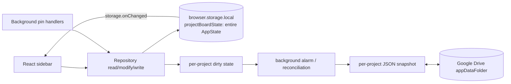

# Pboard collaboration and storage evaluation

Research date: 2026-09-28. Scope: architecture review and an isolated RxDB experiment; **no production migration**. “Documented” below means the linked official documentation describes the feature. “Possible” means pboard would need to design and test it. Library behavior, licensing, quotas, and extension compatibility must be rechecked before adoption.

## Executive summary

Keep the current storage and Drive sync for the shipped single-user product while preparing a narrower repository boundary and a separate blob store. The current all-state write and whole-project Drive snapshot are simple, responsive for current boards, and poor foundations for concurrent collaboration. No candidate supplies pboard's owner-controlled ACL, peer revocation, image transfer, and conflict semantics together.

**RxDB + free Dexie/IndexedDB is the best first browser-storage experiment**, because it gives one-document card writes, live queries, an open-source replication engine, and a documented WebRTC plugin. Its premium direct IndexedDB storage is *not* needed to try it. However, RxDB's default replication conflict handler can discard the fork, its CRDT plugin uses JSON update operators rather than collaborative character-level text, its Google Drive plugin is explicitly beta and targets a single user's account, and WebRTC attachment replication is not documented specifically. Do not select RxDB/WebRTC/Drive as the collaboration design until those points are tested. [RxDB storage](https://rxdb.info/rx-storage.html), [CRDT](https://rxdb.info/crdt.html), [Drive plugin](https://rxdb.info/replication-google-drive.html), [WebRTC](https://rxdb.info/replication-webrtc.html).

**Automerge is the strongest fit if concurrent editing of the same card text is a core product requirement.** Its CRDT merge and IndexedDB Repo storage are documented, but WebRTC, blobs, ACL, indexing and migration would be pboard's responsibility. Start with one project document containing metadata and card map, with images external, then measure real project sizes. [Text](https://automerge.org/docs/reference/documents/text/), [Repo storage](https://automerge.org/docs/reference/repositories/storage/), [modeling guidance](https://automerge.org/docs/cookbook/modeling-data/).

**Triplit is viable for local-only use but its documented collaboration path is client/server.** Choosing it for collaboration would imply running its sync server or building a new transport. Its AGPL-3.0 license also deserves a deliberate legal decision before combining it with a GPLv3 client and a commercial hosted service. [Offline/local-only docs](https://raw.githubusercontent.com/aspen-cloud/triplit/main/packages/docs/src/pages/offline-mode.mdx), [project README and license](https://github.com/aspen-cloud/triplit).

The isolated RxDB 17.5.0 experiment used fake IndexedDB under Node. It verified CRUD, ten 128 KiB Blob attachments, close/reopen, and live query emissions at 100/1,000/5,000 cards. It is **not a Firefox or Chromium disk benchmark**. Its 5,000-card all-cards query took about 54 seconds on reopen; that is a strong reason to test indexed, bounded queries in real browsers before any migration decision.

## 1. Current architecture and product requirements

The exact local source of truth is `projectBoardState`, one `AppState` object with `version: 3`, `projects[]`, `boardItems[]`, and `currentProjectId` ([repository](../src/storage/repository.ts), [types](../src/types/index.ts)). `load()` reads that single key and normalizes legacy template, revision, timestamps, and card display mode. Every mutating repository operation reads the whole state and writes the whole state back through `storage.set({projectBoardState: state})`. `selectProject` and `reorderProjects` do so too. There is no per-card storage, operation log, local transaction journal, or incremental React selector. Drive auth, each project's sync state (`pboardDriveProject:<id>`), and a shared tombstone map are separate `browser.storage.local` keys ([sync state](../src/sync/state.ts)).

`withStorageLock` uses `navigator.locks` when present; otherwise it queues promises in a `WeakMap` scoped to the current JS realm ([lock](../src/storage/lock.ts)). The fallback does **not** coordinate sidebar and background contexts or multiple devices. The local lock only serializes participating operations and is not a distributed conflict protocol. On each `projectBoardState` storage event, React calls `repository.load()` and replaces its `AppState`; most sidebar mutations also call `reload()` explicitly ([App](../src/sidebar/App.tsx)). This can produce duplicate full reads/renders. React then filters and sorts cards in memory by numeric `order`.

Projects carry UUID, name, template, integer `revision`, `createdAt`, and monotonic local `updatedAt`. Cards carry UUID, project ID, type, status, optional display mode/title/source/image, text content, integer `order`, and timestamps. A card edit touches the parent project revision and timestamp. There is no card revision, actor ID, vector clock, or causal change ID. `reorderItems` takes a full ID permutation and rewrites every card's index and `updatedAt`, then saves the whole state. Insert/delete/merge also shift or normalize indices. `trash` is a card status and can be restored by another status update; `deleteItem`, `emptyTrash`, and `deleteProject` physically remove local records. Only *project deletion* gets a Drive tombstone; there are no replicated card tombstones.

Drive sync is opt-in. A repository change marks a project dirty with an incrementing local change token; an alarm schedules an idle sync after 25 seconds, and reconciliation also runs at startup/sidebar load ([background sync](../src/sync/background.ts)). A Drive file named `project-<id>.pboard` in the private app-data folder contains JSON `format: pboard-project`, version 1, project metadata and **all cards including inline images** ([snapshot](../src/sync/snapshot.ts), [transport](../src/sync/driveTransport.ts)). Upload is full-file create/PATCH. The `changeToken` prevents an in-flight upload from falsely marking newer local work clean. It is not a cross-device version vector. Reconciliation compares project `updatedAt`; the newer timestamp's **entire project** replaces the older, equal timestamps are treated as equal, and there is no field/card merge or conflict UI ([provider](../src/sync/googleDriveProvider.ts)). Clock skew and concurrent edits can therefore lose one side's changes. A local project-delete tombstone blocks reimport and drives eventual remote deletion for that installation; it does not establish owner-authoritative deletion across independent collaborators. The Drive app-data location is not a shared project workspace.

Images are first-class `BoardImage {dataUrl,mimeType,width,height}` values inline in cards and thus in both whole local state and whole Drive snapshots. Dropped images have a 20 MiB input limit; dropped and captured images are scaled to a maximum 1,400-pixel edge and encoded as WebP quality 0.82 ([processing](../src/images/processing.ts)). They are not stored as separate `Blob`s or deduplicated. Base64 adds roughly 33% bytes before JSON and browser storage overhead. Duplicating an image card copies its image value into another card. Image merge is blocked.

Approximate local write amplification for a project state serialized size **S** and project snapshot size **P** (these are formulas, not measured disk writes):

| Action | Repository read/write | Additional effect |
|---|---|---|
| Edit text or status | read S, write S; touch project | full P upload on next Drive sync |
| Move one card | read S, update many order fields, write S | full P upload; conflict surface is whole project |
| Add screenshot of encoded size B | read S, write about S+B | full P+B snapshot; subsequent unrelated edits keep rewriting B |
| Select project | read S, write S | no project dirty mark, but all-state storage event |

The dominant current constraints are offline immediacy, Firefox-first WebExtension support, Chromium side panel/MV3 service-worker lifetime, images, no mandatory pboard data service, optional Drive, and GPLv3-compatible distribution. Future replicas should keep normal writes local and durable before network work. [Firefox extension storage](https://developer.mozilla.org/en-US/docs/Mozilla/Add-ons/WebExtensions/API/storage), [Chrome extension IndexedDB/service workers](https://developer.chrome.com/docs/extensions/develop/concepts/storage-and-cookies).

## 2. Concurrency-sensitive operations

The following are **pboard policy recommendations**, not automatic promises of a library. LWW means last-write-wins on a field or operation using a defined deterministic clock/tie-breaker, not whole-project timestamp replacement.

| Operation | Reasonable policy | Why/guard |
|---|---|---|
| Edit different cards | per-card documents or CRDT map | independent changes should both survive |
| Edit same card content | text CRDT if simultaneous typing is required; otherwise explicit conflict copy/resolution | whole-string LWW loses work; RxDB JSON `$set` is not character-level text |
| Title edits | field-level LWW with visible history/conflict copy | lower volume than body text, but preserve recoverability |
| Status changes | field-level LWW or validated transition operation | concurrent Done vs Rejected needs deterministic and inspectable outcome |
| Card movement/reorder | stable rank key plus deterministic tie-breaker; or true sequence CRDT | integer renumbering rewrites many cards and conflicts heavily |
| Merge cards | explicit atomic operation/owner validation or user conflict resolution | combines two contents and deletes source; conflicts with edits/moves/deletes |
| Duplicate card | new UUID operation | concurrent duplicates are separate cards; image reference needs refcount/GC |
| Delete vs edit | soft delete/tombstone with retained history and explicit restore policy | physical delete loses causality; decide whether later edit resurrects |
| Trash/restore | status transition with actor/time and explicit restore | current trash is reversible; empty-trash is destructive |
| Project rename | field-level LWW with history | easy to merge separately from cards |
| Project deletion | owner-authoritative signed tombstone; delayed physical GC | irreversible intent must dominate stale replicas without losing audit |
| Template change | owner-authoritative migration operation | current implementation remaps unsupported types; concurrent edits need versioned rule |
| Image creation/deletion | immutable blob ID + metadata operation; delayed GC | binary does not text-merge, missing blob must be retriable |
| Membership/permissions | owner-authoritative signed versioned ACL; server validation if strong enforcement required | cannot trust a client-side role flag |
| Other project metadata | field-level merge for independent fields; owner validation for policy fields | avoid whole-project overwrite |

**Ordering:** integer indices are suitable locally, poor under concurrent moves. Fractional/LexoRank-like string keys let one move update one card, but two peers can choose the same gap: include a stable actor/card tie-breaker, define rebalance, and test move-vs-move of the *same* card. Numeric floats are unsafe after repeated midpoint insertion. A CRDT sequence preserves concurrent insertion semantics, but moving an existing item may be represented as delete+insert and needs a stable card-ID policy; Automerge documents explicitly distinguish fine-grained list edits from replacing a whole list. For pboard's card map, start with rank keys and `(rank, cardId)` order, with a bounded rebalance operation; compare against an Automerge sequence in a real concurrency test. [Fractional indexing implementation and collision guidance](https://github.com/rocicorp/fractional-indexing), [Automerge lists](https://automerge.org/docs/reference/documents/lists/), [Automerge merge rules](https://automerge.org/docs/reference/under-the-hood/merge-rules/).

## 3. Candidate comparison: supplied versus custom

| Property | Current + operation log | RxDB + free Dexie | Automerge Repo | Triplit |
|---|---|---|---|---|
| Local durable writes | current `browser.storage.local`; log custom | documented Dexie-backed IndexedDB | documented Repo IndexedDB adapter | documented IndexedDB option; default is memory |
| Reactive UI | storage event/full reload; granular selectors custom | native observable queries | document-handle change events/React bindings | native subscriptions/React hooks |
| Offline | native current behavior | native local DB | native local documents | native if IndexedDB configured |
| Conflict unit | project snapshot today; log semantics custom | document-level, configurable conflict handler; optional JSON-operator CRDT | CRDT document/map/list/text | property-level CRDT sync with server |
| Same-card text | custom | custom text CRDT/integration or conflict UI | native text splices if UI emits fine-grained edits | no documented character-level editor CRDT |
| Concurrent order | custom | custom rank/sequence model | CRDT list possible; move semantics still design work | custom rank/sequence model |
| P2P/WebRTC | fully custom | documented WebRTC plugin + required signaling | no official built-in WebRTC adapter found; custom/community | no documented P2P path found |
| Server needed for collaboration | signaling/TURN possibly; no central data service | signaling/TURN possibly; no central data service | custom WebRTC or WebSocket relay | Triplit sync server in documented path |
| Owner offline | peers with data may continue locally; sync when connected | yes, local peers continue; disconnected peers need rendezvous/store-forward | yes, loaded docs continue locally | clients continue locally; server needed to exchange new updates |
| Authorization | entirely custom | custom for P2P; peer validation is not write ACL | custom; Repo sharing policy is not full ACL | server-enforced rules documented |
| Images | current inline base64 | native Blob attachments locally; Drive plugin documents replication; WebRTC attachment path unverified | external blob store advised | external blob service likely needed; no official attachment path verified |
| Schema/storage migration | custom | documented schema and storage migration tooling | app-level schema evolution; history semantics | schema tooling and server deployment path |
| Backup/export | current project JSON/Drive | JSON export/backup plugins | binary document saves plus custom blob manifest | custom export and image package |
| Relative cost/risk | little local migration; high replication engineering | moderate data migration; plugin-specific gaps and bundle/query cost | high model/UI migration; strong merge quality | server and AGPL operational commitment |

Native/browser compatibility means IndexedDB and WebRTC exist in Firefox and Chromium extension pages. **No full extension smoke test was performed for these libraries**. Chromium MV3 service workers can be suspended, so a permanent network session should live in an extension page/offscreen document or reconnect cleanly. Firefox background and Chromium service-worker behavior must be tested separately. [Chrome extension storage contexts](https://developer.chrome.com/docs/extensions/develop/concepts/storage-and-cookies), [Firefox background contexts](https://developer.mozilla.org/en-US/docs/Mozilla/Add-ons/WebExtensions/Background_scripts).

### Current architecture evolved

The repository API and Drive code are already small and understandable. A durable operation log could make local writes incremental and feed both Drive and peers. But pboard would own log format/versioning, replay, checkpoints, tombstones, identity, deduplication, field/text/order merges, blob transport, GC, and recovery from partial/corrupt logs. Adding only an op log while retaining an all-state projection write would **not** remove current write amplification. This path is credible if collaboration stays light and implementation control is more important than delivery speed; it is the highest protocol-maintenance burden.

### Triplit

Official Triplit docs say `TriplitClient` defaults to **memory** and accepts `storage: 'indexeddb'`; it caches IndexedDB data in memory by default. Local-only mode works with no server URL/token or `autoConnect: false`, and persisted outbox changes can later sync. Its normal collaboration path uses a sync server, websocket connection, query-based partial replication, optimistic updates, server-side authorization, and automatic reconnect. That provides good UI latency and offline editing, including while the owner is offline **if the server remains online**. It does not satisfy “no central data service” in its documented sync architecture. WebRTC/P2P, Drive replication, binary attachment replication, and extension-specific support were not found in official docs and should be treated as custom/unverified. [Storage](https://raw.githubusercontent.com/aspen-cloud/triplit/main/packages/docs/src/pages/client/storage.mdx), [offline/local-only](https://raw.githubusercontent.com/aspen-cloud/triplit/main/packages/docs/src/pages/offline-mode.mdx), [sync engine](https://raw.githubusercontent.com/aspen-cloud/triplit/main/packages/docs/src/pages/client/sync-engine.mdx), [project overview](https://github.com/aspen-cloud/triplit).

The project repository identifies AGPL-3.0, with current source and a maintained monorepo visible on GitHub. AGPLv3 and GPLv3 can be combined under their specific compatibility provisions, but AGPL network-source obligations may affect a modified hosted sync server; a commercial *service* is possible under open-source licenses, yet client/server distribution and any proprietary additions need legal review. This is an architectural license constraint, not a legal conclusion. [Triplit license](https://github.com/aspen-cloud/triplit/blob/main/LICENSE), [FSF GPLv3/AGPL compatibility](https://www.gnu.org/licenses/license-compatibility.en.html).

### RxDB

For pboard, use **free `getRxStorageDexie()` over IndexedDB** first. RxDB's faster direct IndexedDB and OPFS storages are premium; the core, Dexie storage, replication, WebRTC and CRDT plugin are documented in the open-source tier. The free tier currently advertises up to 13 open collections. The core is Apache-2.0, compatible with a GPLv3 client; premium plugins have separate paid terms and should not be assumed GPL-distributable. Official docs recommend Dexie or premium IndexedDB for larger browser data, and the direct premium backend claims lower latency/smaller build. The tested npm package was 17.5.0; its changelog records active releases in 2026. [Storage guide](https://rxdb.info/rx-storage.html), [Dexie](https://rxdb.info/rx-storage-dexie.html), [premium matrix](https://rxdb.info/premium/), [changelog](https://github.com/pubkey/rxdb/blob/master/CHANGELOG.md).

RxDB writes locally and exposes observable queries. Its standard replication protocol supports checkpoints, `_deleted` tombstones, attachment payloads in the generic engine, and custom document conflict handlers; **the default conflict handler drops the fork/client version in favor of the master**. The CRDT plugin stores JSON update operators in each document and deterministically replays them; it is useful for counters/sets/field patches but is not a substitute for a collaborative text editor. It disallows arbitrary non-CRDT writes once enabled. A pboard RxDB design could make the owner an ACL authority and peers durable replicas, with no owner database in the data path, **but pboard must implement signed/validated ACL and safe conflict policies**. [Replication](https://rxdb.info/replication.html), [CRDT](https://rxdb.info/crdt.html), [conflicts](https://rxdb.info/transactions-conflicts-revisions.html).

RxDB attachments store `Blob`s separately from ordinary document fields; query/write performance need not carry each image inline. Deleting a document removes its attachments. The generic sync engine supports attachment data but explicitly warns that **not all replication plugins do**. The Google Drive plugin *does* document attachments: base64 in a separate `_attachments_data` field of each document JSON file. The WebRTC plugin's official page does **not** document attachment handling, and this investigation did not demonstrate it, so do not count on WebRTC image replication yet. [Attachments](https://rxdb.info/rx-attachment.html), [generic replication](https://rxdb.info/replication.html), [Drive attachments](https://rxdb.info/replication-google-drive.html), [WebRTC page](https://rxdb.info/replication-webrtc.html).

The RxDB Google Drive plugin is explicitly **beta since v17** and may change without a major release; it is not a production-recommended collaboration foundation yet. It maps **one RxDB document to one JSON file** under the user's app-data folder, checkpoints from Drive `modifiedTime`, uses transaction-file locking/retry, and relies on normal RxDB conflict handling. Its WebRTC channel carries **RESYNC notifications**, while Drive remains the document data store; signal files in Drive provide rendezvous, and Drive has no native realtime file-change stream. The docs describe cross-device use by the **same Google account**, not independent collaborator ACLs. Shared project membership and per-user Drive credentials are not solved. More files and polling imply more Drive API use than pboard's current per-project snapshot; quotas are measured in units per method and can change. [Drive plugin](https://rxdb.info/replication-google-drive.html), [Google quota and method costs](https://developers.google.com/workspace/drive/api/guides/limits).

The separate RxDB WebRTC plugin sends document replication over data channels after signaling. RxDB requires a signaling server, warns its public demo signaling server is unsuitable for production, and exposes `isPeerValid` to reject a peer at connection time. Peer validation is **not document-level authorization** and a modified peer can still send forbidden document changes unless pboard verifies operations. Peers can keep writing locally while another peer is offline, but delivery waits for reconnection or a durable store-forward path. Inspection of the installed 17.5.0 handler found that it recreates a closed signaling WebSocket and forwards a `config` object to `simple-peer` (the plausible path for ICE/TURN servers); the package also has a replication `retryTime` option. **TURN and reconnect behavior were not exercised**, and the official page documents neither TURN parameters nor attachment guarantees. The official docs additionally say browser builds need a `process.nextTick` polyfill for `simple-peer`, an extension-bundle integration detail. [WebRTC docs](https://rxdb.info/replication-webrtc.html), [handler source](https://github.com/pubkey/rxdb/blob/master/src/plugins/replication-webrtc/connection-handler-simple-peer.ts).

RxDB has documented schema migrations, storage migrations, JSON import/export, and backup tools. They reduce plumbing but do not migrate pboard's current `AppState` automatically or define pboard's semantic conflict rules. Document-per-card storage scales better for point writes than the current single key, but full live queries still cost memory and read time; measure query shape and bundle in real extensions. [Schema migration](https://rxdb.info/migration-schema.html), [storage migration](https://rxdb.info/migration-storage.html), [JSON export](https://rxdb.info/json-import-export.html).

### Automerge

Automerge's `Repo` coordinates document handles, persistence and network adapters. The official IndexedDB adapter persists in browsers; WebSocket, MessageChannel and BroadcastChannel network adapters are documented. No official WebRTC adapter was found in those docs or the Repo package list; P2P over WebRTC is plausible with a custom/community adapter, signaling and ICE/TURN work. The example public sync server is for experiments, not a production dependency to assume. Its core and Repo are MIT-licensed, suitable for a GPLv3 client subject to normal notices; active 2026 releases are visible. [Repo](https://automerge.org/docs/reference/repositories/), [storage](https://automerge.org/docs/reference/repositories/storage/), [networking](https://automerge.org/docs/reference/repositories/networking/), [license](https://github.com/automerge/automerge), [Repo license](https://github.com/automerge/automerge-repo).

One project = one Automerge document is a plausible first model: project metadata, a map of card IDs to card fields, and a list or rank map of card positions. Fine-grained edits to different cards/fields merge; `Automerge.splice` supports concurrent character-level text edits; lists merge insert/delete operations. Replacing the whole cards array or assigning a whole text string defeats much of that value. The current React text editor and repository methods would need to emit fine-grained changes, and merge/delete/template policies still need pboard rules. The official modeling guide says hundreds of documents have been prototyped, cautions that workload determines performance, and notes that documents retain full change history. Repo compacts *storage records* into snapshots, but this is not wholesale deletion of CRDT history; do not promise bounded document growth. One large project document also forces broad load/sync/query scope; card-per-document improves granularity but complicates project consistency and discovery. Benchmark both. [Text](https://automerge.org/docs/reference/documents/text/), [lists](https://automerge.org/docs/reference/documents/lists/), [modeling/performance](https://automerge.org/docs/cookbook/modeling-data/), [Repo compaction](https://automerge.org/docs/reference/under-the-hood/storage/).

Automerge supports byte arrays as values, but placing large screenshots inside project CRDT history is a poor fit: immutable image bytes would be carried with document history and transfer. **Project metadata + cards in Automerge, images in a separate content-addressed IndexedDB Blob store** is cleaner for pboard. A blob manifest/availability protocol, P2P transfer, Drive backup and GC are custom. Repo share policy controls sharing behavior, not strong authorization against modified clients; it currently marks some sharing configuration experimental. Schema evolution and binary document backup are application work, though Automerge's format and sync protocol are transport agnostic. [Document types](https://automerge.org/docs/reference/documents/), [Repo sharing API](https://github.com/automerge/automerge-repo/blob/main/packages/automerge-repo/src/Repo.ts).

## 4. Images and attachments

Recommended target **for a future experiment, not a migration now**: keep card metadata and an immutable `imageId`/hash in the chosen document model; store original processed WebP as an IndexedDB `Blob` in a separate blob store, plus a small thumbnail and metadata record. IndexedDB supports Blob values. Derive a content hash to deduplicate copied screenshots; use explicit refcounts or mark-and-sweep only after replica acknowledgement/retention window. Export/import must include a manifest, hashes, files, metadata and integrity checks. Drive can back up blobs as separate files, but appDataFolder is not automatically a collaborator-shared transport. [IndexedDB structured values](https://github.com/w3c/IndexedDB/blob/main/index.bs), [RxDB attachments](https://rxdb.info/rx-attachment.html).

| Image choice | Assessment for pboard |
|---|---|
| A. RxDB attachments | Good local ergonomics; tied to card lifecycle. Drive plugin documents transfer. WebRTC transfer remains unverified; duplicated cards/backup may duplicate binary. |
| B. Separate blob collection | Metadata/indexing convenient, but verify actual binary storage and plugin replication; avoid base64 in ordinary query documents. |
| C. IndexedDB Blob by content ID | Most transport-neutral and easy to pair with RxDB or Automerge; pboard owns P2P/Drive transfer, GC, export and availability. **Preferred research target.** |
| D. External Drive files | Useful asynchronous backup/store-forward; not an offline local source and adds OAuth/quota/sharing constraints. |
| E. Inline CRDT/base64 | Simple serialization but repeats binary in state, sync and history. Avoid for future collaboration. |

The current 1,400-pixel maximum bounds image dimensions, not encoded byte size after processing; actual screenshots vary widely. Record size histograms on non-sensitive synthetic/test data, enforce a post-encode cap, and test 10/100/1,000 images. P2P transfer should chunk blobs, apply backpressure, verify hashes, resume partial transfers, and offer Drive/relay fallback. An image card may arrive before its blob; render a recoverable pending state. Do not garbage-collect a blob merely because one replica deleted the last local reference.

## 5. WebRTC, infrastructure, and owner authority

**No central data service** means peer documents normally flow directly. It does *not* mean **no backend at all**. WebRTC peers still need rendezvous/signaling to exchange offers and ICE candidates. STUN helps discover usable addresses; restrictive NAT/firewalls may require a TURN relay, which carries the actual data and has bandwidth/privacy cost. Without connected peers or a durable mailbox, an offline collaborator cannot receive others' new work; local editing continues, then converges later. Drive can provide asynchronous store-and-forward if all parties have a workable authorization/sharing model. Distinguish signaling, ICE/STUN, TURN, durable persistence, document synchronization and ACL as separate services. [RxDB signaling requirement](https://rxdb.info/replication-webrtc.html), [MDN connectivity](https://developer.mozilla.org/en-US/docs/Web/API/WebRTC_API/Connectivity), [MDN protocols](https://developer.mozilla.org/en-US/docs/Web/API/WebRTC_API/Protocols), [WebRTC data-channel encryption](https://developer.mozilla.org/en-US/docs/Web/API/WebRTC_API/Using_data_channels).

The proposed model—each peer a durable replica, owner controls membership, owner need not be online for edits—is sound as a *collaboration* goal. It is not strong authorization by itself. Cryptographic identities and signatures can authenticate who authored an operation; owner-signed, versioned ACL documents can define who was permitted at a given epoch; every honest replica can reject invalid signatures/roles and keep an audit trail. But an open-source client can be modified to ignore UI rules, leak data already received, replay stale operations, or propose unauthorized writes. A malicious peer can inject changes unless receiving peers validate **every operation and ACL epoch**, not just the transport connection. Signed operations help integrity and attribution, not secrecy or forced deletion. Offline revocation takes effect only when a peer learns it; previously shared data cannot be clawed back. Owner deletion can be represented by a signed tombstone and prevented from resurrecting on honest replicas; it cannot erase hostile replicas or all offline copies.

For **strong centralized enforcement**, a trusted server/relay must authenticate clients, validate writes and membership on receipt, and control access to stored data; it may be a thin authorization/replication service rather than the sole authoritative database. End-to-end encryption can keep that server from reading content, but enforcing semantic card edits without seeing plaintext then needs signed operation validation and key/epoch management. A pure peer design can achieve convergence among honest validators and owner control over admission; it cannot guarantee timely revocation or prevent copying by former members. Triplit explicitly provides server-enforced authorization in its documented model; RxDB/Automerge do not supply pboard-specific ACL. [Triplit project overview](https://github.com/aspen-cloud/triplit), [RxDB peer validation](https://rxdb.info/replication-webrtc.html), [Automerge Repo sharing API](https://github.com/automerge/automerge-repo/blob/main/packages/automerge-repo/src/Repo.ts).

## 6. Isolated performance proof of concept

Files: [`experiments/collaboration/rxdb-bench.mjs`](../experiments/collaboration/rxdb-bench.mjs), local package and README. Installed `rxdb@17.5.0`, `dexie@4.4.6`, `fake-indexeddb@6.2.5` **only in that subdirectory**; root dependencies, production code, and user data are unchanged. It makes one project ID, N card documents with an indexed `(projectId, orderKey)`, ten 128 KiB WebP-typed Blob attachments, a live all-project sorted query, then edit/status/reorder one card, read the query, close/reopen, and reload the project. Reorder changes one rank key, unlike today's full-index renumbering. Reactive query emitted four times (initial + three writes). Attachment read returned a usable 131,072-byte Blob. Reopen retained all cards in the same in-process fake IndexedDB. No WebRTC peer or actual Drive call was made.

| Cards | DB open | Bulk insert | 10 attachments | Edit text with live query | Status | One-card rank move | Reopen | Reload all cards | RSS before→after |
|---:|---:|---:|---:|---:|---:|---:|---:|---:|---:|
| 100 | 24 ms | 8 ms | 20 ms | 35 ms | 1 ms | 1 ms | 2 ms | 26 ms | 83→104 MiB |
| 1,000 | 3 ms | 76 ms | 26 ms | 2,117 ms | 3 ms | 3 ms | 2 ms | 2,097 ms | 104→114 MiB |
| 5,000 | 2 ms | 457 ms | 102 ms | 54,831 ms | 17 ms | 12 ms | 2 ms | 54,272 ms | 115→163 MiB |

Logical payloads: 10 × 128 KiB = 1.25 MiB of attachments per run; plain initial card JSON was about 20 KiB, 207 KiB, and 1.04 MiB respectively. **Actual IndexedDB disk bytes were not measured** because `fake-indexeddb` is in-memory; package install occupied about 70 MiB, which is *not* a browser bundle-size measurement. RSS deltas include Node, RxDB caches and the emulator, and the three cases ran sequentially in one process. The 1,000/5,000 edit time includes work triggered by a broad live query; the reload time includes emulator query/index behavior. These results expose a risk in query shape and test harness scaling, not a finding that RxDB is too slow in real browsers. A real extension benchmark must measure cold open, bounded/virtualized query, one-card write, image throughput, on-disk quota, heap and built asset size in Firefox and Chromium. [RxDB Dexie storage](https://rxdb.info/rx-storage-dexie.html).

WebRTC two-peer tests were not run. They require a real browser harness, signaling and network conditions, and the attachment path is not documented for that plugin. The next test matrix must cover card create/update, image arrival and retrieval, different-card offline edits, same-card conflict, delete-vs-edit, owner-offline work, reconnect/convergence, and simultaneous moves. If WebRTC attachments fail, report that before designing a transfer workaround.

**Production validation:** `npm run check` was run after the investigation. Type-checking passed; Vitest reported 152 passing tests and one existing release-metadata failure. `tests/releaseMetadata.test.ts` and both browser manifests expect `0.9.1`, while `package.json` and the root lockfile declare `0.9.2`. The investigation did not change any of those files. Release metadata should be reconciled separately, then the suite rerun.

## 7. Concrete architecture options

| Option | Responsiveness / offline | Collaboration and infrastructure | Security, migration, likely failure |
|---|---|---|---|
| **1. Current local + custom op log + Drive + WebRTC** | Potentially excellent if local append/projection is incremental; current full-state write remains until redesigned | Maximum freedom; requires custom signaling/TURN, log and merge protocol, Drive mailbox | Largest protocol/maintenance burden; easy to lose changes through replay, compaction or ordering bugs; smallest UI migration |
| **2. RxDB + WebRTC + RxDB Google Drive plugin** | Local writes and reactive queries; offline replicas | No central pboard DB, but signaling/TURN; Drive beta plugin is same-account oriented, not a shared ACL solution | Moderate local migration, high integration risk; WebRTC attachments unverified; Drive quota/latency and conflicting plugin assumptions |
| **3. RxDB + custom pboard relay/cloud later** | Same local behavior; relay asynchronous | Server can persist offline-peer changes and enforce ACL without being sole local source | More infrastructure, but clearest production authorization and attachment transfer; moderate migration and service cost |
| **4. Automerge project docs + IndexedDB + custom WebRTC + separate blobs + Drive** | Strong local/offline semantics and same-card text merge | No mandatory central DB; custom WebRTC/signaling/TURN, blob and Drive protocol | Higher model/editor migration; CRDT history, document size and authorization require explicit design; likely best collaboration semantics |
| **5. Triplit + sync server** | Optimistic local cache with durable IndexedDB option | Excellent documented client/server realtime; central sync service and server uptime needed for exchange | Simpler server-validated ACL, but server operations, AGPL review, external blob path and server architecture commitment |

The safest decision today is **not to replace the production repository**. Prioritize a design experiment comparing RxDB document-level sync against Automerge fine-grained text/ordering, with separate image transfer and an explicit authority protocol. If same-card live text collaboration is not a product priority, RxDB + a small trusted relay may be easier to maintain than custom WebRTC plus beta Drive replication. If the strongest requirement is no central data service, Automerge or RxDB P2P can satisfy the data path, but signaling/TURN and delayed offline-peer delivery remain.

## 8. Migration impact and staged path (proposal only)

The existing `createRepository` methods offer useful command names, but the interface is **not sufficient to hide a migration by itself**: `load()` exposes the full `AppState`, sidebar derives views from it, and consumers expect `browser.storage.onChanged` full reloads. It needs an explicit adapter for project/card queries and change subscriptions; otherwise a new DB merely feeds a whole-state projection and loses its performance benefit.

| Module | Likely impact |
|---|---|
| `src/types`, templates, card rendering, image crop/processing, background capture/pin commands | mostly unchanged at product level; data types gain image ID/actor/version fields |
| `src/sidebar/App.tsx`, card edit/status/reorder hooks, `src/sidebar/serialize.ts` | adapt to reactive project/card queries and async image availability; avoid full `AppState` reloads |
| `src/storage/repository.ts`, `src/storage/browser.ts`, `src/storage/lock.ts` | formal interface then alternate implementation; old implementation retained through verification |
| `src/sync/state.ts`, `snapshot.ts`, `googleDriveProvider.ts`, `driveTransport.ts` | retain during local migration; later adapt to new export/replication protocol or keep as backup |
| `src/images/processing.ts`, `src/sidebar/components/Card.tsx` | processing mostly unchanged; storage/rendering changes from data URL to image ID/Blob URL |
| `src/background/*` | pin/capture entry points stay, repository access and service-worker reconnection may change |

1. **Phase 0:** establish real-browser baseline: board size, write latency, quota, cold open, image distribution, regression fixtures. Define acceptance limits for immediate UI response.
2. **Phase 1:** define a repository interface for commands, per-project/card reads, subscriptions, image retrieval, and deterministic export; retain the current adapter.
3. **Phase 2:** build new local storage behind an experimental flag, isolated namespace, no sync. Benchmark in Firefox/Chromium extension contexts.
4. **Phase 3:** one-way, checksummed import of current `AppState` and inline images into new local storage; preserve original key and Drive snapshots as rollback data.
5. **Phase 4:** dual verification (read old/new, compare IDs/fields/images/order; writes only to one active source), offline/restart/crash tests and reversible switch.
6. **Phase 5:** change default only after latency/data-integrity gates; retain recovery/export.
7. **Phase 6:** add replication, owner/ACL validation, image transfer, and failure-state UI separately. Never infer that local migration validates collaboration.

## 9. Recommended next experiments and open questions

1. Real Firefox and Chromium extension POC for RxDB free Dexie: 100/1,000/5,000 cards, 10/100 images, cold/warm open, broad versus bounded queries, asset bundle, actual IndexedDB size and MV3 suspension/reconnect. Keep all code under `experiments/`.
2. Two-peer RxDB WebRTC test with self-hosted local signaling and explicit attachment round trip. Repeat behind TURN/restrictive NAT. Record `isPeerValid` behavior and conflict handler outcomes for the full matrix above.
3. Automerge project document POC: 100/1,000/5,000 cards, fine-grained text edits, concurrent moves, merge/delete policies, save size after 1,000 edits, and independent blob store. Compare one-project-doc versus card-doc granularity.
4. Decide product semantics before picking sync: Is same-card character-level collaboration essential? Can collaborators share a hosted authorization service? Must owner revocation work immediately? Are Drive accounts shared or separate? What is the minimum acceptable image-delivery delay?
5. Review GPLv3/AGPL and any premium plugin terms with counsel before a distribution or hosted-service commitment. Confirm WebExtension permissions, CSP/WASM packaging, and browser quota behavior in target releases.

Unresolved risks: WebRTC attachment support; concurrent rank moves and rank rebalance; Drive plugin beta and same-account model; clock/causality of current snapshots; malicious peer validation; revocation while offline; delete/GC correctness; extension background lifetime; actual browser performance and bundle size. No recommendation here treats “P2P” as infrastructure-free or “owner authority” as “owner database is the sole source of truth.”
