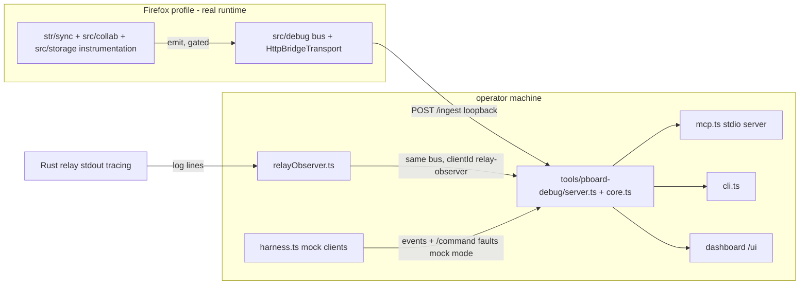

# Architecture

## Components

| Part | File(s) | Role |
|---|---|---|
| Event schema | `src/debug/schema.ts` | single source of truth: components, event-name registry, identity fields, validation, limits, redaction pattern, filters, `TraceView`. Import-free and erasable-TS so Node can run it directly. |
| Bus | `src/debug/bus.ts` | per-context queue (default bound 2 000), batcher (64 events / 250 ms flush), sanitisation + key-pattern redaction, overflow drop accounting, transport failure cooldown (30 s). Disabled by default: `emit` is a boolean test. |
| Transport | `src/debug/bridgeTransport.ts` | batched `POST /ingest` to the bridge (loopback enforced by `isSafeBridgeEndpoint`; token as query param; `keepalive` lets a batch finish during worker teardown). Also the pull-model poll (`/inspect/request` → answer via `/inspect/respond`). |
| Context wiring | `src/debug/browser.ts` | enablement policy (storage setting `pboardDebugBridge`, DEV / `__PBOARD_DIAGNOSTICS__` build flag), stable `clientId`/`sessionId` resolution (`ids.ts`), `pboardDebug` console handle. |
| Inspection | `src/debug/inspect.ts`, `stateSnapshot.ts`, `stateInspection.ts` | controlled read-only board/connection projections; composed in `src/background/index.ts` and `src/sidebar/main.tsx` with `roomViewSource` fed from `roomSnapshots()` and `transportSnapshot()`. |
| Bridge core | `tools/pboard-debug/core.ts` | 20 000-event ring with dense `bridgeSeq` stamps; client/session registry; connection ledger + findings (duplicate/orphan); trace correlation; captures; envelope-identity stamping; mock-mode fault queue. |
| Bridge server | `tools/pboard-debug/server.ts` | loopback HTTP + `/events/subscribe` WebSocket; token auth; restricted CORS (origin echo incl. `moz-extension:`/`chrome-extension:`, never wildcard, preflights refused); mode gate (`mock` / `local` / `production-observer`). |
| MCP server | `tools/pboard-debug/mcp.ts` | 23 read-only-by-default tools over the bridge (see [mcp-tools.md](mcp-tools.md)). |
| Harness | `tools/pboard-debug/harness.ts` | six mock-mode scenarios driving a mini sync runtime through the real bus; consumes faults via `/fault/poll` and emits `harness.fault.injected`; records a capture per run. |
| Observer | `tools/pboard-debug/relayObserver.ts` | Rust relay tracing lines → `relay.*` events (whitelist parser; unknown lines counted and dropped, never silently trusted). |
| Operator UI | `dashboard.html` (served at `/ui`), `cli.ts` | live table / five one-call reads. |
| E2E | `firefox-e2e.mjs`, `firefox-e2e-probe.ts` | real Firefox ×2 + real Rust relay; acceptance A–E (see [firefox-debugging.md](firefox-debugging.md)). |

## Browser composition

`configureDebugForContext(context)` runs at the top level of both
`src/background/index.ts` and `src/sidebar/main.tsx` — before anything can
dial, because a socket created before configuration would be invisible to the
ledger. It reads the storage setting once; when disabled it resolves without
creating a transport and every later `emit` pays one boolean check. The
sidebar registers state inspection with the real room snapshots (rooms live
in the sidebar runtime); the background registers its own view. This is the
only permanent cost of the feature in a disabled production build: one storage
read at boot.

## Dataflow invariants

- **Producers never block.** `emit` enqueues (bounded) or drops with
  accounting (`debugDropReport()`); the batcher POSTs fire-and-forget; a
  failed POST drops the batch and trips the transport cooldown. A dead bridge
  must never slow or fail the app.
- **Events never change behaviour.** Every emit site is wrapped by the gated
  helpers: `trackTransportSocket` attaches only observers (`{once:true}`
  listeners; a non-DOM socket double that lacks `addEventListener` simply
  never fires); `emitBridgeFrame` reads one property (`dial.debugConnectionId`)
  when unwatched; `markBridgeWatching()` is called exactly once per context
  when the bridge activates. Socket wrapping is avoided by design — the ledger
  records lifecycle from listeners, the owners call `emitBridgeFrame` on frames.
- **Identity is stamped at the authenticated boundary.** `POST /ingest`
  requires an `IngestEnvelope{protocol, clientId, sessionId, context}`; the
  bridge stamps these onto events that lack them (harness/raw senders need
  only supply envelope identity) and rejects spoofed mismatches — an event
  carrying a *different* clientId than its authenticated envelope is dropped
  and counted (`rejectedEvents` per client).
- **Two clocks, used honestly.** `timestamp` is the producer wall clock (ISO,
  never compared across machines); `receivedAt` is the bridge receive stamp —
  cross-producer ordering uses `receivedAt`/`bridgeSeq`; durations within one
  producer use `monotonicTime`. `sequenceNumber` gaps mean dropped telemetry,
  which the reader can always see.
- **Truncation is always announced.** Buffer overflow sets `bufferOverflown`
  on queries covering the gap; query pages that were cut set `truncated`;
  capture export caps set `truncatedEvents`; the observer reports its own
  mapped/unmapped line counts.

## Trace model

An operation's `traceId` (`op:<operationId>` or a scenario trace) correlates
stages across producers: sender `sync.operation.created/queued/transmitted` →
frame `websocket.message.sent` → server `relay.*` (correlated by room hash
prefix — relay lines carry its own session ids, so server stages are labelled
partial where per-operation ids are absent, see
[limitations.md](limitations.md)) → receiver `operation.received/validated/
applied`. `core.traceFor` assembles a `TraceView` with `missingStages` and
`duplicateStages` from the registry contract, which is what
`pboard_debug_trace_operation` returns.
