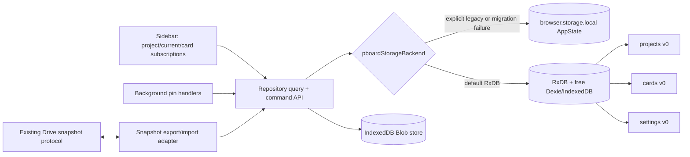

# RxDB local storage rollout

Reviewed 12 October 2026. RxDB is the default local repository. The legacy `browser.storage.local` repository remains available for migration, fallback, and rollback. This document covers local storage; the integrated WebRTC and Google-account collaboration layers are described in [collaboration.md](collaboration.md). The RxDB Google Drive plugin and a publisher-operated hosted service are not used.

## Architecture

The legacy implementation and its `projectBoardState` key remain intact. The RxDB implementation is in [`src/storage/rxdbRepository.ts`](../src/storage/rxdbRepository.ts); [`src/storage/browser.ts`](../src/storage/browser.ts) selects the backend per extension context. RxDB uses the free `getRxStorageDexie()` backend over IndexedDB; the separate `pboard-images-v1` IndexedDB database stores binary Blobs. The UI subscribes separately to projects, the selected project, and cards in that project. `load()` exists only for compatibility with old callers; normal sidebar changes do not call it.

## Versioned schemas and queries

All three schemas start at version 0 in [`rxdbSchemas.ts`](../src/storage/rxdbSchemas.ts). Future changes require explicit RxDB schema migrations, not silent field removal.

| Collection | Identity and fields | Indexes |
|---|---|---|
| `projects` | Existing project ID, name, template, revision, timestamps; added project `orderKey` and append high-water `tailOrderKey` | `orderKey` |
| `cards` | Existing card ID, project ID, type, title, content, status, display mode, source, timestamps; added `orderKey`, optional image ID/dimensions/MIME, optional `deletedAt` | `projectId`, `(projectId, orderKey)`, `(projectId, status)` |
| `settings` | Key/value documents for `currentProjectId`, `migrationVersion`, local/account project order, and account selection metadata | primary key |

Cards are queried only for the selected project in the board subscription. Card ID lookup uses the primary key. Card status query uses the project/status index. `BoardItem.order` is a compatibility projection derived from sorted rank keys in list/export queries; it is not persisted in RxDB. Existing fields, including optional source metadata, are retained. Ownership/ACL/actor fields were not added speculatively.

## Ordering

[`orderKey.ts`](../src/storage/orderKey.ts) uses the CC0 `fractional-indexing` library. Initial migration generates monotonic string keys from the legacy numeric order, using the original array order as the stable tie behavior. Comparison is `(orderKey, cardId)` so equal keys converge to a deterministic order. An ordinary single-card move changes one card's key; insertions choose a key between neighbors. The project document retains a high-water tail key so appending does not scan a 5,000-card board. Multi-card permutations and explicit `rebalanceProject()` may rewrite ranks. Keys over 64 characters raise an explicit rebalance error rather than silently using floating-point midpoint arithmetic. This is not a distributed move CRDT. Live replication resolves conflicts on each card document by write time; simultaneous moves of different cards use deterministic rank/ID ordering, while concurrent changes to the same card can overwrite one another.

## Images and deletion

New card documents contain `imageId` (SHA-256 of processed bytes), MIME type, width, and height, never data URLs. [`blobStore.ts`](../src/storage/blobStore.ts) stores the original processed WebP bytes as an IndexedDB `Blob`; duplicates share the content ID. Card rendering creates/revokes object URLs and shows a loading or missing-image state. Drive export temporarily reconstructs the historical inline `BoardImage` only at the wire boundary. Drive import extracts it again. This preserves `.pboard` snapshot version 1 compatibility, but snapshot creation still requires reading/encoding each project's images.

Card deletion and empty-trash set `deletedAt` on card documents and hide them from normal queries/Drive export. They retain image references. Project removal first commits an account preference marker. Owners then remove the project document and tombstone its cards; collaborators retain shared content and hide it only from their own list. Private Drive deletion uses the existing pending tombstone mechanism. Shared removal markers persist to block rediscovery; see [account preferences and deletion](collaboration.md#account-preferences-and-deletion). No automatic blob GC is run. `deleteImage` refuses to remove a blob while *any* card, including a tombstone, references it. This conservative policy favors rollback and future replication safety over immediate space reclamation. A future GC needs an explicit retention window, replica acknowledgements, and backup policy.

## Migration, fallback, rollback

If `pboardStorageBackend` is absent, the selector now chooses `"rxdb"`. An explicit `"legacy"` value continues to choose the old repository. Existing manual `"rxdb"` selections remain valid. `setStorageBackend("rxdb")` in the storage module imports and verifies before recording the selector. Reload extension contexts after a manual backend change.

On first RxDB opening, migration reads the normalized legacy `AppState`, imports projects/cards in visible order, decodes/deduplicates images, verifies project/card IDs and counts and image presence, then writes `settings.migrationVersion = "1"`. It does not modify the old `projectBoardState` key. Repeated imports upsert by stable ID. A failed import records `pboardRxMigrationError` in extension storage; selection falls back to the untouched legacy repository. A Web Lock serializes migration where the browser supports it; the import remains idempotent for retry. **Do not manually delete the legacy key during the rollout.**

`setStorageBackend("legacy")` after RxDB use exports the full current RxDB state to the old format, saves the pre-rollback value at `pboardStateBeforeRxRollback`, switches the selector, and invalidates the RxDB migration marker so later re-opt-in imports the latest legacy state. The RxDB copy remains on disk. A raw selector change back to legacy would expose the older legacy snapshot instead of new RxDB edits; use the rollback helper when recovering recent work. Backend switching while views remain open is unsupported: reload extension contexts.

## Google Drive and live replication

`src/sync/snapshot.ts` adapts the local repository to the version-1 project snapshot format. RxDB exports project records plus hydrated images; imports separate images back into the Blob store. The legacy adapter remains available. RxDB's Google Drive plugin is not used.

Private backups retain the `project-<id>.pboard` protocol and whole-project timestamp winner. Shared boards use a separate Drive snapshot path, WebRTC pools for project/card documents, and Drive image assets. Shared sync does not replace existing documents with a whole remote snapshot. Account project order/removal preferences have their own settings conflict merge and synchronization path. The complete behavior and security limits are maintained in [collaboration.md](collaboration.md).

## Validation and known limits

The suite covers schema-backed CRUD, project-scoped subscriptions, ordering, migration, Blob deduplication, tombstones, snapshot import/export, backend fallback, rollback, and keyboard-focus retention after delayed writes. Run `npm run check` for current typechecking, tests, both builds, and build verification; see [BUILD.md](../BUILD.md). Historical suite totals and package versions are not current validation results.

### Historical rollout measurements

The following samples were recorded during the original local-storage rollout, before the current collaboration integration. They have not been rerun for this documentation review. At that checkpoint the sidebar was about 572 KiB minified / 179 KiB gzip and the background about 310 KiB / 98 KiB gzip per variant; those figures are not current bundle sizes. The previous baseline was not captured.

An additional [browser-page harness](../experiments/collaboration/browser-bench.html) ran in headless Chromium against **real IndexedDB**, using this repository implementation and a temporary browser profile. These are one-shot wall-clock samples, not statistically robust benchmarks and **not extension-context measurements**. The image sample contains 128 KiB per Blob; 10 images at 100 cards and 100 images at the larger sizes. `storageDelta` is the origin's `navigator.storage.estimate()` change and is approximate (browser compression, caches and quota accounting apply). Heap is Chromium's optional `performance.memory.usedJSHeapSize` snapshot and includes the page/runtime.

| Cards / images | Open | Bulk insert | Images | Current project | Switch away/back | Add | Text | Status | One-card move | Duplicate image | Image load | Project query | Reopen | Reload project | Storage delta | Heap snapshot |
|---:|---:|---:|---:|---:|---:|---:|---:|---:|---:|---:|---:|---:|---:|---:|---:|---:|
| 100 / 10 | 13 ms | 8 ms | 20 ms | 0.3 ms | 3 ms | 2 ms | 2 ms | 1 ms | 2 ms | 2 ms | 0.2 ms | 0.4 ms | 3 ms | 3 ms | 1.8 MB | 20 MB |
| 1,000 / 100 | 5 ms | 78 ms | 198 ms | 0.1 ms | 2 ms | 2 ms | 2 ms | 2 ms | 3 ms | 3 ms | 0.2 ms | 2 ms | 4 ms | 25 ms | 5.6 MB | 40 MB |
| 5,000 / 100 | 5 ms | 390 ms | 220 ms | 1 ms | 3 ms | 2 ms | 1 ms | 1 ms | 5 ms | 10 ms | 0.2 ms | 10 ms | 4 ms | 114 ms | 27 MB | 39 MB |

Bulk insertion bypasses normal command events and sets the project tail rank to model a completed import. The 5,000-card reload reads the whole project and is the clearest remaining scaling concern; real sidebar rendering/virtualization was not measured. The earlier isolated [Node/fake-IndexedDB benchmark](../experiments/collaboration/README.md) is a useful API test but not browser disk evidence.

A separate throwaway **built Chromium MV3 extension** smoke test used the [DevTools helper](../experiments/collaboration/chromium-smoke.mjs): opt in to RxDB, create a project through the sidebar, drop a 1×1 PNG, and reload the sidebar. A second test injected a legacy project with a 1400×700 WebP, enabled the RxDB migration, terminated and restarted Chromium with the **same workspace test profile**, and reopened the sidebar. The migrated project and image card persisted; the image decoded from a `blob:` URL at natural width 1400 and the untouched legacy state remained available. This verifies the basic extension-context, migration, and browser-restart paths, not every lifecycle edge. This is historical evidence, not a current release gate. Firefox, a real side-panel close/reopen (as opposed to opening its page as a tab), extension update/reload, MV3 service-worker suspension/restart, and full Drive sync against a test account still require manual/integration verification before any wider rollout. The default change itself does not remove or overwrite legacy state.
