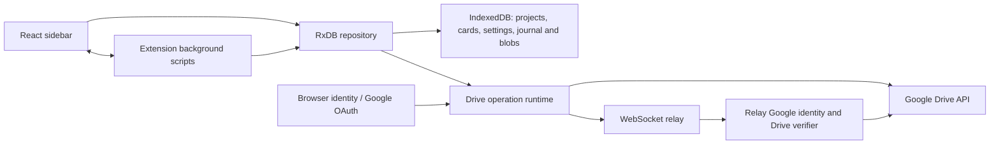
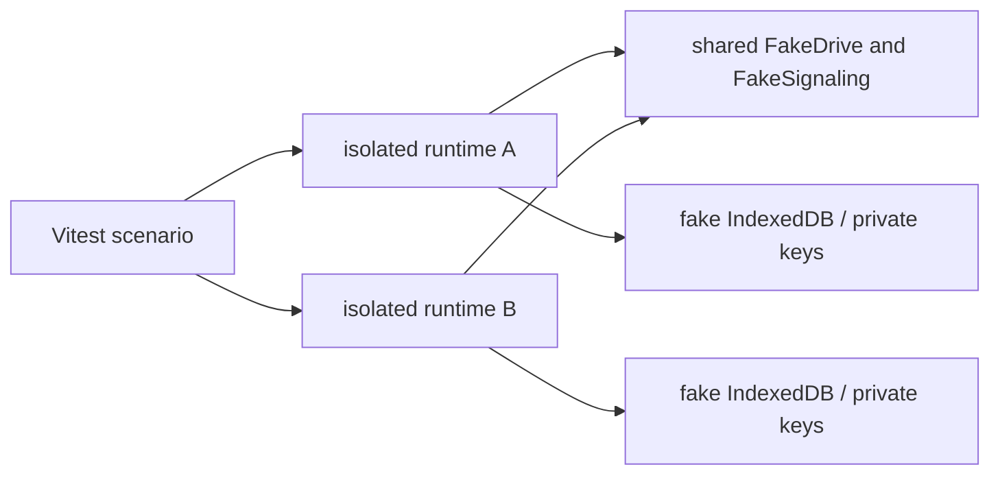

# Local collaboration testing: architecture and current gaps

This is an inventory and implementation direction, not a claim that the requested local testing platform is complete. The existing test doubles are in-process fixtures; they do not yet provide two real Firefox extension instances or offline browser services.

## Application and service boundaries

Firefox uses the MV3 manifest's background scripts, sidebar, content scripts and extension messaging. `src/storage/rxdbRepository.ts` composes RxDB with IndexedDB-backed blobs, journal, tombstones and conflict handling. The browser composition root is `src/sync/browser.ts`; the Android composition root is separate. Drive operation sessions, snapshots, board discovery, permissions and account-channel logic are composed by `src/sync/runtime.ts` and `src/sync/operations/`. The source also contains legacy signed-authority, WebRTC, and Drive-presence paths; the browser composition root currently disables WebRTC peer pools. Their tests must distinguish those paths from the current Drive-authorized operation runtime.

Firefox OAuth in `src/sync/googleAuth.ts` uses browser identity, authorization code with PKCE, and Google token/refresh/revocation endpoints. Access and ID tokens are distinct; refreshed credentials must belong to the same grant. The relay's `/drive/admit` verifier in `services/pboard-signaling/src/google_identity.rs` verifies an ID token against Google keys and checks the access token's identity and Drive folder capabilities before issuing admission. The repository contains the Rust relay, including its operation log, admission and socket protocol; `../vps-maint/SERVICES.md`, when present, documents deployment and identifies the local relay source. This audit does not assert that deployed bytes match the checkout.

## Current test boundary

`tests/multiBrowser/fixtures/browser.ts` constructs real runtime and RxDB instances with isolated module graphs, storage and test keys. `fakeDrive.ts` models a subset of Drive files, inherited ACLs and faults. `fakeSignaling.ts` models portions of the relay protocol, rooms, operation replay and restarts. These fixtures are in-process and use fake IndexedDB; the Drive admission shortcut compares synthetic credentials and does **not** validate Google-signed JWTs. They do not prove actual browser profile, background lifecycle, network, Google OAuth or deployed server behavior. The Rust relay has a separately compiled `test-google-fixture` feature and local protocol tests; this is a promising boundary for a realistic local server, not evidence of browser E2E coverage.

`npm test` runs Vitest, including unit, recovery and multi-browser tests. Ordinary CI runs root typecheck/tests for browser targets and Android's own checks for Android, then builds packages. The existing `npm run test:collaboration` is a separate Chromium-oriented smoke test that defaults to a public WSS endpoint; it is **not** the requested offline harness. It must not be represented as one.

## Gaps and implementation direction

1. ~~Establish a real Firefox automation feasibility test with two disposable
   profiles and the actual extension, with explicit process cleanup and no
   production-network access.~~ **Closed for the debug bridge:**
   `npm run debug:test:e2e` runs two disposable headless profiles with the
   real extension and the real Rust relay against a loopback Drive stub, with
   explicit process cleanup (`tools/pboard-debug/firefox-e2e.mjs`,
   [debugging/firefox-debugging.md](../debugging/firefox-debugging.md)). It
   proves local feasibility, not CI availability (no CI browser execution has
   been demonstrated), and its collaboration fixture is the legacy board-grant
   posture.
2. Provide explicit test-only service endpoints and authentication seams, compiled out of production, without bypassing authorization. Reuse the Rust relay and its test-only verifier where possible; prove ID-token, access-token and Drive identity matching. The in-process synthetic token convention is not a substitute for that validation.
3. Consolidate and contract-test the Drive and relay doubles against the production requests and server semantics. Enforce inherited ACLs on every mutation, including revocation and conditional writes. The fake does not claim Google Drive compatibility; revisions, failure injection, clock behavior and HTTP fidelity need systematic assessment.
4. ~~Add deterministic fault scenarios, event correlation with redaction,
   independent persisted-state and server assertions, reproducible seeded
   model tests and machine-readable failure reports.~~ **Partly provided by
   the debug bridge:** seeded mock-mode scenarios with bridge-gated fault
   injection, schema-enforced redaction, cross-client trace correlation and
   exported machine-readable captures
   ([debugging/test-harness-integration.md](../debugging/test-harness-integration.md)).
   Independent persisted-state assertions and a full offline run remain open.
5. Add a scenario catalog, consistency checks, documented local commands, CI browser installation/execution and release verification gates only after the corresponding tests work. Do not silently exclude failures or use production credentials or endpoints.

## Current verification and limitations

The most recent complete local Vitest run reports **1,904 passed, 0 failed** across 260 files (includes the Live Debug Bridge suites — `npm run debug:test`). Reaching that required two kinds of work, both worth knowing before the next investigation:

- **Real defects on the Drive-authorized path**, each now fixed and covered: the reconnect-ceiling bypass was wired only into the signed-authority room, so `healRelay(force)` could never repair a Drive-authorized room; a Drive-authorized board's room never flushed its log tail on close, so switching boards stranded the tail and the durable snapshot kept the state from before the session's edits; a record enqueued while the account channel's flush was running was stranded until the next `synced` edge, which a healthy connection never reaches; and `assertCanMutate` consulted only the project row, so a tombstoned board whose row survives let a live device author into it after the owner's erase.
- **Suites written for the retired signed-authority path**, retargeted to Drive-ACL authority (same-account join, editor/viewer roles, one room per Drive folder, no courier dials) or removed where the code they exercised is unreachable in every shipping composition root (the account re-pin panel, the `account:<hash>` pin ceremony, and the Drive-presence ghost room). The local Drive fake's viewer metadata-write authorization was independently reproduced and corrected with a regression test during this audit. No randomized replay, full offline run, or remote CI execution has been demonstrated. Two-Firefox acceptance now exists for the debug bridge (`npm run debug:test:e2e`, local only) and demonstrates local feasibility, not CI. The count above is local evidence; it is not proof of deployment behaviour.

For the implemented metadata-write boundary, Google's [role reference](https://developers.google.com/workspace/drive/api/guides/ref-roles) distinguishes reader and writer access. Actual Drive uses finer-grained [file capabilities](https://developers.google.com/workspace/drive/api/reference/rest/v3/files); the fixture's role check is an approximation and does not yet model every restriction or shared-drive rule.
